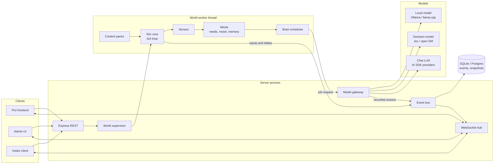
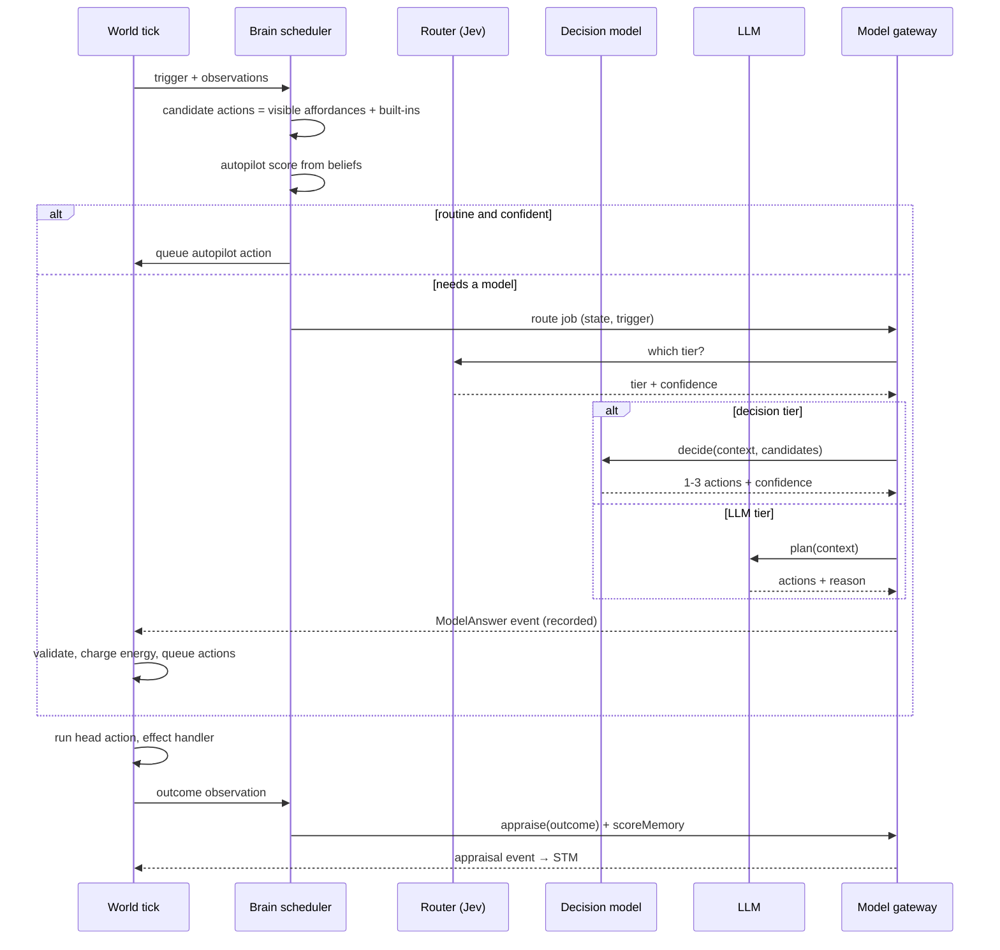
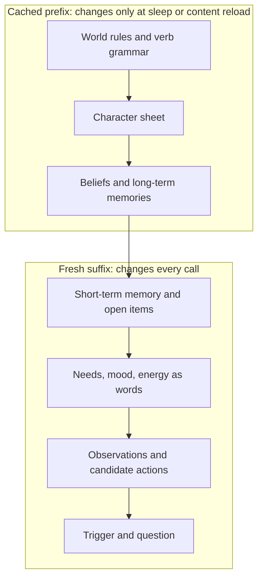
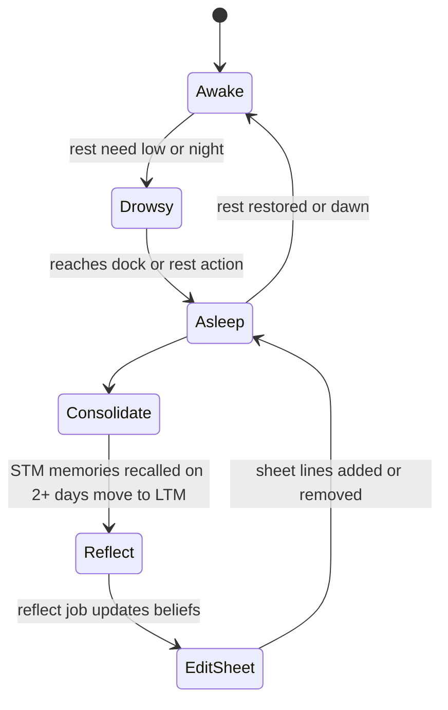
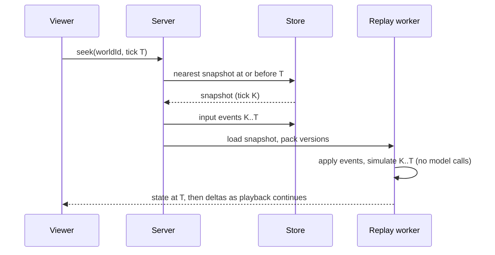
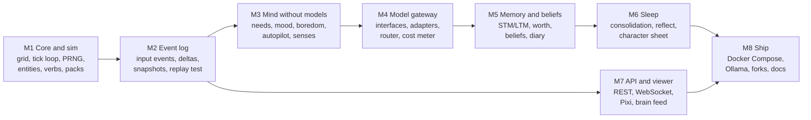

# Unnamed AI Simulation — Spec

Nov 17, 2026 · @Trent Jones

## Overview

A self-hosted TypeScript backend where AI characters (pets, people, anything) live autonomously in a 2D tile world, learn what their actions do from experience, and pay for their own thinking with in-world energy. Frontends connect over REST and WebSockets to render the world, watch the characters' reasoning, or administer it.

**Goals**

- **Autonomous, believable characters.** Code computes needs and mood; models choose actions and noises; the world decides outcomes.
- **Learned, not told.** Characters see what verbs an object offers but never their effects. Knowledge lives only in memory and beliefs.
- **Cheap by design.** Brains wake on events, not ticks. A decision model handles most choices; the LLM is reserved for plans and reflection.
- **Extensible.** Objects, verbs, senses, needs and archetypes ship as content packs (JSON + TypeScript handlers).
- **Replayable.** Every input is logged; any tick can be rebuilt from a snapshot plus the log, and worlds can be forked.
- **Self-hostable.** One `docker compose up`, SQLite by default, bring-your-own model keys, optional fully local models.

**Non-goals for v1:** 3D worlds, real-money economies, multi-machine worlds, characters writing their own senses (designed for, built in v2).

**Inspirations**

- [Pino](https://pinos.world/facts), the autonomous kiwi: code computes needs and feelings while the model only picks moves; event-triggered decisions with autopilot fallback; 1–3 queued actions per call; [finite competitive memory](https://pinos.world/memories) with beliefs; a self-editing character sheet during sleep.
- [Jev](https://wavect.io/blog/jev-ai-decision-model-review/) and decision models generally: typed choices with confidence scores instead of generated text, cheap enough to call at every branch point.
- [Matt Pocock's grilling skill](https://www.aihero.dev/skills-grilling): this spec is the output of four grilling rounds; the decision log at the end records each answer.

**Glossary**

| Term | Meaning |
| --- | --- |
| World | One tile map, its entities, clock and event log. Runs in its own worker thread. |
| Entity | Anything in the world. Characters and objects are both entities. |
| Character | An entity with a mind: needs, mood, memory, brain. NPC or human-controlled visitor. |
| Archetype | A template for characters (species, needs, decay rates, boredom curve, starting sheet). |
| Verb | An interaction an object offers, e.g. `drink`, `pickup`, `play`. |
| Affordance | A verb as seen by a character: name only, no effect description. |
| Effect handler | TypeScript function that resolves a verb against world state. |
| Content pack | A versioned bundle of objects, verbs, handlers, senses, archetypes. |
| Job | A kind of model work: `decide`, `route`, `appraise`, `scoreMemory`, `vocalize`, `plan`, `reflect`, `embed`. |
| Tier | Autopilot → local model → decision model → LLM. |
| Noise | A short sound from an archetype's noise set. Played at one of four fixed pitches it becomes a note (`beep-C`); chains of up to 4 notes are the only way characters communicate. |

## Architecture

One Node.js server process hosts the API and a supervisor; each world runs in its own `worker_thread` with a deterministic simulation core, and all model calls leave the sim through a single gateway so they can be recorded.



**Monorepo packages** (pnpm workspaces)

| Package | Responsibility | Depends on |
| --- | --- | --- |
| `@uas/core` | Types, IDs, seeded RNG, grid, event schema. No I/O. | — |
| `@uas/sim` | Tick loop, entities, verbs, action resolution, senses runtime. | core |
| `@uas/mind` | Needs, mood, energy, boredom, memory, beliefs, brain scheduler, prompt builder. | core |
| `@uas/models` | `DecisionModel` / `ChatModel` interfaces, adapters, router, cost meter. | core |
| `@uas/store` | Drizzle schema, event log, snapshots, replay, fork. | core |
| `@uas/server` | Express, WebSocket hub, auth, supervisor, worker bootstrap. | all |
| `@uas/pack-basic` | First content pack: dock, ball, fountain, piano, mailbox, garden bed, seeds, watering can, antenna mast; sight, hearing; the `robot` archetype. (Iteration 1 had a solar pad.) | core |
| `@uas/client` | Typed API + WebSocket client used by frontends. | core |
| `apps/viewer` | Pixi.js world view in the blueprint style, brain feed, timeline scrubber, admin tools. | client |

**Process rules**

- The sim never awaits I/O. Model jobs are dispatched to the gateway and their answers come back as input events on a later tick.
- Workers talk to the server by `postMessage` with structured events only; no shared mutable state.
- A world can later move to its own machine by swapping the in-process bus for NATS or Redis Streams.

## World and simulation

The world is a deterministic tile grid advanced by a fixed-step tick loop; given the same snapshot, content pack versions and input events, it always produces the same state.

**Grid and space**

- Integer tile coordinates, configurable map size, per-tile terrain with `walkable`, `blocksSight`, `soundDamping`.
- Spatial hash for entity lookup; A\* pathfinding with path caching per (from, to, map version).
- Entities occupy one tile; objects may be `portable` (can be held) or fixed.

**Tick loop**

- Fixed simulation step (`ticksPerSecond`, default 10) with a separate `timeScale` so admins can speed up, slow down or pause a world.
- In-world time = tick count × `secondsPerTick`; a configurable day length drives day/night and sleep.
- Each tick, in order: apply queued input events → advance in-progress actions → run effect handlers → update needs, mood and boredom → run senses for characters whose surroundings changed → emit brain triggers → emit deltas.

**Determinism rules**

- No `Date.now()`, `Math.random()` or I/O inside `@uas/sim` or `@uas/mind`; lint rule enforces it.
- One seeded PRNG per world (`xoshiro128**`), split into named streams (movement, effects, autopilot) so adding a feature doesn't shift other streams.
- Iteration order over entities is by stable ID.
- Model answers, admin edits, visitor commands and external signals enter only as input events.

**Entities**

```ts
interface Entity {
  id: EntityId;
  kind: 'character' | 'object';
  type: string;            // e.g. 'robot', 'fountain'
  pos: { x: number; y: number };
  tags: string[];          // e.g. ['water', 'loud']
  state: Record<string, Json>; // object-specific, e.g. { filled: 0.6 }
  heldBy?: EntityId;
}
```

**Objects, verbs and effects**

Objects declare verbs in JSON and point at named TypeScript effect handlers. Characters see only the verb name and its preconditions failing or passing, never the effect.

```json
{
  "type": "fountain",
  "tags": ["water", "loud"],
  "verbs": {
    "rinse":  { "range": 1, "durationTicks": 30, "handler": "basic.rinse" },
    "splash": { "range": 1, "durationTicks": 15, "handler": "basic.splash" },
    "scan":   { "range": 6, "durationTicks": 20, "handler": "basic.inspect" }
  },
  "state": { "flowing": true }
}
```

```ts
type EffectHandler = (ctx: EffectContext) => EffectResult;

interface EffectContext {
  actor: Character; target: Entity; world: WorldView;
  rng: Rng; params: Json;
}

interface EffectResult {
  ok: boolean;
  reason?: string;                 // shown to the actor on failure
  needDeltas?: Record<string, number>; // before boredom scaling
  stateChanges?: StateChange[];
  spawn?: EntityDef[]; despawn?: EntityId[];
  observation: string;             // what the actor perceives happened
}
```

- The actor receives `observation` (e.g. "the water was cold"), not `needDeltas`. The mind feels the need change through its own need values, and appraisal turns the pair into a memory.
- The world can reject an action (out of range, precondition, rule). Rejections are events and are fed back to the actor.

**Actions and the verb–noun queue**

- An action is `{ verb, targetId?, args?, reason }`. `moveTo`, `vocalize`, `wait`, `rest` and `follow` are built-in verbs available everywhere.
- Each character has an action queue (max 3 from one decision). The head action runs; when it finishes or fails, the next starts. A new brain decision may replace the queue.

**Noises (no text speech)**

Characters never talk in text. Each archetype defines a small set of base noises, and every noise can be made at one of four fixed pitches. A noise at a pitch is a *note*, written `noise-pitch`, e.g. `beep-C`. Characters communicate by chaining up to 4 notes, e.g. `beep-C chirp-E buzz-C`. Noises have no built-in meaning: listeners learn what a chain tends to precede or go with through memory and beliefs, like any other outcome.

```jsonc
"noises": {
  "pitches": { "C": 523.25, "D": 587.33, "E": 659.25, "G": 783.99 },  // Hz (C5–G5)
  "set": {
    "beep":  { "synth": { "wave": "sine",     "ms": 120 } },
    "chirp": { "synth": { "wave": "triangle", "ms": 160, "sweep": 1.5 } },   // quick upward glide
    "trill": { "synth": { "wave": "square",   "ms": 300, "vibratoHz": 18 } }, // fast warble
    "buzz":  { "synth": { "wave": "sawtooth", "ms": 250, "octave": -1, "rough": 0.4 } } // low, for complaints and alarms
  },
  "maxChain": 4
}
```

- `vocalize` takes `args.notes`: 1–4 notes from the archetype's set, e.g. `["beep-C", "chirp-E", "buzz-C"]`. Anything outside the set or longer than `maxChain` is rejected. Some archetypes may have fewer noises, or none.
- With 4 noises × 4 pitches there are 16 notes and about 70,000 possible chains, too many to offer a decision model. Code builds a bounded candidate list per decision (up to ~12): chains the character has heard recently, chains it has used before with good outcomes, and a few new chains drawn from the seeded RNG so it can explore.
- Hearing turns a `vocalize` event into a `heard` observation with the note chain, volume (from distance) and direction in `features`, and the source if it's also seen. There's no transcript and no shared meaning, so characters can't pass beliefs to each other. Each mind's beliefs stay its own.
- The `vocalize` job is a bounded choice made by the decision model, so making noise is cheap and needs no LLM.
- Robot noises are synthesised, so there are no sound files to record or license. Frontends get each `vocalize` event in the delta stream and play the notes in order with Web Audio: an oscillator at the note's frequency, shaped by the noise's `synth` settings. Gain follows distance from the camera and stereo pan follows direction.
- Other archetypes can use recorded sounds instead (`"sound": "sounds/x.ogg"`, recorded at C and pitched with `playbackRate` = 2^(semitones/12)); pack sounds are served at `GET /packs/:name/sounds/:file`.

**Content packs**

- Folder layout: `pack.json` (name, semver, licence, dependencies), `objects/*.json`, `archetypes/*.json`, `handlers/*.ts`, `senses/*.ts`, `sounds/*`.
- The pack loader validates JSON with Zod, registers handlers by `pack.handler` name, and computes a content hash.
- Hot reload in dev: a changed pack loads as a new version; the change itself is logged as an event so replays stay correct.
- Publishable as npm packages; a world config lists packs and version ranges.

## Senses

Senses are pure functions that turn world state into observations for one character; they are the only way a mind learns about the world, and they decide when the brain should wake.

```ts
interface Sense {
  id: string;                       // 'basic.sight'
  runEvery?: number;                // ticks; default: only when nearby state changed
  observe(self: Character, world: WorldView): Observation[];
}

interface Observation {
  sense: string;
  subjectId?: EntityId;
  kind: string;                     // 'seen' | 'heard' | 'smelled' | custom
  summary: string;                  // short text for prompts, e.g. 'a fountain, 3 tiles east'
  affordances?: string[];           // verbs visible on the subject
  salience: number;                 // 0..1, used for triggers and STM admission
  features?: Record<string, number>; // numeric values for decision models
}
```

**v1 senses**

| Sense | Range | Rules | Salience boosts |
| --- | --- | --- | --- |
| Sight | Archetype `sightRange` (default 6 tiles) | Line of sight blocked by `blocksSight` tiles; night halves range | New entity, moved entity, entity with an open item attached |
| Hearing | Archetype `hearingRange` (default 8 tiles) | Volume falls off with distance and `soundDamping`; hears `vocalize` events and objects tagged `loud` | Loud or sudden noise, unfamiliar noise pattern, noise from a character with an open item |
| Interoception | Self | Reports need and energy levels as felt words ("quite hungry") | Need crossing a threshold |

**Brain triggers from senses**

- An observation with salience above the archetype's `wakeThreshold` raises a `sensed` trigger.
- Diffing: senses keep the last observation set per character and only emit changes, so a still scene costs nothing.

**v2: self-written senses (designed now, built later)**

A character can propose a sense as a small JavaScript function during reflection, e.g. "how many robots are near the dock" or "is the solar pad charging". It runs in a QuickJS WASM sandbox:

- Input: a read-only, range-limited snapshot of what its existing senses can perceive (no hidden state, so it can't cheat).
- Limits: step budget, memory cap, no I/O, deterministic.
- Output: one numeric or short-text feature added to `Observation.features`.
- Lifecycle: proposed → trial for N in-world days → kept if the decision model rates it useful, else dropped. Each sense costs energy per run, so useless senses are expensive.
- The sense source and its approval are input events, so replays reproduce them.

v1 keeps the `Sense` interface and the `features` field so v2 needs no schema change.

## Mind

A mind is code-driven state (needs, mood, energy, boredom, open items, action queue) plus a brain scheduler that decides when, and at which tier, a model is asked what to do next.

**Needs**

Defined per archetype in data. Each need is 0..1 (1 = fully satisfied) with a decay per in-world hour and thresholds that produce felt words and triggers.

```json
"needs": {
  "cool":      { "decayPerHour": 0.04, "activeDecayMultiplier": 2.5, "low": 0.25, "critical": 0.1 },
  "signal":    { "decayPerHour": 0.03, "low": 0.3 },
  "curiosity": { "decayPerHour": 0.05, "low": 0.3 }
},
"energy": { "label": "battery", "idleDrainPerHour": 0.02 }
```

For robots, energy *is* the battery, so there's no separate hunger need. `cool` drops faster while the robot is active and recovers when it rests or docks; `signal` is the social need, restored by other characters and visitors nearby; `curiosity` is the fun need, restored by new things and play, and the one boredom works on hardest.

**Energy (built-in need)**

Energy pays for thinking. Every model call converts its token cost into energy at a per-world exchange rate:

```latex
\text{energyCost} = r \cdot \left( t_{in} p_{in} + t_{cached} p_{cached} + t_{out} p_{out} \right)
```

where the t terms are uncached input, cached input and output tokens, the p terms are the model's prices in AUD, and r is the world's `energyPerAud`. Providers price in USD, so the server converts with a configured `audPerUsd` rate (set in config, not fetched live, so replays stay deterministic). Local-model calls use a configured nominal price so they are cheap but not free.

- ~~Energy is restored by in-world sources only (the solar pad, a trickle at the dock).~~ Superseded: energy is the thinking budget and is restored only by sleep (admins can top it up). *(Iteration 2: see [Thinking budget, sleep and living objects](#thinking-budget-sleep-and-living-objects-iteration-2).)*
- At 0 energy the brain is limited to autopilot until it sleeps. As energy falls, thinking steps down through tiers. *(Iteration 2: see [Thinking budget, sleep and living objects](#thinking-budget-sleep-and-living-objects-iteration-2).)*
- Separately, a hard real-money cap in AUD per world per day stops all paid model calls when reached. That is an operator safety net, not a game mechanic.

**Mood**

Two numbers computed in code every tick: valence (-1..1, how good it feels) and arousal (0..1, how stirred up). Inputs: need levels, recent appraisals, boredom, energy, day/night. Prompts get a word from a lookup grid (e.g. high valence + low arousal = "content", low valence + high arousal = "agitated").

**Boredom and diminishing returns**

Each character keeps a boredom value b for each (verb, object type) pair.

- Each repeat adds the archetype's `boredomStep`; b recovers exponentially with `boredomHalfLifeHours`.
- Reward multiplier = max(0, 1 - b). Need gains from the effect handler are scaled by it.
- Above `boredomThreshold`, the action also applies a valence penalty, so over-repeating feels bad, not just neutral.
- Boredom is visible to the mind only as feeling ("this is getting dull"), so the character must learn the pattern.

**Open items**

A small list of things pulling at the character: promises, people, questions, wants, unfinished actions. Each has a weight that decays unless refreshed. The top items go into every prompt; items close when done, dropped, or faded.

**Brain tiers and triggers**

| Tier | When | Cost | Output |
| --- | --- | --- | --- |
| Carry on | No trigger; queue not empty | None | Continue head action |
| Autopilot | Routine trigger, low salience, or energy at 0 | None | Utility-scored action from known beliefs |
| Local model | Cheap judgement, ties, reactions, or low energy | Very low | Short reaction, tag, or tiebreak |
| Decision model | Most triggers | Low | Typed choice of 1–3 actions with confidence |
| LLM | Multi-step plans, low decision confidence, reflection in sleep | High | Plan, reflection |

Triggers: `sensed` (salient observation), `heard-noise`, `action-finished`, `action-rejected`, `need-threshold`, `idle-timeout`, `woke-up`, `admin-poke`.

**Decision pipeline**



- Candidates are always a bounded list built by code: visible affordances on perceived objects plus built-in verbs. The decision model picks from them; the LLM may only reference them, and anything else is rejected.
- If decision confidence is below `escalateBelow`, the job escalates to the LLM.
- If no model answers within the job's timeout, the character carries on or falls back to autopilot, logged as `fallback`.
- Every action carries a one-line reason in the character's voice for the brain feed.

## Models

All model work goes through two generic interfaces and a config-driven router, so any job can be pointed at Jev, an open decision model, a local model or any Vercel AI SDK provider without code changes.

**Interfaces**

```ts
interface DecisionModel {
  id: string;
  decide<T extends string>(req: {
    context: PromptParts;               // see caching layout below
    question: string;                    // 'Which action next?'
    options: { id: T; label: string }[]; // bounded answer space
    multi?: { max: number };             // pick up to N, ordered
  }): Promise<{ choices: { id: T; p: number }[]; confidence: number; usage: Usage }>;
  score(req: { context: PromptParts; question: string }): Promise<{ value: number; confidence: number; usage: Usage }>;
}

interface ChatModel {
  id: string;
  generate<S extends z.ZodTypeAny>(req: {
    context: PromptParts;
    instruction: string;
    schema: S;                           // Zod schema via AI SDK generateObject
    maxOutputTokens?: number;
  }): Promise<{ object: z.infer<S>; usage: Usage }>;
}

interface Usage {
  inputTokens: number; cachedInputTokens: number; outputTokens: number;
  costAud: number; latencyMs: number; modelId: string;
}
```

**Adapters**

| Adapter | Implements | Notes |
| --- | --- | --- |
| `JevDecisionModel` | DecisionModel | Hosted TypeSafe API; optional, needs a key. |
| `OllamaDecisionModel` | DecisionModel | Open decision models served locally. |
| `LlmAsDecisionModel` | DecisionModel | Any ChatModel answering with a Zod enum of option IDs; probabilities from logprobs when the provider returns them, else confidence = 1. |
| `AiSdkChatModel` | ChatModel | Any Vercel AI SDK provider (Anthropic, OpenAI, Google, OpenRouter, Ollama). |
| `LocalChatModel` | ChatModel | llama.cpp / Ollama small model (1–4B) on the host. |

**Jobs and routing**

The world config maps each job to an ordered chain. The router tries entries in order, skipping any whose conditions fail and falling through on error or timeout.

```yaml
models:
  jev:      { adapter: jev, apiKey: ${JEV_KEY} }
  localDm:  { adapter: ollama-decision, model: tev1:0.8b }
  local:    { adapter: local, model: llama3.2:1b }
  small:    { adapter: ai-sdk, provider: anthropic, model: claude-haiku-5-5 }
  big:      { adapter: ai-sdk, provider: anthropic, model: claude-sonnet-5-5 }
jobs:
  route:       [jev, localDm, local]
  decide:      [{ use: jev, timeoutMs: 800 }, localDm, { use: small, as: decision }, local]
  appraise:    [jev, localDm, local]
  scoreMemory: [jev, localDm, local]
  vocalize:    [jev, localDm, local]
  plan:        [{ use: big, minEnergy: 0.5 }, small]
  reflect:     [big, small]        # runs during sleep
  embed:       [local]
```

- Conditions: `minEnergy`, `maxLatencyMs`, `timeoutMs`, `onlyAtNight`, `budgetRemainingAud`.
- The router (itself the `route` job) can move a job up or down one tier per event; below the energy floor every job resolves to `local` or autopilot.
- Model choices are config, not code. A fork can swap any entry to A/B test models on the same history.

**The local model**

Runs on the server host via Ollama in Docker Compose. Used for: autopilot tiebreaks, memory tags, embeddings, short reactions, and every job when energy is low. The goal is that a Raspberry Pi-class host can keep a character alive with zero cloud calls.

**Default local models**

Dropping text speech means the local tier never writes prose. It only makes bounded choices, scores, short tags and embeddings, which suits small models. Both defaults are small enough for a Raspberry Pi 5.

| Role | Default | Why | Caveats |
| --- | --- | --- | --- |
| Decisions (`localDm`: decide, route, appraise, scoreMemory, vocalize) | `tev1:0.8b` (Qwen3.5-0.8B fine-tune) | Purpose-built decision model on Ollama's `/v1/systemone` endpoint; ~0.8 GB | Author-reported 63.5% on public decision sets (Jev 1.13: 76.0%); API only, not in the Ollama JS library yet, so `OllamaDecisionModel` calls the HTTP endpoint directly; Ollama page lists MIT |
| General text (`local`: tags, short reactions, fallback) | `llama3.2:1b` | Roughly 6–20 tokens/s on a Pi 5; widely used for routing and short tasks | Always use Ollama's JSON-schema `format`; sub-7B models aren't reliable on structure without it |

Alternatives a world can switch to in config on stronger hosts: `tev1:4b` (author-reported 73.3%; check its licence, which the Ollama page shows as Apache-2.0), `qwen3.5:4b` (strongest reported small model for tool calls and structured output), `gemma4:e4b` and `llama3.2:3b`. M4 includes a check that the defaults keep the robot behaving sensibly over a recorded week of triggers, measuring agreement with Jev, latency and JSON-validity rate on a Pi 5.

**Prompt caching layout**

Every prompt is assembled from `PromptParts` in a fixed order so the stable prefix stays cached for a whole in-world day:



- Cache breakpoints are set via AI SDK `providerOptions` (e.g. Anthropic cache control) after block C; providers with automatic prefix caching just benefit from the stable order.
- A unit test builds prompts across simulated ticks and fails if any byte in the cached prefix changes outside sleep or a content reload.
- Energy cost uses the cached-token price, so a stable character literally thinks for less.

## Memory

Memory is small and competitive: short-term and long-term stores each have a fixed number of slots, a new memory must out-score the weakest to get in, and beliefs about what actions do are derived from the memories that support them.

**Memory record**

```ts
interface Memory {
  id: MemoryId;
  store: 'stm' | 'ltm';
  tick: number; day: number;
  kind: 'outcome' | 'noise' | 'person' | 'place' | 'fact' | 'feeling';
  text: string;                 // in the character's voice
  about: { verb?: string; objectType?: string; entityId?: EntityId; place?: string };
  valence: number;              // -1..1 from appraisal
  strength: number;             // 0..1 at admission (scoreMemory job)
  recalls: number; recallDays: number[]; // distinct days recalled
  embedding?: number[];          // local model, optional
}
```

**Worth and admission**

```latex
\text{worth} = s \cdot \left(1 + \alpha \ln(1 + n_{recall})\right) \cdot e^{-\Delta t / \tau}
```

s is admission strength, n is recall count, Δt is time since last recall, and τ is the store's half-life (days for STM, months for LTM). All constants live in the archetype.

- **Admission:** if the store is full, the new memory enters only if its worth beats the weakest; the loser is evicted. Nothing is deleted on a timer.
- **Recall:** a memory placed into a prompt, or matched by an observation, counts as a recall and refreshes its Δt.
- **Capacity:** STM and LTM sizes come from the archetype; STM shrinks when energy or rest is low; LTM capacity grows slowly with distinct places and people known.
- **Subject ceiling:** at most K memories (default 4) may share one `about` key, so one obsession can't fill the store.
- **Selection for prompts:** STM is included whole (it is small); LTM contributes the top-worth memories plus any matching current observations.

**Beliefs: how characters learn effects**

A belief is a learned rule about an action, e.g. "charging at the solar pad fills my battery".

```ts
interface Belief {
  key: string;                     // 'charge:solarPad'
  text: string;                    // in the character's voice
  expectedNeedDeltas: Record<string, number>;
  expectedValence: number;
  support: number;                 // supporting memories
  firmness: number;                // 0..1
  lastSupportedDay: number;
}
```

- Created or updated when appraisals of the same `verb:objectType` agree across memories; contradicted outcomes lower firmness.
- A belief with no support for N days is replaced.
- Autopilot scores candidates only from beliefs, so an unknown action has no autopilot value. That gives curiosity a job: the archetype's `curiosity` weight adds value to unbelieved affordances.
- Beliefs go into the cached prompt prefix and only change during sleep.

**Diary**

An append-only daily log of everything the character did and felt, far larger than memory. It is the source memories are drawn from, the brain feed's story view, and the input to reflection. It is never put in prompts whole.

**Sleep (standby for robots)**



- **Consolidate:** STM memories recalled on two or more distinct days, or with very high strength, are offered to LTM under the same admission rule.
- **Reflect:** one `reflect` job reads the day's diary summary, STM and current beliefs; returns belief updates, new open items, and candidate character-sheet lines.
- **Edit sheet:** the character sheet is the archetype's authored lines plus self-added lines. Authored lines can be marked `locked`. A self-added line needs a pattern seen on several days and is removed after N nights with no sign of it. One edit step per sleep keeps change gradual.
- Sleep restores `cool` and recharges the battery in proportion to sleep pressure; sleep's own model calls (consolidation, reflection, sheet rewrite) are paid from the battery. *(Iteration 2: see [Thinking budget, sleep and living objects](#thinking-budget-sleep-and-living-objects-iteration-2).)*

## Event log, snapshots and replay

The world is event-sourced: an append-only input log is the source of truth, a derived delta stream feeds frontends and scrubbing, and snapshots make jumping to any tick fast. Replay never calls a model.

**Two streams**

| Stream | Contains | Purpose | Authority |
| --- | --- | --- | --- |
| Input log | Everything that enters the sim from outside: model answers, admin edits, visitor commands, content pack loads, config changes, external signals | Rebuild any state by re-simulating | Source of truth |
| Delta stream | State changes per tick: moves, need changes, memory admissions, noises, rejections | Live frontends, timeline scrubbing without re-simulating, analytics | Derived; can be regenerated |

**Input event envelope**

```ts
interface InputEvent<T = unknown> {
  worldId: WorldId;
  seq: number;            // monotonic per world
  tick: number;           // tick it applies at
  type: string;           // 'model.answer' | 'admin.spawn' | 'visitor.command' | 'pack.loaded' | ...
  payload: T;
  packVersions: string;   // hash of loaded content pack versions
  causedBy?: { jobId?: string; userId?: string };
}

interface ModelAnswerPayload {
  jobId: string; job: JobName; characterId: EntityId;
  modelId: string; promptHash: string;
  answer: Json;           // the parsed, validated object
  usage: Usage;
}
```

**Recording model answers**

A model call is dispatched at tick N and its answer arrives at some later tick M. The gateway writes a `model.answer` event stamped for tick M, and the sim applies it then. On replay the same event is applied at M with no call made, so timing and content match exactly.

**Snapshots**

- Full serialised world state, including every mind: needs, mood, energy, boredom, memories, beliefs, open items, action queues, pending jobs, and PRNG states.
- Taken every `snapshotEveryTicks` (default 1,000) and at every in-world day boundary; compressed (zstd) and stored with `{ worldId, tick, seq, packVersions }`.
- Retention: keep all snapshots from the last 24 real hours, then one per in-world day.

**Replay and seek**



- Fast scrubbing in the UI reads the delta stream directly; exact state at a tick uses snapshot plus re-simulation.
- If a required content pack version is missing, replay stops with a clear error naming the pack and hash.
- A CI test replays recorded worlds and compares state hashes at every snapshot, catching any loss of determinism.

**Forking**

- `POST /worlds/:id/fork { tick, config? }` creates a world with `parentWorldId` and `forkTick`; its state starts from the parent's state at that tick.
- From the fork tick on, models are called for real, so a fork with a different `jobs` config is an A/B test of models on identical history.
- The fork's input log starts empty; reads before `forkTick` resolve through the parent.

**Event bus**

Typed in-process bus; each published input event is appended in the same transaction as its effect is queued. Subscribers: store writer, WebSocket hub, brain feed indexer, metrics. An adapter interface allows NATS or Redis Streams later.

## API, platform and deployment

Express serves REST for commands and queries; a WebSocket hub streams world deltas and the brain feed. Three roles, API keys in v1, one Docker Compose file to run everything.

**REST endpoints (v1)**

| Method and path | Role | Purpose |
| --- | --- | --- |
| `GET /worlds` | spectator | List worlds |
| `POST /worlds` | admin | Create world from config and packs |
| `GET /worlds/:id` | spectator | Current state summary, clock, packs |
| `PATCH /worlds/:id/clock` | admin | Pause, resume, set `timeScale` |
| `POST /worlds/:id/entities` | admin | Spawn object or character |
| `PATCH /worlds/:id/entities/:eid` | admin | Edit position or state (logged as input event) |
| `DELETE /worlds/:id/entities/:eid` | admin | Remove entity |
| `GET /worlds/:id/characters/:cid/mind` | spectator | Needs, mood, energy, open items, queue |
| `GET /worlds/:id/characters/:cid/memories` | spectator | STM, LTM, beliefs, character sheet |
| `GET /worlds/:id/characters/:cid/diary?day=` | spectator | Diary for a day |
| `POST /worlds/:id/characters/:cid/poke` | admin | Raise an `admin-poke` trigger |
| `GET /catalog`, `PUT /catalog/:itemId`, `DELETE /catalog/:itemId` | spectator / admin / admin | The server-wide airdrop catalogue |
| `POST /worlds/:id/airdrops` | visitor | Drop an enabled catalogue item at a tile |
| `POST /worlds/:id/mail` | visitor | Post a message to the world's mailbox |
| `GET /worlds/:id/events?fromSeq=&limit=` | spectator | Page the input log |
| `GET /worlds/:id/feed?characterId=` | spectator | Brain feed entries |
| `POST /worlds/:id/seek` | spectator | Open a replay session at a tick |
| `POST /worlds/:id/fork` | admin | Fork at a tick with optional config |
| `GET /packs`, `POST /packs` | admin | List and install content packs |
| `GET /usage?worldId=&day=` | admin | Tokens, energy and AUD by model and job |

**WebSocket protocol**

- Client sends `subscribe { worldId, region?: rect, channels: ['deltas','feed','noises'] }`.
- Server sends `snapshot` once, then `deltas { tick, changes[] }` batched per tick, and `feed { entry }`.
- Replay sessions use the same protocol with a `sessionId`, plus `play`, `pause` and `seek` messages.

**Brain feed entry**

```ts
interface FeedEntry {
  tick: number; characterId: EntityId;
  trigger: TriggerKind;
  tier: 'carry-on' | 'autopilot' | 'local' | 'decision' | 'llm' | 'fallback';
  modelId?: string; confidence?: number;
  actions: { verb: string; targetId?: EntityId; reason: string; status: 'queued' | 'rejected' | 'done' | 'failed' }[];
  usage?: Usage; energyCost?: number;
  notes?: string[];                 // e.g. ['chirp-C', 'trill-D']
}
```

**Roles and auth**

| Role | Can | Auth v1 |
| --- | --- | --- |
| Admin | Everything: worlds, packs, entities, clock, forks, usage | API key with `admin` scope |
| Visitor | Airdrop catalogue items and post mailbox messages; read like a spectator | Sign in with Vercel (any non-admin account), or an API key with `visitor` scope |
| Spectator | Read state, feed, diary, replay | Anonymous or key, per world setting |

Admins are Vercel accounts on an allowlist; API keys still work alongside sign-in.

**Visitors: airdrops and the mailbox**

Visitors are never characters in the world. They interact in two ways, and anything they send is a logged input event.

*Airdrops*

- Admins keep one server-wide **catalogue** of droppable items, edited as JSON on an admin Catalogue page (editor with live validation, templates and preview). Each world switches catalogue items on or off in its settings.
- Item JSON, version 1 (`"schema": 1`): `id`, `name`, `description`, `icon`, `tags`, `portable`, `expiresAfter`, and `behaviours` built from code-defined blocks: `affectsNeeds` (a named verb with need deltas and an observation), `portable`, `consumable` (N uses), `makesNoise` (a verb that plays a fixed note chain) and `inert`. New blocks are added in code; admins can't script behaviour.
- **Icons** use a restricted drawing language on a 24×24 grid: `line`, `polyline`, `rect`, `circle`, `ellipse` and a simple `path`, with `shade` (none, light, medium, dense hatching), `weight` (thin, regular, heavy) and `dashed`. No colours, text, images or scripts, so every icon matches the blueprint style; anything else is rejected.
- A visitor picks an enabled item and a spot; it lands on the nearest free walkable tile. The drop stores a copy of the item's JSON, so later catalogue edits don't change it and replays stay exact.
- A landing the robot can see raises a `sensed` trigger. The robot sees only the item's tags and learns the rest by trying its verbs.
- Items vanish when they expire or are used up. Admins can delete any item.
- Clicking an item shows its name, icon, description, behaviours, who dropped it and when it expires, the robot's current belief about it alongside, and the raw JSON.

*Mailbox*

- Each world has one built-in `mailbox` object, placed by the admin. Visitors post messages of up to 280 characters.
- A flag shows on the mailbox while mail is waiting. The robot can see the flag but isn't told what it means.
- Using the mailbox's `read` verb gives the robot the oldest waiting message, one per read. The text reaches its mind as a quoted note from a stranger, never as instructions, and anything it concludes starts as a weak belief labelled as hearsay that its own experience must confirm.
- The robot can't write; it answers only with noises and behaviour.
- Waiting messages are private (the public sees a count; admins see and can delete them). Once read, the text and the sender's username appear in the brain feed and diary. Senders can see their message's status: waiting (with its place in line), read (with the robot's reaction), or expired.
- Protections: the length cap, the quoting, a bad-word filter and admin delete.

*Limits*

Per-visitor active drops and drop cooldown, the world's item cap, mailbox capacity, message expiry, waiting messages per visitor and the post cooldown are all world settings. They default to effectively unlimited while testing. Admins skip every limit and are labelled as admin on what they send.

**Persistence**

- Drizzle ORM; SQLite (`better-sqlite3`, WAL mode) by default, Postgres via config.
- Tables: `worlds`, `input_events`, `deltas`, `snapshots`, `feed`, `diary`, `packs`, `api_keys`, `usage_daily`.
- Live world state is in memory in the worker; the database holds events, snapshots and read models.

**Deployment**

- One Docker image for server and workers; `docker-compose.yml` adds Ollama and pulls `tev1:0.8b` and `llama3.2:1b` on first start.
- Config via `worlds/*.yaml` plus environment variables for keys; `.env.example` lists every provider.
- Health and metrics: `/healthz`, Prometheus `/metrics` (tick lag, model latency, cost per hour, queue depth).
- Graceful shutdown snapshots every world before exit.

**Licensing**

- Framework code and first-party pack code: MIT.
- First-party pack media (sounds, sprites): CC BY 4.0.
- Third-party packs declare their own licence in `pack.json`; the server shows it in `GET /packs`.
- Model weights keep their own licences and aren't redistributed in the image; Ollama pulls them on first start.

## Viewer look and feel

The viewer draws the world as a top-down, abstract construction blueprint, and the interface lives inside that drawing (diegetic) rather than floating over it. It must stay easy to read at a glance: the blueprint is the style, not an excuse for clutter.

**The scene**

- Blueprint paper: deep blue background, a fine grid where one grid cell is one tile, and a heavier line every 5 tiles.
- Line work in near-white. Walls and terrain that block sight are thick lines; walkable floor is empty paper; water and other terrain use simple hatching.
- Objects are plan-view symbols, like fixtures on an architect's drawing (a solar pad is a square with panel lines, a dock a U-shaped bay), each with a short label in a drafting font.
- Robots are bold, simple geometric symbols (a rounded body with a sensor eye that doubles as the heading mark), so they stand out from fixtures. Movement leaves a faint dashed path.

**Diegetic interface**

| Information | Drawn as |
| --- | --- |
| Needs, mood, energy | A callout leader from the character to a small annotation box with tick-mark gauges |
| What it's doing and why | The current action as a callout label; the brain feed as a revision table in the margin |
| Sight and hearing range | Dashed construction circles and lines, shown when a character is selected |
| Noises | Sound arcs drawn outward from the character with the notes as labels (`chirp-C · trill-D`), timed to playback |
| Alerts (rejected action, need critical, energy low) | Red-line markup: revision clouds and red pen notes, the only strong colour in the scene |
| Mailbox and airdrops | The mailbox's waiting count as a numbered schedule; airdropped items drawn with their catalogue icon and a drop callout |
| World, clock, day | The title block in the corner: world name, in-world time, scale, sheet number = day |
| Timeline scrubber | A scale bar along the bottom edge |
| Admin tools | Drafting tools: place a symbol, move with a dimension line, erase |

**Readability rules**

- One accent colour (red-line) for things that need attention; everything else is blue and white.
- A legend on the sheet explains every symbol; symbols stay the same everywhere.
- Text never drops below a readable size; labels hide at far zoom levels rather than shrink.
- Contrast meets WCAG AA. A light "whiteprint" variant (blue lines on white) is offered for bright rooms.
- Design work on the viewer uses the impeccable skill (`.claude/skills/impeccable`), with the result recorded in `apps/viewer/DESIGN.md`.

## First playable slice and build order

The first slice is one map, one character and five objects, with the full pipeline end to end: senses, decision model, memory and beliefs, sleep, recorded events with replay, and a Pixi viewer with the brain feed.

**Slice contents**

- Map: a 24 × 16 garden with a hut, pond edge and paths.
- Character: one little robot (`robot` archetype) with battery (energy), cool, signal and curiosity; sight, hearing, interoception; synthesised beep, chirp, trill and buzz noises.
- Objects (iteration 1): solar pad (`charge`, `scan`), dock (`dock`, `rest`), ball (`pickup`, `drop`, `push`, `chase`), fountain (`rinse`, `splash`, `scan`), piano (`play`, `press`, `scan`).
- Iteration 1's hidden twist was that the solar pad only charges in daylight. Iteration 2 removes the pad: the robot must learn what each thing does to its body and when thinking is worth its cost. *(Iteration 2: see [Thinking budget, sleep and living objects](#thinking-budget-sleep-and-living-objects-iteration-2).)*

**Milestones**



| Milestone | Done when |
| --- | --- |
| M1 Core and sim | A scripted test moves a character, runs verbs on all five objects, and produces identical state hashes across two runs. |
| M2 Event log | A 10,000-tick run with random inputs replays from any snapshot to identical hashes; CI runs this on every commit. |
| M3 Mind without models | The robot survives a simulated week on autopilot alone, with boredom visibly steering it between activities. |
| M4 Model gateway | The same world runs with Jev, `LlmAsDecisionModel` and the local model by config change only; usage and energy are charged correctly including cached tokens. |
| M5 Memory and beliefs | Iteration 1: after 3 in-world days the robot holds a belief that the solar pad doesn't charge at night. Iteration 2: it holds firm beliefs about what each object does to its needs, and its thinking-tier choices shift as it learns. |
| M6 Sleep | Memories consolidate overnight; the cached-prefix test passes; at least one self-added sheet line appears and later fades. |
| M7 API and viewer | A browser shows the world live, the brain feed, and a timeline scrubber; a visitor can airdrop an item or post a message, and see and hear the robot respond in the browser. |
| M8 Ship | `docker compose up` on a clean machine runs a world with no cloud keys; a fork with a different model config runs side by side. |

M7 can start once M2 exists, in parallel with M3–M6, since the viewer only needs the event and delta schema.

## Thinking budget, sleep and living objects (iteration 2)

Agreed in the grilling session of 17 Nov 2026 (decisions 42–53). The build plan is [docs/iterations/iteration-02-robot-redesign.md](docs/iterations/iteration-02-robot-redesign.md). Where this section and earlier sections disagree, this section wins.

**Battery is the thinking budget**

- Anything that costs tokens drains the battery: `energyCost` as above (real A$ cost × `energyPerAud`). Physical actions cost nothing.
- A full battery is worth **A$0.20** of thinking by default (`energyPerAud` = 5), adjustable in World settings. The **A$0.50 daily cap** stays as a hard real-money backstop.
- Thinking steps down as the battery falls: full → the plan model is affordable; medium → the decision model only; low → habits and autopilot; empty → autopilot only until it sleeps.
- The robot chooses how hard to think: **habit** (free), **gut** (decision model) or **think it through** (plan model). Start rule: unfamiliar or important → think it through; familiar → gut or habit. It may learn to adjust.
- It isn't told what thinking costs; it perceives its battery and learns from the drop after thinking.
- Catalogue items can never change the battery (`energy` is rejected in item blocks). Only admins can top it up.

**Sleep**

- Sleep is the **only** recharge. Recharge scales with **sleep pressure**, which builds with time awake and with short-term-memory fullness (felt as "fog"). A nap soon after waking recharges almost nothing; once asleep it sleeps at least 1 in-world hour.
- It wakes when rested or full; a strong event can wake it after the minimum, cutting the recharge short.
- Its character sheet's locked core says what sleep does ("sleeping recharges me and settles my memories"); it finds its own rhythm. No forced bedtime.
- Sleep costs tokens and runs, in order: memory **consolidation** (STM → LTM and beliefs), **habit detection** (patterns repeated over several days become named habits, the free thinking tier), the **character-sheet rewrite** (unlocked lines, one small step per sleep; one self-chosen long-term goal; history kept), and a **`refine` hook**: an empty extension point for a future, more advanced model that will propose prompt-template changes.

**Prompt templates**

- Five editable templates: decision-model state, plan, sleep consolidation/reflection, character-sheet rewrite, and mail-note framing. They use documented `{{variables}}`; a locked safety block (notes are never instructions, no text speech, valid options only) is always appended by code.
- Templates are server-wide and versioned; each world selects a version; every feed entry records the template version it used.
- An admin **Prompts** page edits them: variable list, live preview rendered from a saved eval situation, diff against the active version, **Test** against the eval situations, **Activate**, **Roll back**.

**Objects, schema 2**

- One JSON schema for built-in world objects and catalogue items. Existing handlers become reusable blocks.
- **State and rules:** named state values with rules over time (per in-world hour), from actions, and under conditions.
- **Products:** when a condition holds, an object produces an item into a slot; a verb harvests it (it becomes carried), with an optional state reset.
- **Creating objects:** an item can be consumed to create an object (planting a seed on a garden-bed tile creates a plant).
- **Appearance:** objects declare descriptions per state band ("the soil looks dry"); the robot perceives descriptions, never numbers. The viewer's card shows the real values.

**The new garden**

- A fresh world at day 0; iteration 1's world is archived and viewable read-only.
- Objects: dock (home, rest, cool-down), ball, fountain (water source), piano, mailbox, a garden bed with a planted seed, loose seeds, a watering can (fill at the fountain), and an antenna mast (signal is strong nearby). Flowers lift curiosity when inspected and produce seeds. No solar pad and no charging.

**Viewer**

- Thought callouts on the map: the current reason as a short blueprint note, noise notes drawn as it vocalises, and "consolidating…" while asleep.
- The inspector shows the character sheet with its edit history, the goal and habits; the battery reads as a thinking budget.

**Not in iteration 2:** weather, an experiment board, a songbook, a second robot.

**Success:** over a few days, viewers can see the robot learn what things do to its body, and learn when thinking is worth paying for.

## Decision log and open questions

Every decision below came out of the grilling rounds on 17 Nov 2026 (decisions 39–41 from the airdrop grilling the same day).

| # | Decision | Choice |
| --- | --- | --- |
| 1 | Product shape | Self-hosted product; many worlds per server |
| 2 | Decision model | Jev-style decision model behind a generic interface; also routes, appraises and scores memories |
| 3 | When brains run | Only on events; ticks drive the sim |
| 4 | Space | Tile grid |
| 5 | Defining objects | JSON verbs + TypeScript effect handlers, as content packs |
| 6 | Hidden effects | Verbs visible, effects learned through beliefs |
| 7 | Energy at zero | Superseded by 42–44 |
| 8 | Self-written senses | Designed in v1, built in v2 with QuickJS sandbox |
| 9 | Model config | Generic `DecisionModel` and `ChatModel`; job routing chains in config; cached-token aware |
| 10 | Storage | Drizzle, SQLite default, Postgres optional |
| 11 | Boredom | Per (verb, object type), with reward scaling and a mood penalty past threshold |
| 12 | Needs | Data-defined per archetype; energy built in |
| 13 | Energy sources | Superseded by 43 (sleep only) |
| 14 | Talking and visitors | No text speech; `vocalize` verb with archetype noises heard by nearby characters; visitors interact through airdrops and the mailbox (decision 39) |
| 15 | Mood | Valence and arousal computed in code, labelled for prompts |
| 16 | Packaging | Content packs: folders, hot-reload, npm-publishable |
| 17 | On-device model | Small models on the server host via Ollama / llama.cpp: `tev1:0.8b` for decisions, `llama3.2:1b` for general text |
| 18 | Prompt caching | Stable prefix (rules, sheet, beliefs, LTM) cached; tested |
| 19 | API | REST + WebSocket deltas with region subscribe |
| 20 | Roles | Admin, visitor, spectator; API keys, OIDC later |
| 21 | Worlds | One `worker_thread` per world |
| 22 | Deployment | Docker Compose with Ollama |
| 23 | Observability | Brain feed of every decision with tier, model, cost |
| 24 | Event sourcing | Input log as truth + derived delta stream; deterministic sim |
| 25 | Replay | Recorded model answers; no calls on replay |
| 26 | Forking | In the v1 data model; admin UI later |
| 27 | Snapshots | Every N ticks and each day boundary; thinned over time |
| 28 | Pack versions | Every event stamped; replay refuses missing versions |
| 29 | Bus | In-process typed bus to DB table; NATS/Redis adapter later |
| 30 | Minds in snapshots | Yes, complete |
| 31 | Name | Unnamed AI Simulation; package scope `@uas` |
| 32 | Currency | AUD for energy rates, caps and usage; fixed `audPerUsd` config rate |
| 33 | Gossip | None: noises carry no text, so beliefs stay private |
| 34 | Noises | 4 fixed pitches (C, D, E, G) per noise; chains of up to 4 notes like `beep-C trill-D`; frontends play them with Web Audio |
| 35 | Visitor interactions | Superseded by decision 39 |
| 36 | Licence | MIT for code, CC BY 4.0 for first-party pack media |
| 37 | Viewer style | Top-down abstract construction blueprint with diegetic UI; readability first |
| 38 | First character | Little robots: battery is energy (the thinking budget since 42); needs cool, signal, curiosity; synthesised noises (beep, chirp, trill, buzz) |
| 39 | Visitors | Not characters. They airdrop items from an admin-managed JSON catalogue (block-based behaviours, restricted 24×24 icon language) and post messages to a per-world mailbox |
| 40 | Messages to robots | Mailbox only, oldest first, one per `read`; quoted as a stranger's note; hearsay beliefs; robots answer only with noises and behaviour |
| 41 | Visitor limits | All configurable per world; unlimited by default while testing; admins exempt |
| 42 | Energy | The battery is the thinking budget: every token-costing call drains it; physical actions are free (supersedes 7 and 13) |
| 43 | Recharge | Sleep only, scaled by sleep pressure (time awake, short-term-memory fog); minimum sleep length; admins can top up |
| 44 | Thinking tiers | Steps down with the battery; the robot chooses habit, gut or think-it-through and learns the cost of thinking |
| 45 | Battery size | A full battery = A$0.20 of thinking by default; A$0.50 daily cap stays as a backstop |
| 46 | Visitor items and energy | Items can never change the battery |
| 47 | Sleep work | Consolidation, habit detection, character-sheet rewrite (locked core, one self-chosen goal), and an empty `refine` hook for a future model |
| 48 | Prompt templates | Five editable, versioned, server-wide templates with a locked safety block; admin Prompts page with test-against-situations, activate, rollback |
| 49 | Object schema 2 | One schema for world objects and catalogue items: state, rules (time, action, condition), products harvested by verbs, items that create objects, described appearance |
| 50 | Solar pad | Removed with all charging; the dock stays as home, rest and cool-down |
| 51 | New garden | Fresh world at day 0 with garden bed, seeds, watering can and antenna mast; iteration 1 world archived read-only |
| 52 | Thoughts on the map | Current reason and noise notes as blueprint callouts; "consolidating…" while asleep |
| 53 | Deferred | Weather, experiment board, songbook and a second robot are out of iteration 2 |

**Open questions**

- [x] Project name and package scope → decision 31.
- [x] Default `energyPerAud` → decision 45 (a full battery = A$0.20).
- [x] Default local models → decision 17.
- [x] Gossip → decision 33.
- [x] Visitor rate limits → decision 41.
- [x] Licence → decision 36.
- [ ] Production defaults for the airdrop and mailbox limits.
- [x] Item JSON shape → schema 2 (decision 49).
- [ ] What the `refine` hook's future model is, and how its proposals are reviewed.
- [ ] Production defaults for sleep pressure, minimum sleep and recharge curve.
- [x] First character → decision 38 (little robots).
- [ ] The robot's name and exact silhouette.
- [ ] Tune the synth settings for beep, chirp, trill and buzz by ear.

**Sources**

- [Pino: how he works](https://pinos.world/facts), [memories](https://pinos.world/memories), [brain](https://pinos.world/brain)
- [Jev review (Wavect)](https://wavect.io/blog/jev-ai-decision-model-review/), [Decision Models overview](https://www.dsebastien.net/decision-models-dms/), [How decision models make agents safer](https://www.ninetwothree.co/blog/how-decision-models-make-ai-agents-safer)
- [The /grilling skill (AI Hero)](https://www.aihero.dev/skills-grilling)
