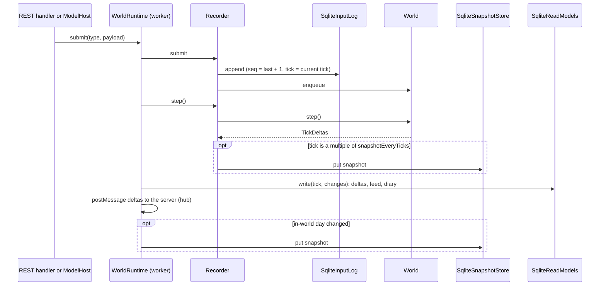
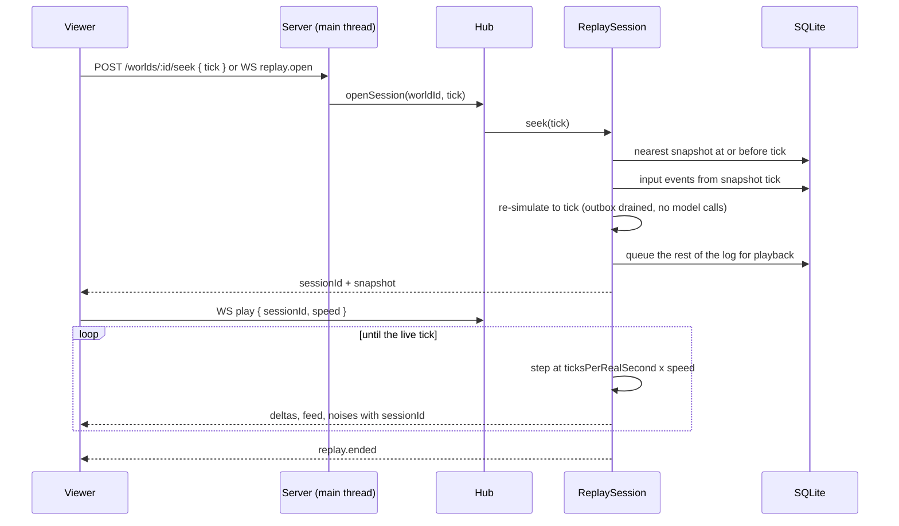
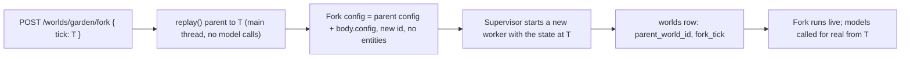

# Events and replay

A world is event-sourced. The append-only **input log** is the source of truth. The **delta stream** is derived from it and feeds live viewers and fast scrubbing. **Snapshots** make it quick to rebuild any tick. Replay never calls a model, because model answers are themselves logged inputs.

Code: [`packages/store/src`](../../packages/store/src): [`log.ts`](../../packages/store/src/log.ts), [`snapshots.ts`](../../packages/store/src/snapshots.ts), [`replay.ts`](../../packages/store/src/replay.ts), [`sqlite.ts`](../../packages/store/src/sqlite.ts), [`schema.ts`](../../packages/store/src/schema.ts). Event and delta types: [`events.ts`](../../packages/core/src/events.ts). Server wiring: [`runtime.ts`](../../packages/server/src/runtime.ts), [`replay-session.ts`](../../packages/server/src/replay-session.ts), [`app.ts`](../../packages/server/src/app.ts).

## Two streams

| Stream | Contains | Stored in | Authority |
| --- | --- | --- | --- |
| Input log | Everything that enters the sim from outside: model answers (and queue drops), admin edits, pokes, settings and clock changes, airdrops, mail, pack upgrades, model-load signals | `input_events` | Source of truth |
| Delta stream | Per-tick state changes: moves, needs, mood, actions, noises, memories, beliefs, sleep, diary, feed entries, airdrops, mailbox and mail statuses, rejected inputs | `deltas` (plus `feed` and `diary` read models) | Derived; can be regenerated by replay |

### Input events

```ts
interface InputEvent<T> {
  worldId; seq;          // seq is gap-free and monotonic per world
  tick;                  // the tick it applies at
  type; payload;
  packVersions;          // the world's pack versions when it was recorded
  causedBy?: { jobId?, userId? };
}
```

| `type` | Payload | Source |
| --- | --- | --- |
| `model.answer` | `{ jobId, job, characterId, modelId, promptHash, answer, usage }` | world runtime, from the model queue |
| `models.load` | `{ busy }` | world runtime, when the queue starts or stops backing up |
| `admin.spawn` | `EntityDef` | `POST /worlds/:id/entities` |
| `admin.edit` | `{ id, pos?, state?, needs?, energy? }` | `PATCH /worlds/:id/entities/:eid` |
| `admin.despawn` | `{ id }` | `DELETE /worlds/:id/entities/:eid`; on start, for leftover visitor characters |
| `admin.poke` | `{ characterId }` | `POST /worlds/:id/characters/:cid/poke` |
| `airdrop.drop` | `{ dropId, item, pos, by, expiresAfterSeconds? }` (a copy of the catalogue item's JSON) | `POST /worlds/:id/airdrops` |
| `airdrop.remove` | `{ dropId, reason: 'deleted' }` | `DELETE /worlds/:id/airdrops/:dropId` |
| `mail.post` | `{ mailId, text, by, expiresAfterSeconds? }` | `POST /worlds/:id/mail` |
| `mail.remove` | `{ mailId }` | `DELETE /worlds/:id/mail/:mailId` |
| `pack.loaded` | `{ packVersions }` | world runtime on start, when the packs changed since the snapshot |

`causedBy.userId` is a hash prefix of the API key, never the key itself. `by` on visitor inputs is `{ username, admin, userKey }`, where `userKey` is that same kind of hash. Non-admins get `mail.post` without its `text` from `GET /events`.

**Pack upgrades.** A world normally loads only with the pack versions its snapshot was saved with. When the packs change (for example, when the airdrop and mailbox objects were added), the runtime loads the snapshot anyway (`allowPackUpgrade`), replays the log as recorded, then logs `pack.loaded` with the new versions; the sim accepts it only if they match the loaded packs. Events are stamped with the world's versions at the time. A replay or seek enqueues a stretch of the log at once, so a world restored for an upgrade accepts inputs stamped with older versions as well as the loaded ones; seeking before, across and after the upgrade works ([`visitors.test.ts`](../../packages/server/test/visitors.test.ts)). A replay from a snapshot taken before the upgrade runs the old part of the log on the current pack code, so it is only as exact as the packs' unchanged behaviour.

### Deltas

The full list of delta kinds and their fields is in [viewer-integration.md](../viewer-integration.md#delta-kinds). Brain-feed entries travel as `feed` deltas inside the stream; the WebSocket hub splits them onto their own channel.

## Recording

`Recorder` ([`replay.ts`](../../packages/store/src/replay.ts)) wraps the live world:



An input is always stamped with the current tick and applied on the next `step()`, so live and replay apply it at the same tick. A model answer dispatched at tick N is recorded at whatever later tick it arrives.

## Snapshots

- A snapshot is the full `WorldState` (every entity and mind, PRNG states, `ext`), stored with `{ worldId, tick, seq, packVersions }`. `tick` is the next tick to run.
- Taken when a new world's recorder starts (no snapshot at or before the current tick), every `snapshotEveryTicks` (1,000 in the garden), at every in-world day boundary, and at graceful shutdown.
- SQLite stores them zstd-compressed (`node:zlib`). There is no retention thinning yet; every snapshot is kept.
- On start, the runtime loads the latest snapshot, re-queues logged inputs from that tick and re-simulates to the end of the log without calling models. Ticks after the last logged input that weren't snapshotted are re-run live, not replayed.

## Replay and seek

`replay()` loads the nearest snapshot at or before the target tick, queues the logged inputs from the snapshot's tick, and steps to the target. Restoring a snapshot saved under other pack versions throws unless the caller allows a pack upgrade (the live runtime, replay sessions and forks do). It never calls a model: the mind's outbox is drained and discarded on every replayed tick.



- Replay sessions run in the server's main thread, not in a worker.
- **Fast scrubbing** reads stored deltas with `GET /worlds/:id/deltas?fromTick=&toTick=` (optionally `&kinds=`) and applies them to a snapshot, without re-simulating.
- **Exact state** at a tick uses a replay session.

Determinism is checked by [`m2-replay.test.ts`](../../packages/store/test/m2-replay.test.ts) (a 10,000-tick run with random inputs replays from every snapshot to identical hashes, refuses a missing pack version, enforces gap-free seq) , [`sqlite.test.ts`](../../packages/store/test/sqlite.test.ts) (a mind world replayed from SQLite) and [`visitors-replay.test.ts`](../../packages/store/test/visitors-replay.test.ts) (drops, use, consumption, expiry, mail posts and reads replay to identical hashes; the `pack.loaded` upgrade).

## Forking

`POST /worlds/:id/fork { tick, id?, config? }` ([`app.ts`](../../packages/server/src/app.ts)):



- The fork starts from the parent's exact state at tick T and continues from tick T with its own empty input log and its own snapshots.
- A fork with a different `models.jobs` config is an A/B test of models on identical history.
- Reads before the fork tick do **not** resolve through the parent: the fork's history starts at T.
- Forks are not written to `worlds/*.yaml`, so they are not restarted when the server restarts.

## Tables

Schema: [`schema.ts`](../../packages/store/src/schema.ts) (Drizzle definitions plus the bootstrap DDL). Every worker and the server main thread open the same file in WAL mode with a 5-second busy timeout.

| Table | Written by | Read by |
| --- | --- | --- |
| `worlds` | runtime on first start (config, parent, fork tick) | not read yet |
| `input_events` | `Recorder` | replay, resume, `GET /events` |
| `snapshots` | `Recorder`, runtime | replay, resume |
| `deltas` | runtime, each tick with changes | `GET /deltas` |
| `feed` | runtime, from `feed` deltas; step statuses updated from `feedStep` deltas | `GET /feed` |
| `diary` | runtime, from `diary` deltas | `GET /diary` |
| `packs` | runtime on start | not read yet |
| `usage_daily` | runtime at shutdown | not read yet (`GET /usage` reads the in-memory meter) |
| `api_keys` | nothing | nothing; keys come from environment variables |
| `catalog_items` | server (`PUT`/`DELETE /catalog`, first-run seed) | `GET /catalog`, `POST /worlds/:id/airdrops` |
| `mail` | runtime on `POST /mail`; statuses from `mail` deltas | `GET /worlds/:id/mail` |
| `server_meta` | server (`catalogSeeded`) | the catalogue seed |
