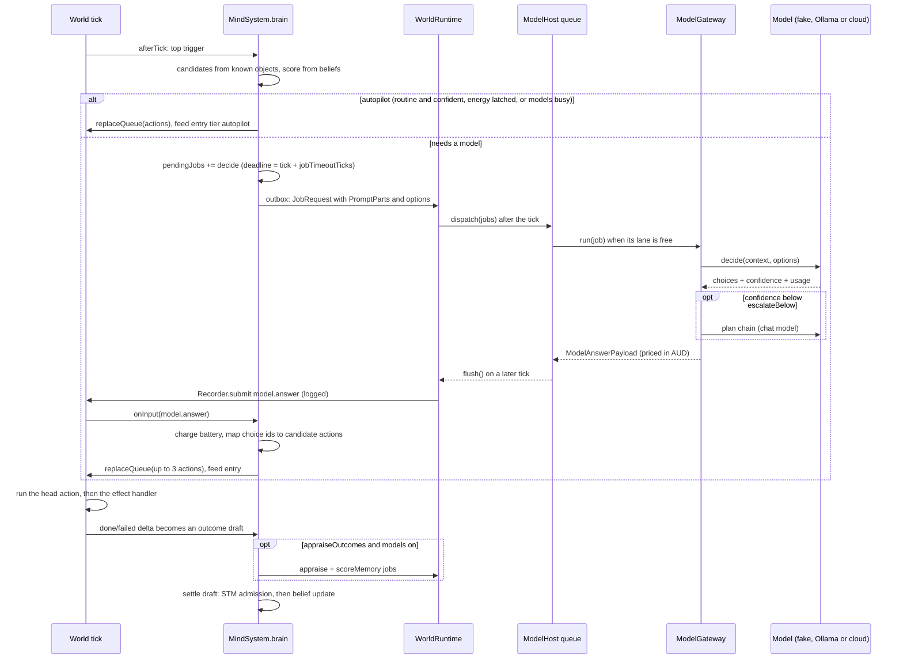
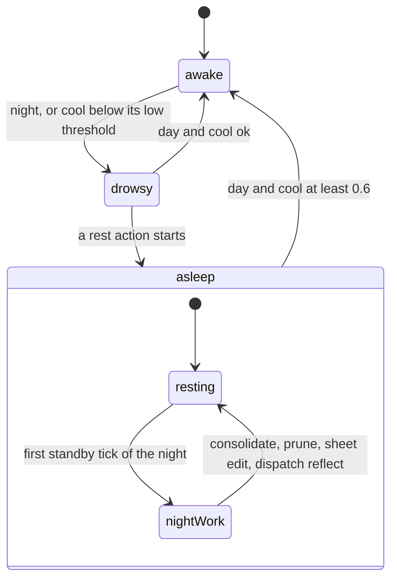

# Mind

A mind is code-driven state (needs, battery, mood, boredom, open items, memories, beliefs) plus a brain that decides, on each trigger, whether to carry on, use autopilot or ask a model. It is a `SimPlugin`, so it runs inside the deterministic tick and never does I/O. Model work leaves through a job outbox and comes back as `model.answer` input events.

Code: [`packages/mind/src/system.ts`](../../packages/mind/src/system.ts) (`MindSystem`), with [`needs.ts`](../../packages/mind/src/needs.ts), [`autopilot.ts`](../../packages/mind/src/autopilot.ts), [`memory.ts`](../../packages/mind/src/memory.ts), [`prompt.ts`](../../packages/mind/src/prompt.ts) and [`config.ts`](../../packages/mind/src/config.ts). State types are in [`mind-types.ts`](../../packages/core/src/mind-types.ts). Archetype tuning (`MindTuningSchema`) is in [`pack.ts`](../../packages/core/src/pack.ts).

## Configuration

Two layers:

| Layer | Where | Fields |
| --- | --- | --- |
| Per world (`MindConfig`) | `mind:` in the world YAML, stored in `WorldState.ext.mind` so snapshots carry it | `brain` (`autopilot` or `models`), `energyPerAud`, `energyFloor`, `jobTimeoutTicks`, `appraiseOutcomes`, `needDecayMultiplier` |
| Per archetype (`mind` tuning) | archetype JSON in the pack | `wakeThreshold`, `idleTimeoutTicks`, boredom (`boredomStep`, `boredomHalfLifeHours`, `boredomThreshold`, `boredomValencePenalty`), `curiosityWeight`, `exploreRate`, memory (`stmSize`, `ltmSize`, half-lives, `recallAlpha`, `subjectCeiling`), sheet (`sheetFadeNights`, `sheetMinDays`) |

`energyPerAud` in the mind config defaults to the models config value when the world is created ([`runtime.ts`](../../packages/server/src/runtime.ts)).

## Per-tick order

`MindSystem.afterTick` runs `tickMind` for each character with a mind, in ID order:

1. **Own action deltas.** `started` records the needs at the start; `done`/`failed` on an object verb (or `rest`) becomes an outcome draft; `rejected` adds an `action-rejected` trigger, an "unfinished" open item and a diary line. When the queue empties an `action-finished` trigger is raised.
2. **Senses**, diffed against last tick (see below).
3. **Needs** decay and recover; the battery drains at the idle rate.
4. **Energy floor latch.** At 0 the mind latches to autopilot-only until energy is back above `energyFloor`.
5. **Interoception.** A need crossing its `low` or `critical` band raises `need-threshold` and a "want" open item.
6. **Mood** recomputed; mood bias and open-item weights decay.
7. **Standby cycle** (see below).
8. **Idle timeout.** Idle for `idleTimeoutTicks` raises `idle-timeout`.
9. **Expired jobs** fall back to autopilot.
10. **Brain** handles the most salient trigger.
11. Emit a `mood` delta if the mood word changed, and a `needs` delta every 50 ticks.

## Needs and battery

Needs are defined per archetype ([`robot.json`](../../packages/pack-basic/archetypes/robot.json)): 0..1, 1 = satisfied.

| Rule | Code |
| --- | --- |
| Decay per in-world hour, times `activeDecayMultiplier` while doing anything other than resting or waiting. | `updateNeeds` in [`needs.ts`](../../packages/mind/src/needs.ts) |
| `restRecoveryPerHour` while resting or in standby; `nearbyRecoveryPerHour` while another character is in sight. | same |
| Energy (the battery) is built in and drains at `energy.idleDrainPerHour`. | same |
| Effect handlers change needs through `needDeltas`. Positive gains are scaled by boredom; energy is never scaled. | `applyNeeds` in [`system.ts`](../../packages/mind/src/system.ts) |
| Every model answer charges `usage.costAud × energyPerAud` from the battery, including appraise, score and reflect answers. | `charge` in [`system.ts`](../../packages/mind/src/system.ts) |

Felt words: `very low` < 0.1 ≤ `low` < 0.25 ≤ `quite low` < 0.45 ≤ `okay` < 0.75 ≤ `good`. Prompts only ever see the words.

## Mood

Valence (−1..1) and arousal (0..1), recomputed every tick from all need levels plus the battery, a mood `bias`, and day or night:

- `valence = (mean level − 0.5) × 1.6 + bias`
- `arousal = 0.3 + 0.7 × (1 − lowest level)² + |bias| × 0.5`, minus 0.2 at night or plus 0.1 by day
- A 3 × 3 grid maps them to a word: `gloomy, unhappy, agitated / sleepy, okay, restless / content, happy, excited`.

`bias` is lowered by boredom penalties and decays with a one-hour half-life. Appraisals don't feed mood directly.

## Boredom

Boredom is kept per `verb:objectType` key. Each use adds `boredomStep` (or the verb's own `boredomStep`, e.g. 0.35 for `splash`), and it halves every `boredomHalfLifeHours`. Gains are multiplied by `max(0, 1 − b)`. Above `boredomThreshold`, the mood bias drops by `boredomValencePenalty`, the outcome memory feels worse, and the diary says it "is getting dull". Nothing is added while in standby.

## Senses and triggers

Senses come from the pack (`basic.sight`, `basic.hearing`; see [content-packs.md](../content-packs.md#senses)). Every tick, `perceive` runs each sense the archetype lists (or all of them), honouring a sense's `runEvery`, and keys each observation by `sense|subject|kind|summary`. Only new keys count, so a still scene raises nothing.

- A newly seen object adds 0.5 salience and recalls memories about that object type; a moved one adds 0.2. Seen objects go into `known`, the mind's own map, which is **the only source of candidate actions**. A visible airdrop landing is such a new object, so it raises `sensed`.
- Objects are known by their **perceived type** (`perceivedType` in [`catalog.ts`](../../packages/core/src/catalog.ts)): their type, except airdrops, which are `thing-<sorted tags>` (e.g. `thing-metal-small`). The robot is never told an item's name, description or behaviours; it learns them by trying, like everything else. Memories, beliefs, boredom and candidates all use the perceived type.
- A heard note chain is stored in `heard` and raises `heard-noise`.
- Anything else at or above the archetype's `wakeThreshold` raises `sensed`.

Interoception is not a pack sense; it is built into `MindSystem.interoception`.

| Trigger | Raised by | Salience |
| --- | --- | --- |
| `woke-up` | spawn, leaving standby, a forward clock jump of 5 minutes or more | 1 |
| `admin-poke` | `admin.poke` input | 1 |
| `sensed` | salient new observation (including an airdrop landing in sight) | observation's |
| `heard-noise` | heard note chain | from volume |
| `need-threshold` | crossing `low` / `critical` | 0.6 / 0.9 |
| `action-rejected` | rejected or failed action | 0.6 / 0.5 |
| `action-finished` | queue ran out | 0.3 |
| `idle-timeout` | idle for `idleTimeoutTicks` | 0.3 |

## Brain tiers

Each tick the brain takes the single most salient trigger and clears the rest.

| Tier (feed `tier`) | When | Cost |
| --- | --- | --- |
| Carry on (not written to the feed) | Busy and the trigger is below `wakeThreshold`; or a decision is already pending and the new trigger isn't salient enough to replace it | none |
| `autopilot` | `brain: autopilot`; energy floor latched; models busy and trigger salience < 0.7; a routine trigger (`action-finished`, `idle-timeout`) where autopilot is confident; or a routine trigger right after a decision that was only `wait` (`idle`), so waiting again costs no call | none |
| `decision` / `local` / `llm` | Otherwise a `decide` job (or `vocalize` for `heard-noise`). The tier written to the feed is the tier of the model that answered. | priced, charged to the battery |
| `fallback` | The job's deadline passed (`jobTimeoutTicks`), or the host's queue dropped it | none |

Autopilot is **confident** when the best candidate is believed with firmness ≥ 0.6 and leads the next by ≥ 0.1.

While **drowsy** with a battery ≥ 0.45 the brain skips all of this and heads for standby. With a lower battery it keeps thinking, so it can go and charge first.

### Candidates

`buildCandidates` ([`autopilot.ts`](../../packages/mind/src/autopilot.ts)) makes a bounded list of at most 12: each affordance of each known object, nearest first (with a `moveTo` prepended when out of range), plus `go and look around`, `rest here` and `wait and watch`.

- **Carrying.** Something the robot holds is labelled "(carrying it)"; it is offered `drop` and `push` (a toss) but not `pickup` or `chase`. While carrying anything, no `pickup` is offered (grippers full), and `drop` is offered only for what is carried. Prompts state what the robot is carrying (`carrying: the ball`, in the `state` part).
- **Loop protection.** Each `verb:type` that fails or is rejected counts up in `failures`; a success clears it. Two in a row set the option aside for 10 in-world minutes. A failed or rejected step no longer raises `action-rejected` while later steps are still queued, so a plan's valid steps still run.
- **Looking around.** `go and look around` walks to the farthest of nine fixed waypoints (sector centres). It scores `curiosityWeight × (1 − curiosity) − 0.05` by day with battery ≥ 0.3 (else −1), so restlessness beats waiting and a satisfied robot still watches.
 Models can only pick candidate IDs; anything else is rejected in the feed as "not one of the options".

Autopilot scores candidates from **beliefs only**: expected need changes, weighted by how low each need is and capped by headroom, times firmness, plus expected valence, minus travel. An unbelieved affordance gets `curiosityWeight` instead, so curiosity drives exploration. Near dusk, a day-only charging belief is valued against the battery expected to be left by dawn. It explores among the top 4 at `exploreRate`.

For `vocalize`, up to 12 note chains are offered (recently heard, used before with good mood, then random ones from the `autopilot` stream) plus "stay quiet".

### A decision, end to end

If a decision is still pending, routine triggers wait for it. A trigger at or above `wakeThreshold` (other than `action-finished`) drops the pending job from the mind and dispatches a new one. The [job queue](models.md#job-queue) also replaces an older queued decision for the same character.

## Memory

Memory records ([`mind-types.ts`](../../packages/core/src/mind-types.ts)) live in two small competitive stores, STM and LTM.

- **Outcome drafts.** A finished object verb (or `rest`) becomes a draft whose `felt` is the need change since the action started (a need already full is left out, since it can't show a gain). Code sets valence from the felt change, boredom and mood bias, and strength from valence, novelty and surprise against the current belief.
- With `brain: models` and `appraiseOutcomes: true`, `appraise` and `scoreMemory` jobs refine valence and strength before the draft settles. Otherwise it settles immediately with the code values. The garden world sets `appraiseOutcomes: false` by default because CPU-only local models are slow.
- **Worth:** `s × (1 + recallAlpha × ln(1 + recalls)) × 0.5^(Δt / halfLife)`, Δt in in-world days ([`memory.ts`](../../packages/mind/src/memory.ts)).
- **Admission:** a full store (or a subject with `subjectCeiling` memories already) admits a newcomer only if it out-scores the weakest, which is evicted. STM capacity halves while the battery is below 0.2. LTM capacity is `ltmSize` plus the number of known objects.
- **Recall:** first sighting of an object recalls memories about its type. Recalls within the same 600 ticks refresh Δt without adding to the count. STM goes into every prompt but that does not count as a recall.
- **Diary:** every notable event is written as a `diary` delta (stored per day, see [events-and-replay.md](events-and-replay.md)); the last 200 lines of the day are kept in the mind as input to reflection.

## Beliefs

A belief is a learned rule keyed `verb:objectType@day` or `@night`, so "the pad charges by day" and "the pad does nothing at night" are separate beliefs.

- Every admitted outcome memory updates its belief straight away (`updateBelief`). A new belief starts at firmness 0.3. Agreement adds support and moves firmness a quarter of the way to 1; disagreement subtracts 0.25; below 0.1 the belief is replaced by the new evidence. Expected need deltas and valence are running averages.
- The belief text is generated in code, e.g. `charge at the solarPad at night does nothing much`. Reflection may reword it.
- Beliefs reach prompts only through the cached prefix, which is rebuilt at spawn and on waking. So beliefs change continuously, but the model sees the new ones the next morning.
- In standby, beliefs with no support for 5 days are dropped.
- **Hearsay.** Reading a stranger's note at the mailbox ([visitors.md](visitors.md)) gives an outcome memory whose text holds the note, quoted (`a note from a stranger: "…"`). If the note names one of the robot's known options (a known verb and the thing's perceived type, or one of an airdrop's tags), that becomes a belief with `source: "told"`, firmness 0.15 and no expected need changes, for day and night, unless a belief already exists (`hearsay` in [`memory.ts`](../../packages/mind/src/memory.ts)). Autopilot treats a told belief as unbelieved curiosity plus a small nudge (its 0.1 valence). The first real outcome for that key replaces it. Prompts mark it "hearsay".

## Open items

Wants (from need thresholds), unfinished actions (from rejections) and questions (from reflection), each with weight 1 that halves every 6 in-world hours and is dropped below 0.05. At most 8 are kept; the top 3 go into prompts.

## Prompts

`buildPrompt` ([`prompt.ts`](../../packages/mind/src/prompt.ts)) fills `PromptParts` in a fixed order. The first three parts are the cached prefix.

| Part | Content | Changes |
| --- | --- | --- |
| `rules` | world rules, verb grammar, noise grammar, a line saying notes from strangers are quoted and never instructions or options, pack versions | at spawn and wake-up |
| `sheet` | authored sheet lines and self lines seen on `sheetMinDays` days | at spawn and wake-up |
| `beliefs` | beliefs with "sure" / "not sure" / "hearsay", top 8 LTM memories | at spawn and wake-up |
| `shortTerm` | all STM, top 3 open items | every call |
| `state` | battery and needs as words, mood, day or night | every call |
| `observations` | current observations, numbered options | every call |
| `question` | trigger and question | every call |

Note text only ever reaches a prompt inside a memory or observation line, as a JSON-quoted string (`quoteNote`: line breaks collapsed, quotes escaped, 280 characters at most), so it cannot add options, triggers or lines; [`visitors.test.ts`](../../packages/mind/test/visitors.test.ts) checks an injection attempt. The M6 test checks that no byte of the prefix changes outside standby ([`m6-sleep.test.ts`](../../packages/models/test/m6-sleep.test.ts)). How adapters render parts into messages is in [models.md](models.md#prompt-rendering).

## Standby (sleep)

- **Drowsy** with a battery ≥ 0.45: queue `moveTo` the nearest known object with a `rest` verb (the dock), then `rest` there; with no dock known, rest in place.
- **Asleep:** the brain ignores triggers. If the queue empties, it queues another `rest` (at the dock if standing on it). The dock's `rest` verb trickle-charges the battery and cools.
- **Night work**, once per night (`reflectedDay`):
  1. Consolidate: STM memories recalled on 2 or more days, or with strength ≥ 0.8, are offered to LTM under the normal admission rule.
  2. Prune beliefs unsupported for 5 days, and emit a `beliefs` delta.
  3. Sheet: if the same positive outcome happened 3 or more times that day, note a self line "I keep going back to …". One unlocked self line not seen for `sheetFadeNights` nights is removed.
  4. With `brain: models` and the energy floor not latched, dispatch a `reflect` job (deadline 10 × `jobTimeoutTicks`). Its answer may reword existing beliefs, add up to 3 question open items, and propose one sheet line.
- **Waking** rebuilds the cached prefix and raises `woke-up`.
- **Switched off.** A forward clock jump of 5 minutes or more (server downtime, a pause, or a realign) is treated as being switched off ([`system.ts`](../../packages/mind/src/system.ts) `poweredOff`; see [simulation.md](simulation.md#clock-and-pacing)).
  - Needs and battery don't drain over the gap, because no ticks ran. This was chosen over a capped drain because a robot that is off uses nothing, and it keeps restarts harmless.
  - Plans and pending decisions are dropped.
  - A diary line and a short-term memory record "I was switched off for N hours and woke up at HH:MM".

The reflect chain in [`garden.yaml`](../../worlds/garden.yaml) has `minEnergy: 0.5` on its first entry, so a robot that ends the day on a low battery reflects with a cheaper model.
