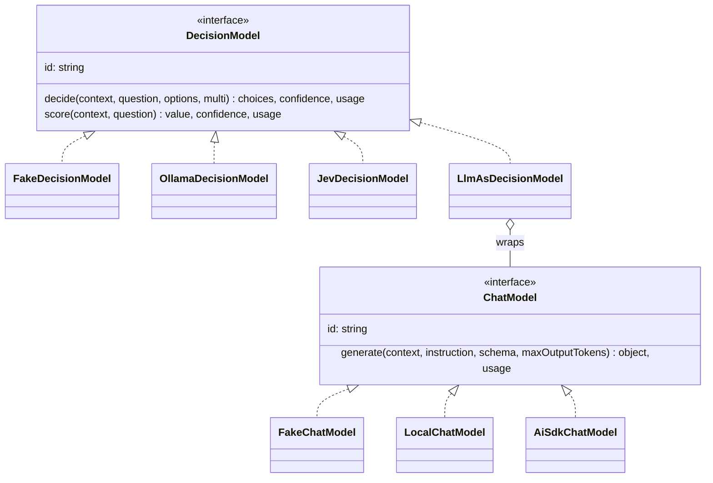
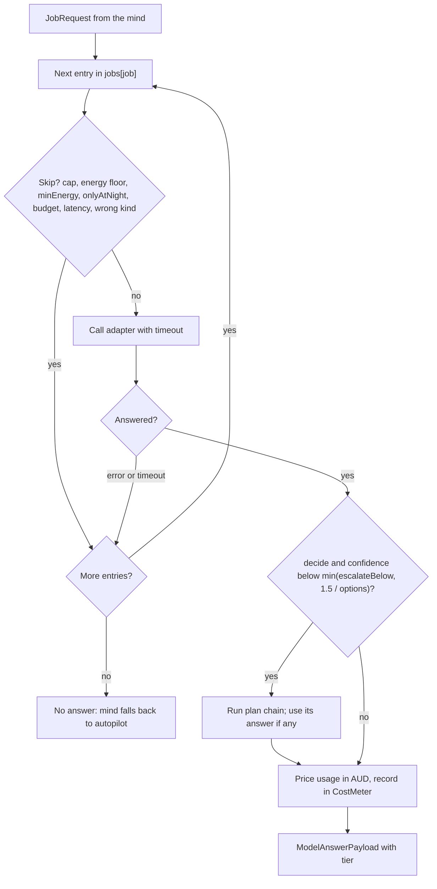
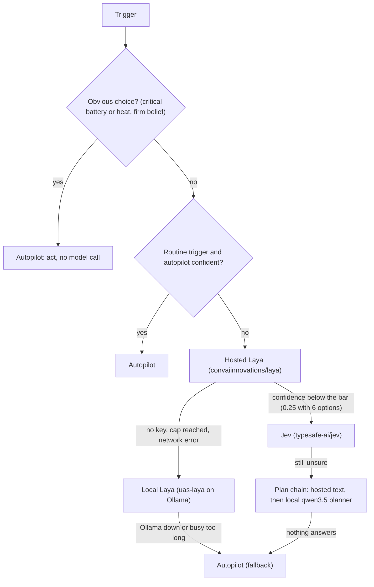
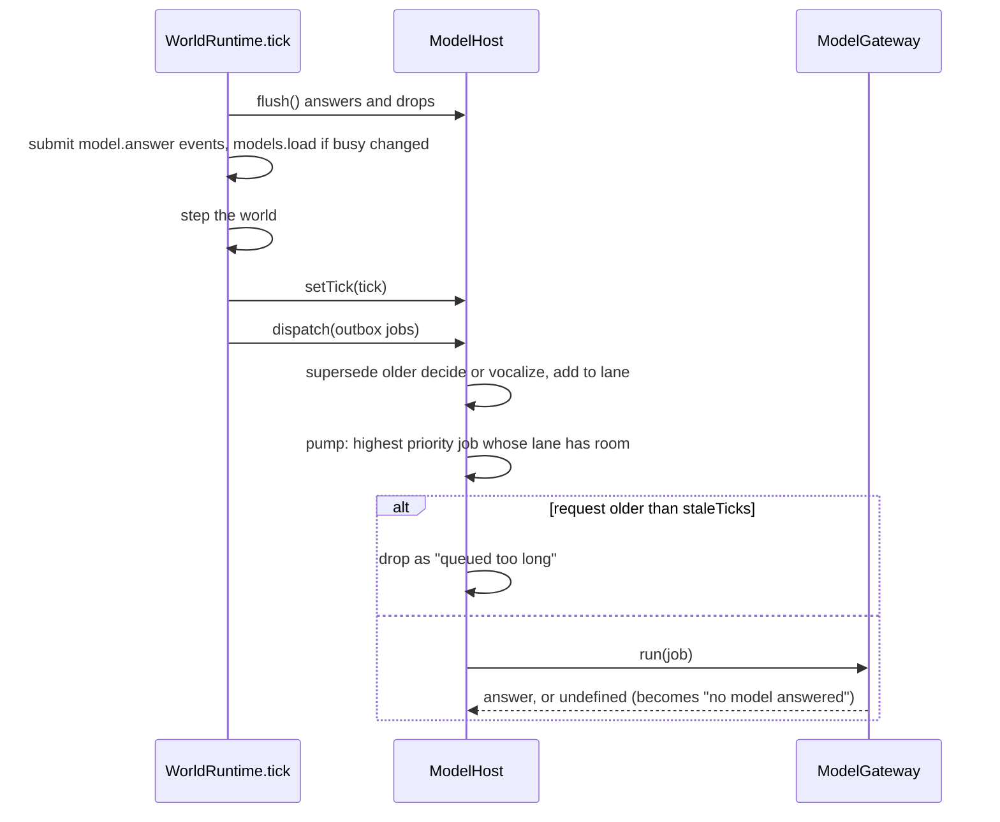

# Models

All model work goes through two interfaces and a config-driven router, so a job can be pointed at a fake, a local Ollama model or a cloud model by editing the world YAML. Model calls happen outside the deterministic sim; their answers come back as recorded `model.answer` input events, so replays never call a model.

Code: [`packages/models/src`](../../packages/models/src): [`types.ts`](../../packages/models/src/types.ts), [`config.ts`](../../packages/models/src/config.ts), [`gateway.ts`](../../packages/models/src/gateway.ts), [`host.ts`](../../packages/models/src/host.ts), [`meter.ts`](../../packages/models/src/meter.ts), [`render.ts`](../../packages/models/src/render.ts) and [`adapters/`](../../packages/models/src/adapters).

## Interfaces



`Usage` is `{ inputTokens, cachedInputTokens, outputTokens, costAud, latencyMs, modelId }`, where `inputTokens` is uncached input only. Adapters measure raw `TokenCounts`; a pricer turns them into `Usage`.

## Adapters

| Config `adapter` | Class | Implements | Feed tier | Notes |
| --- | --- | --- | --- | --- |
| `fake-decision` | [`FakeDecisionModel`](../../packages/models/src/adapters/fake.ts) | DecisionModel | `decision` | Offline and deterministic. Ranks options from what a real model would see (needs as words, beliefs, time of day, recent STM). Free unless given a price. |
| `fake-chat` | [`FakeChatModel`](../../packages/models/src/adapters/fake.ts) | ChatModel | `llm` | Answers the plan and reflect schemas with something plausible. |
| `ollama-decision` | [`OllamaDecisionModel`](../../packages/models/src/adapters/ollama-decision.ts) | DecisionModel | `decision` | Tev1 through Ollama's `/v1/systemone` over HTTP. Sends one string of state, trimming the cached prefix first to fit about 2k tokens (5,000 characters). `score` uses a five-level scale. |
| `local` | [`LocalChatModel`](../../packages/models/src/adapters/local-chat.ts) | ChatModel | `local` | `llama3.2:1b` through `/api/chat`, always with a JSON-schema `format`, temperature 0, `num_ctx` 4096. |
| `ai-sdk` | [`AiSdkChatModel`](../../packages/models/src/adapters/ai-sdk.ts) | ChatModel | `llm` | Vercel AI SDK `generateText` with structured output. Only `provider: anthropic` is wired; the cached prefix is the system message marked for Anthropic prompt caching. |
| `jev` | [`JevDecisionModel`](../../packages/models/src/adapters/jev.ts) | DecisionModel | `decision` | **Stub.** Both methods throw, so the router falls through to the next entry. |
| (automatic) | [`LlmAsDecisionModel`](../../packages/models/src/adapters/llm-as-decision.ts) | DecisionModel | as wrapped | Used when a decide or score job lands on a chat model. Asks for a Zod enum of option IDs; confidence is always 1 (no logprobs). |

### Prompt rendering

`renderPrompt` ([`render.ts`](../../packages/models/src/render.ts)) joins the first three `PromptParts` (rules, sheet, beliefs) into the system message and the rest into the user message. The part order is built by the mind; see [mind.md](mind.md#prompts).

## Jobs and routing

Each world's YAML has a `models:` block, validated by `ModelsConfigSchema` ([`config.ts`](../../packages/models/src/config.ts)). `${VAR}` and `${VAR:-default}` are substituted from the environment first.

| Key | Default | Meaning |
| --- | --- | --- |
| `audPerUsd` | 1.55 | Fixed conversion rate, never fetched, so replays agree |
| `dailyCapAud` | 2 | Real-money cap per world per real (UTC) day; paid models are skipped once reached |
| `escalateBelow` | 0.35 | Upper bound of the escalation bar: a `decide` answer escalates (to `escalateTo`, then the `plan` chain) when its confidence is below `min(escalateBelow, 1.5 / options)`, i.e. 0.25 with the usual 6 options |
| `energyFloor` | 0.1 | Paid models are skipped below this battery level |
| `energyPerAud` | 5 | Battery drained per AUD of thinking: a full battery is A$0.20 (decision 45). It seeds a new world's mind config; World settings change it live |
| `defaultTimeoutMs` | 30,000 | Per-call timeout when an entry doesn't set one |
| `ollamaUrl` | `http://localhost:11434` | Default Ollama endpoint for local adapters |
| `queue` | see [Job queue](#job-queue) | Concurrency per lane and staleness |
| `models` | | Named model definitions (adapter, model, price, apiKey, url) |
| `jobs` | | Ordered chain per job |

A chain entry is a model name or `{ use, timeoutMs?, minEnergy?, maxLatencyMs?, onlyAtNight?, budgetRemainingAud?, as? }`. The gateway tries entries in order and skips an entry when:

- it is a paid model and today's spend has reached `dailyCapAud`, or the battery is below `energyFloor`;
- `minEnergy`, `onlyAtNight`, `budgetRemainingAud` or `maxLatencyMs` (last observed latency) fails;
- the job needs a chat model and the entry isn't one;
- the job is `embed` (not implemented).

An error or timeout falls through to the next entry. If every entry fails, the job has no answer and the character falls back to autopilot.

Jobs in use: `decide`, `vocalize`, `appraise` and `scoreMemory` (decision models), `plan` (escalation) and `reflect` (chat models). `route` and `embed` exist in the job enum but nothing dispatches them. The current chains are in [`worlds/garden.yaml`](../../worlds/garden.yaml); environment variables pick each chain's head (see [operations.md](../operations.md#environment-variables)).



The plan chain asks a chat model for up to 3 option IDs with a one-line reason each; IDs not in the options are dropped, and an answer with none left counts as a failure.

## Cost meter and energy

`priceUsage` ([`meter.ts`](../../packages/models/src/meter.ts)):

```text
costAud = audPerUsd × (inputTokens × inputPerMTok + cachedInputTokens × cachedInputPerMTok + outputTokens × outputPerMTok) / 1,000,000
```

- Prices are USD per million tokens, from each model's `price` in config.
- Local models without a price get a nominal one (0.01 / 0.01 / 0.02 USD per million tokens) so they are cheap but not free. Fakes and unpriced cloud models are free.
- Ollama reports only newly evaluated prompt tokens, so local calls never show cached tokens.
- `CostMeter` keeps totals by `(real UTC day, modelId, job)`: calls, tokens, AUD and energy. It drives the daily cap and `GET /usage`. It lives in memory in the world worker and is written to the `usage_daily` table only when the world shuts down, so a restart resets today's spend.

The gateway records `energy = costAud × energyPerAud` in the meter. The battery is actually charged by the mind when the `model.answer` event is applied (`MindSystem.charge`), using the mind config's `energyPerAud`. That keeps charging inside the deterministic replay. See [mind.md](mind.md#needs-and-battery).

## Local models

| Name in garden.yaml | Adapter | Model | Used for |
| --- | --- | --- | --- |
| `localDm` | `ollama-decision` | `uas-laya` by default (`UAS_DM_MODEL`): `laya:421m-typed-decisions-bf16` with `num_thread` baked in | decide, vocalize, appraise, scoreMemory when selected |
| `tev` | `ollama-decision` | `uas-tev1` (`UAS_TEV_MODEL`): `tev1:0.8b` with `num_ctx 2048` and `num_thread` | alternative decision model: `UAS_DECIDER=tev` |
| `local` | `local` | `UAS_TEXT_MODEL`, see [Text model](#text-model) | reflect fallback |
| `planner` | `local` | `UAS_PLAN_MODEL` (`qwen3.5:0.8b`) | plan fallback |

- **Laya** (`laya:421m-typed-decisions-bf16`, 421M ModernBERT, Apache-2.0, Ollama ≥ 0.40) answers through the same `/v1/systemone` request and response shape as Tev1, so no adapter change was needed.
  - It scores options in one forward pass with a 512-token budget per question, covering instructions, options and state. Longer states are truncated, so `localDm` sets `maxStateChars: 900`.
  - The tag `laya:latest` is the English variant with a 512-token context. The typed-decisions variant has 1,024.
- **Tev1** (`tev1:0.8b`) stays supported as `tev`.
- Local models are the fallback when there is no `AI_GATEWAY_API_KEY`, the daily cap is spent, or the network is down; see [Hosted models](#hosted-models-vercel-ai-gateway).
- `/v1/systemone` ignores request options. That's why thread count, and Tev1's context, are baked into the derived models `uas-laya` and `uas-tev1` by `npm run ollama:pull` ([`scripts/ollama-pull.sh`](../../scripts/ollama-pull.sh)).
- The adapter sends a slim state: needs and time first, then what the robot notices, beliefs, the last few short-term lines and the question. The options go in `criteria`. See [`ollama-decision.ts`](../../packages/models/src/adapters/ollama-decision.ts).
- The adapter returns the top option plus any other option with probability ≥ 0.25 (up to `multi.max`). The mind keeps `wait` and `rest` only as a whole plan.
- **Laya versus Tev1** on the decide job ([bake-off](../benchmarks/2026-11-17-decide.md), 30 recorded garden prompts, 4-CPU cap):

  | | Laya | Tev1 |
  | --- | --- | --- |
  | Latency p50 / p95 | 4.7 / 5.1 s | 8.4 / 10.6 s |
  | Mean confidence | 0.63 | 0.35 |
  | Agrees with the reference ranking (top 1 / top 3) | 10% / 20% | 30% / 50% |

  - Laya is about twice as fast and more confident, but it chooses worse.
  - It leans towards whatever sounds fun (it splashed the fountain in 11 of 30 prompts), whatever the battery.
  - Neither model charged before dusk on a low battery (0 of 10 each), and both avoided charging at night once they believed it was useless (6 of 6).
  - Laya is the default because the owner asked for it. Tev1 is one env var away.
- Both bake-offs ran under the [CPU cap](../operations.md#local-models-with-ollama-podman-or-docker).

### Text model

The `local` ChatModel handles reflection and short jobs, and the `planner` ChatModel handles plans. Both take `numThread` (= `OLLAMA_THREADS`), always get a JSON-schema `format`, and don't think: `think: false` is sent for `qwen*` models, which otherwise reason at length first. The [bake-offs](../benchmarks/README.md) ran on recorded garden prompts under the 4-CPU cap.

| Job | Candidates | Result | Default |
| --- | --- | --- | --- |
| plan | llama3.2:1b, qwen3.5:0.8b, gemma3:1b | llama3.2 is fastest (17 s p50) but, like gemma3, it just lists the first three options with their labels as reasons. qwen3.5:0.8b (23 s p50) is the only one that chooses and explains from its beliefs. | `planner` = `qwen3.5:0.8b` (`UAS_PLAN_MODEL`) |
| tags / short | the same three | llama3.2 is fastest (9.5 s p50) but 17% of its tags are too long. gemma3 is best (short and grounded, 13 s p50). qwen3.5 tags are often not about the text. Not used by the running system yet. | no change |
| reflect | the same three, plus qwen3.5:2b | see [the reflect bake-off](../benchmarks/2026-11-17-reflect.md) | `local` = `UAS_TEXT_MODEL` |

`OLLAMA_MAX_LOADED_MODELS=3` keeps the decision, text and plan models resident (about 3 GB of RAM). They use no CPU when idle.

- Recommended Ollama server settings are in [operations.md](../operations.md#local-models-ollama).
- `npm run smoke:ollama` ([`smoke-ollama.ts`](../../packages/models/scripts/smoke-ollama.ts)) and the opt-in [`ollama.integration.test.ts`](../../packages/models/test/ollama.integration.test.ts) check both models end to end.

## Hosted models (Vercel AI Gateway)

One key, `AI_GATEWAY_API_KEY`, reaches every hosted model. Without it, the hosted entries are marked unavailable. The gateway logs one warning at startup, skips them silently, and the robot runs on local models and autopilot. The key is sent only as `Authorization: Bearer` and is never logged.

| Name in garden.yaml | Adapter | Gateway model id | Endpoint | US$ per M tokens (in / cached in / out) | Used for |
| --- | --- | --- | --- | --- | --- |
| `laya` | `gateway-decision` | `convaiinnovations/laya` (8k context) | `POST https://ai-gateway.vercel.sh/typesafe/v1/systemone` | 0.0105 / 0.0105 / 0 | routine decisions, vocalize |
| `jev` | `gateway-decision` | `typesafe-ai/jev` (32k context) | same | 0.042 / 0.042 / 0 | unsure decisions (`escalateTo`) |
| `hostedText` | `openai-compatible` | `meta/llama-3.1-8b` by default (`UAS_HOSTED_TEXT_MODEL`), providers Novita then Bedrock | `POST https://ai-gateway.vercel.sh/v1/chat/completions` | 0.22 / 0.22 / 0.22 (conservative) | plan, reflect, appraise |
| `luna` | `openai-compatible` | `openai/gpt-6-luna` | same | 0.10 / 0.01 / 0.50 | better text option |
| `haiku` | `openai-compatible` | `anthropic/claude-haiku-5.5` | same | 0.10 / 0.01 / 0.50 | alternative |
| `nemo` | `openai-compatible` | `mistral/mistral-nemo` | same | 0.029 / 0.029 / 0.03 | cheap open alternative |

- **Prices** come from the gateway's catalogue (`GET https://ai-gateway.vercel.sh/v1/models`), checked 2026-11-17.
  - Llama 3.1 8B is listed at 0.22 / 0.22 with "varies by provider". Its model page shows Novita at 0.02 / 0.05, so `providerOrder: [novita, bedrock]` asks for Novita first, and the table keeps the conservative price.
  - When a response reports the gateway's billed cost (`provider_metadata.gateway.cost`, documented for decisions), that cost is used instead of the table. Cached input tokens (`usage.prompt_tokens_details.cached_tokens`) are priced at the cached rate.
  - The meter converts USD to AUD at the fixed `audPerUsd` (1.55).
- **Decisions** use `SystemOneDecisionModel` ([`ollama-decision.ts`](../../packages/models/src/adapters/ollama-decision.ts)), the same System One request as local Ollama with a different base URL and a Bearer key.
  - AI Gateway documents `/typesafe/v1/systemone` with Jev. It says `GET /typesafe/v1/models` lists the decision models available to you, so hosted Laya is called the same way.
  - Not verified against the live API (no key yet): run `npm run smoke:gateway` once a key exists.
- **Text** uses `OpenAiCompatibleChatModel` ([`openai-compatible.ts`](../../packages/models/src/adapters/openai-compatible.ts)): Chat Completions with `response_format: json_schema`. If the output isn't valid it retries once with a single forced tool call, which helps models whose JSON mode is unreliable.
- **Daily cap.** `dailyCapAud` defaults to A$0.50 per world per UTC day.
  - When it's reached, hosted (paid) entries are skipped and the chain falls through to local models; if nothing answers, the robot uses autopilot. The robot never stops.
  - Every call's usage is upserted into `usage_daily`, and today's rows are loaded at start, so the cap survives a restart.
- **Live check, 2026-11-17** (free-tier team key):
  - Hosted Laya answered through `/typesafe/v1/systemone` in 1.1–3.6 s for about A$0.0000026 per decision.
  - `meta/llama-3.1-8b` planned correctly in about 1 s for about A$0.000016.
  - Jev returned HTTP 403 ("Free tier users do not have access to this model"). On 401 or 403 the gateway disables that model for the rest of the run with one log line. Unsure decisions then keep Laya's answer until the team has paid credits.
  - Through the gateway, Llama 3.1 8B returned `{}` for `json_schema` structured output and HTTP 400 for a forced tool call. `hostedText` therefore uses `structured: prompt`: the schema goes in the prompt and the JSON is extracted and validated. `json_schema` (and a fallback to `prompt`) remains the default for other models.
  - The free tier limits Novita to 5 requests per minute per region. A 429 falls through the chain to local models, like any error.
- The gateway reports billed cost as `usage.cost` (USD) on chat completions and `provider_metadata.gateway.cost` on decisions. Both are used in place of the price table.
- `npm run smoke:gateway` ([`smoke-gateway.ts`](../../packages/models/scripts/smoke-gateway.ts)) makes one Jev call, one hosted Laya call and one text call, and prints latency and A$ cost. Without a key it exits 1 with a clear message.

### Decision routing



- **Escalation bar.** A decision model's confidence is spread over the options it was offered, so the bar is relative to chance: `min(escalateBelow, 1.5 / n)` for n options. With the usual 6, chance is 0.17 and the bar 0.25. On 17 Nov 2026 the live garden escalated 152 of 156 decisions with the old fixed 0.35 bar, because hosted Laya's confidence over 6 options sits around 0.2 to 0.36 (the local bake-off over 12 options had a median of 0.63). Re-check against real data: an escalated feed entry records Laya's confidence in `escalated`.
- **One model, directly.** `ModelGateway.callModel(name, request, 'decide' | 'plan')` makes one configured model's call exactly as a chain would (same adapter request and plan instruction), with no routing, escalation or budget checks and nothing recorded in the meter. The [situation evals](../testing-models.md) use it.
- **Plan answers have no confidence.** A text model's plan used to report confidence 1, which meant nothing. Now it reports none; the feed entry has tier `llm` and `escalated: { from, confidence }` naming the decision model that was unsure.
- **Thinking depth** (decision 44): a `decide` request carries `depth`. `gut` runs the decide chain and never escalates to a plan (Jev escalation still applies); `think` goes straight to the plan chain, falling back to the decide chain if no plan model answers; no depth keeps the old routing. See [mind.md](mind.md#thinking-depth-decision-44).
- **Sleep jobs:** `consolidate` (`ConsolidateSchema`: reworded beliefs, up to 3 open questions, memory ids to forget) and `sheet` (`SheetSchema`: one step `add`/`reword`/`remove`/`none`, a line number, text, an optional goal and why). Both are chat jobs with their own chains, and both are paid from the battery. The fake chat model answers them (the sheet with the code's suggested line).
- While asleep a robot makes no decision calls; only its sleep jobs run.
- A plan answer can hold up to 6 steps. The first 3 go into the queue, and the rest (`planSteps`) follow without another model call for up to an in-world hour, unless something salient interrupts. Those continuation steps appear in the feed as tier `carry-on`.
- The decide prompt offers only the 6 most relevant options: the top by autopilot utility, plus the best untried one for curiosity. The state is compact: day-stable beliefs first, then recent events, observations, needs and the question. That ordering helps prefix caches (Ollama's KV reuse; cached-input pricing on hosted chat models, whose system message carries the stable prefix).

## Job queue

`ModelHost` sits between the mind's outbox and the gateway, in the world worker. It replaced a host that ran every job concurrently.

- **Lanes.** `ModelGateway.laneOf` picks the lane from the first chain entry that wouldn't be skipped: one lane per Ollama URL (`localConcurrency`, default 1, because local models share a CPU), one per cloud model (`cloudConcurrency`, default 4), and an unlimited `instant` lane for fakes.
- **Priority.** Within a lane: `decide` > `vocalize` / `route` > `plan` > `appraise` > `scoreMemory` > `reflect` > `embed`, then arrival order. `reflect` only starts when nothing else waits in its lane.
- **Superseding.** A new `decide` or `vocalize` for a character drops that character's older queued one of the same job.
- **Staleness.** A job whose request tick is more than `queue.staleTicks` (default 75; the garden uses 150 = 30 real seconds) behind the world when it reaches the front is dropped.
- **Drops are answers.** A dropped or failed job is returned as a `model.answer` with `modelId: 'queue'`, zero usage and `answer: { dropped: reason }` (`queued too long`, `superseded`, `no model answered`). The mind treats it as a fallback: it settles any waiting memory draft and runs autopilot with that reason in the feed.
- **Timeouts count from the start of a call**, not from queueing: the gateway starts each chain entry's `timeoutMs` clock when the call begins, and on timeout aborts the HTTP request (`AbortSignal`) so Ollama stops working on an answer nobody will use. Before this, abandoned requests stayed in Ollama's own queue and slowed every later call.
- **Back-pressure.** When jobs are waiting, the runtime logs a `models.load { busy: true }` input event (and `false` when the queue clears). While busy, the mind handles triggers below salience 0.7 with autopilot. Because it is an input event, replays see the same signal.
- **Stats.** `stats()` reports waiting and running jobs per lane, p50/p95/max wait and run times, completed, dropped and timeout counts. They appear in the world status, `GET /usage` and `/metrics` ([server-and-api.md](server-and-api.md#health-and-metrics)).

The mind's own `jobTimeoutTicks` deadline remains as a safety net; with the queue, a job is normally answered or dropped first.


