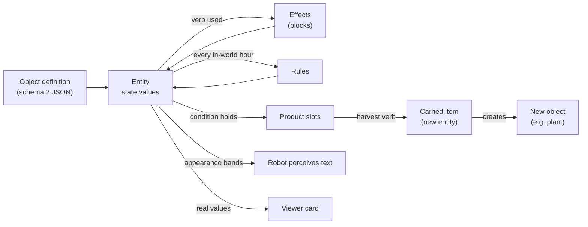

# Objects: schema 2

Status: **built** (contract agreed 18 Nov 2026; backend built the same day, iteration 2 Stage 2). [Built differently](#as-built) lists where the code settled a detail. Design source: the spec's "Objects, schema 2" and "The new garden" ([decision 49](../../Unnamed%20AI%20Simulation%20—%20Spec.md#decision-log-and-open-questions)). Backend and viewer build against this page; any change to it is messaged to the other agent and edited here in the same change.

One JSON schema describes every object: built-in pack objects (dock, ball, fountain, piano, mailbox, garden bed, plant, watering can, antenna mast) and admin catalogue items. Behaviour is data (state, verbs with requirements and effects, rules, products, appearance); the old TypeScript handlers survive only as named effect blocks.



## Definition

```json
{
  "schema": 2,
  "id": "plant",
  "name": "Plant",
  "description": "Grows when watered. Flowers, then seeds.",
  "icon": "<icon>…</icon>",
  "tags": ["plant", "living"],
  "solid": false,
  "portable": false,
  "footprint": { "w": 1, "h": 1 },
  "expiresAfter": null,

  "state": {
    "water":  { "initial": 0.6, "min": 0, "max": 1 },
    "growth": { "initial": 0,   "min": 0, "max": 1 }
  },

  "verbs": {
    "water": {
      "range": 1, "durationSeconds": 5,
      "requires": { "holding": { "type": "watering-can", "state": { "water": { "gte": 0.25 } } } },
      "effects": [
        { "block": "changeState", "target": "held", "values": { "water": -0.25 } },
        { "block": "changeState", "target": "self", "values": { "water": 0.4 } },
        { "block": "observe", "text": "the soil darkened as the water soaked in" }
      ],
      "fail": "the can is empty"
    },
    "inspect": {
      "range": 1, "durationSeconds": 5,
      "requires": { "self": { "growth": { "gte": 0.7 } } },
      "effects": [ { "block": "affectNeeds", "needs": { "curiosity": 0.15 }, "observation": "the flower smelled of something new" } ]
    }
  },

  "rules": [
    { "every": "1h", "change": { "water": -0.04 } },
    { "every": "1h", "when": { "water": { "gte": 0.3 } }, "change": { "growth": 0.02 } },
    { "every": "1h", "when": { "water": { "lt": 0.05 } }, "change": { "growth": -0.01 } }
  ],

  "products": [
    { "slot": "flower", "item": "flower", "when": { "growth": { "gte": 0.7 } }, "everyHours": 24, "max": 1, "verb": "pick" },
    { "slot": "seeds",  "item": "seed",   "when": { "growth": { "gte": 1 } },   "everyHours": 24, "max": 3, "verb": "gather", "reset": { "growth": 0.6 } }
  ],

  "appearance": {
    "water":  [ { "lt": 0.15, "text": "the soil is cracked and dry" }, { "lt": 0.5, "text": "the soil looks dry" }, { "text": "the soil is damp" } ],
    "growth": [ { "lt": 0.1, "text": "a bare patch of soil" }, { "lt": 0.4, "text": "a small green shoot" }, { "lt": 0.7, "text": "a leafy plant" }, { "lt": 1, "text": "a plant with a flower bud" }, { "text": "a plant in full flower" } ]
  }
}
```

### Fields

| Field | Rules |
| --- | --- |
| `schema` | `2`. Schema-1 catalogue items are migrated on read (below). |
| `id` | kebab-case, unique across the pack and catalogue (pack wins on clash; the catalogue rejects pack ids). Also the entity `type`. |
| `name`, `description`, `icon`, `tags` | As schema 1. Pack objects get an `icon` too, so the viewer can draw any object the same way. |
| `solid`, `portable` | Booleans. `portable` adds `pickup` and `drop`. |
| `footprint` | Optional `{ w, h }` tiles, default 1×1, anchored at `pos` (top-left). Used by the garden bed. |
| `state` | Up to 8 named **numeric** values with `initial`, `min`, `max`. Every change is clamped. Booleans are 0/1. |
| `verbs` | Up to 8. `range` (tiles), `durationSeconds`, optional `requires`, `effects` (ordered), optional `fail` text, optional `boredomStep`. `pickup`, `drop`, `scan`, `sleep`, `read` are reserved. |
| `rules` | Up to 8. See [Rules](#rules). |
| `products` | Up to 4 slots. See [Products](#products). |
| `appearance` | Per state value, ordered bands; first match wins; a band without a bound is the fallback and must be last. |
| `expiresAfter` | Catalogue items only, as schema 1. |

### Conditions

A condition maps state names to comparisons: `{ "water": { "gte": 0.3, "lt": 0.9 } }`. Operators: `lt`, `lte`, `gt`, `gte`, `eq`. Several names are ANDed. There are no expression strings, so nothing is parsed or evaluated as code.

### Requirements

`requires` may hold:

- `self`: a condition on the target object.
- `holding`: the actor holds something matching `{ type?, tag?, state? }`.
- `near`: `{ tag | type, range }`: a matching object is within range of the actor (e.g. `fill` needs water nearby).
- `tile`: `{ tag }`: for `createObject` (below).

A failed requirement fails the action with the verb's `fail` text as the observation (or a generic one), costs no battery, and shows as `failed` in the feed.

### Effect blocks

| Block | Fields | Notes |
| --- | --- | --- |
| `changeState` | `target`: `self` \| `held` \| `actor`, `values` (deltas) or `set` (absolute) | `actor` changes needs only through `affectNeeds`. |
| `affectNeeds` | `needs`, `observation` | Need keys must exist on the archetypes; `energy` is rejected (decision 46). |
| `observe` | `text` | Adds an observation. |
| `makeNoise` | `notes` (≤4), `observation?` | As schema-1 `makesNoise`. |
| `consume` | `uses?` | Uses up the target (or `held` with `target: "held"`); removed at 0. |
| `createObject` | `type`, `at`: `here` \| `target` \| `freeTileIn`, `consumeHeld?` | `freeTileIn` picks the free tile inside the target's footprint nearest the actor; fails with "no room" when full. The new entity is a normal spawn with cause `created`. |
| `harvest` | `slot` | Moves one ready product into the actor's hands as a new entity; fails if hands are full or the slot is empty. Products' `verb`s use this automatically. |
| `handler` | `name`, `params?` | Pack objects only: calls a registered TypeScript handler (`basic.push`, `basic.chase`, `basic.dock`, mailbox `read`, …). The catalogue rejects it. |

Effects run in order and are all-or-nothing: if one fails, none apply.

### Rules

- `every`: `"1h"` (in-world hours; `"30m"` and `"1d"` also allowed). Evaluated inside the sim on the in-world clock, never the host clock.
- `when`: optional condition; `change`: deltas to state values.
- Optional `nearby`: `{ range, needs }`: each character within range gets these need deltas per period (the antenna mast's signal). Applied scaled to the time spent in range, so walking past gives a little.
- **Clock jumps** (downtime, `clock.jump`): periods are applied one by one, capped at 7 in-world days, so state ends where it would have been. The number applied and whether the cap was hit are recorded in a `{ kind: 'catchUp', seconds, periods, capped }` delta right after the jump.

### Products

- A slot fills by one every `everyHours` while `when` holds, up to `max`. The fill timer lives on the entity (`products[].hours`, beside `ready`) so it snapshots and replays.
- The slot's `verb` is added to the object automatically (`range` 1, 3 s). Using it runs `harvest`, then applies `reset` (absolute values) if given.
- `item` is an object `id` (pack or catalogue). The harvested entity is created with that definition's initial state.

### Items that create objects

A seed is a portable object whose verb is used **on the bed**. Because verbs belong to the target, the bed declares `plant`:

```json
"plant": {
  "range": 1, "durationSeconds": 8,
  "requires": { "holding": { "type": "seed" } },
  "effects": [ { "block": "createObject", "type": "plant", "at": "freeTileIn", "consumeHeld": true }, { "block": "observe", "text": "you pressed the seed into the soil" } ]
}
```

### Perception

- Prompts and senses describe objects only by name, tags and **current appearance texts** ("plant: a small green shoot; the soil looks dry"), plus product slots as "has a flower you could pick". No state numbers reach the robot.
- The appearance text is computed in the sim, so the mind and the viewer agree on it.

### Schema-1 migration

Read-time, lossless, idempotent: `affectsNeeds` → a verb with `affectNeeds`; `makesNoise` → a verb with `makeNoise`; `consumable { uses }` → state `uses` (initial = uses, min 0) plus `consume` on each verb; `portable {}` → `portable: true`; `inert {}` → no verbs. Saving through the editor writes schema 2. Drops already in a world keep their stored copy and are migrated the same way when loaded.

## The new garden

Map `garden-2` (24 × 16, same hut and pond layout as `garden`), no solar pad. Objects:

| Object | Behaviour |
| --- | --- |
| Dock | Home; `dock`/`rest` cool down. Sleep happens here by preference. |
| Ball | Portable; `push`, `chase`. |
| Fountain | Tag `water`; `rinse` (cool), `splash` (curiosity), `fill` (needs a held watering can: sets its `water` to 1). |
| Piano | Notes, as before. |
| Mailbox | `read`, as before. |
| Garden bed | 3 × 2 footprint, tag `soil`; `plant` (above); starts with one planted seed (a `plant` at growth 0). |
| Plant | As the example: water drains, growth when watered, flower at 0.7 (`inspect` lifts curiosity, `pick` gives a flower), seeds at full growth (`gather`, resets growth to 0.6). |
| Seed | Portable, two loose near the bed. |
| Flower | Portable; `smell` lifts curiosity a little; wilts after 2 in-world days (rule drains `fresh`, removed at 0). |
| Watering can | Portable, state `water` 0..1 (starts 0), appearance "empty / some water / full". |
| Antenna mast | Solid; rule `nearby { range: 3, needs: { signal: +0.2/h } }`; appearance "a tall mast, humming". |

Tuning target: with daily watering a seed flowers in about 2 real days and seeds in about 4; a dry plant stops growing within a day and starts wilting after two.

### Archiving the iteration-1 world

- Worlds gain `archived: true`. An archived world doesn't tick, rejects every input (409 `world archived`), loads no models, and stays readable: timeline, replay, feed, history.
- `npm run world:archive -- --world garden` takes an SQLite backup copy to `data/archive/<world>-<date>.db` first, then sets the flag. `npm run world:new -- --world garden2 --map garden-2` creates the fresh world at day 0. The **owner** runs both on the live database; agents only run them on scratch copies.
- The server's default world for new installs becomes `garden2`.

## API changes

Object entities in snapshots and deltas gain (characters unchanged):

```ts
interface ObjectView {
  // existing: id, kind, type, pos, tags, heldBy
  state: Record<string, number>;            // real values (internal `_…` keys are not sent)
  stateSpec: Record<string, { min: number; max: number }>;
  appearance: string[];                      // current texts, in definition order
  products: { slot: string; item: string; ready: number; max: number; verb: string; nextInHours?: number }[];
  footprint?: { w: number; h: number };
  createdBy?: { entityId: string; tick: number }; // set for objects made by createObject
}
```

- **Keeping it current:** state changes still arrive as `{ kind: 'state', id, set }` (real values only). Whenever an object's `appearance` or `products` change, a `{ kind: 'objectView', id, appearance, products }` delta follows in the same tick. `createdBy` and `footprint` come with the `spawned` entity.
- `GET /objects/defs` (spectator): every definition (pack and enabled catalogue) as schema 2, so the viewer can show names, icons, verbs and rules.
- `GET /worlds/:id` (and `GET /worlds`) include `archived` on the summary; it is not in the snapshot.
- Feed entries for verbs that fail a requirement carry the `fail` text as `result`.
- Catalogue `GET /catalog/templates` returns schema-2 templates: seed, toy, noise-maker, cooling gel. `POST /catalog/validate` returns path errors for schema 2 (e.g. `verbs.water.effects[1].values.colour`).

## Viewer (Stage 2 pieces)

- **Object card:** appearance texts first (what the robot sees), then real state values as labelled bars against `stateSpec`, then products ("1 flower ready · pick"; "next seeds in ~6 h"), then verbs. Planted objects say who planted them and when.
- **Map:** the bed draws its footprint; plants draw by growth band (soil, shoot, leafy, bud, flower); the can shows water level; the mast shows its signal range when selected.
- **Archived worlds:** a read-only banner; drop, mail and settings controls hidden.
- **Catalogue editor:** schema-2 templates; validation errors located by path.

Out of Stage 2: state-over-time sparklines and growth history (Stage 4), thought callouts (Stage 4).

## As built

Where the code settled a detail the contract left open (all messaged to the viewer agent):

- **Engine form.** Schema-2 definitions are validated (`validateObjectDef2` in [`objects.ts`](../../packages/core/src/objects.ts)) and compiled: every verb runs the engine's own `core.blocks` handler with its requirements and effects; `portable` adds `core.pickup`/`core.drop`; each product slot adds its verb (`range` 1, 3 s). The sim runs them in [`world.ts`](../../packages/sim/src/world.ts) (`runBlocks`, `runRules`, `nearbyNeeds`, `refreshViews`).
- **Failures.** A failed *requirement* shows the verb's `fail` text; an *effect* that can't happen says why ("no room", "your grippers are full", "there is nothing to pick yet"). Either way nothing is applied.
- **Rules** may also say `remove: true` (with `when`): the flower is removed once `fresh` reaches 0. Rules start counting at a world's first tick under this code, so a world doesn't "catch up" from before it had rules.
- **Product timers** live on the entity (`products[].hours`), not in state; the view adds `nextInHours`.
- **Deltas:** `{ kind: 'objectView', id, appearance, products }` whenever either changes; `{ kind: 'catchUp', seconds, periods, capped }` after a clock jump.
- **`consume`** on an object with a `uses` value removes it at the start of the next tick once `uses` reaches 0 (so the mind still sees what it used); without `uses`, straight away.
- **`GET /objects/defs`** entries carry `source: 'pack' | 'catalog'`.
- **Planting** requires holding something tagged `seed` (not the `seed` type), so catalogue seeds plant too.
- **Tuning** (real-time garden): water −0.025/h; growth +0.015/h while water ≥ 0.3; −0.01/h while water < 0.05; a watering adds 0.4 and takes 0.25 from the can. With daily watering a planted seed flowers in about 2 days (growth 0.7) and seeds at 1 (about 3 days); a dry plant stops growing within half a day and starts wilting after about a day and a half. A picked flower wilts in 2 days.
- **The solar pad** stays in the pack only as a verb-less legacy type, so the archived iteration-1 world still loads; it charges nothing and the new garden has none.
- **Archiving** is a world-file flag (`archived: true`), set by `npm run world:archive` after an SQLite backup copy. `worlds/garden2.yaml` ships as the new default world; on a server that already runs `garden`, the next start creates `garden2` at day 0 too (the same as `npm run world:new -- --world garden2`).
- **Schema-1 drops** already in a world keep their stored item (migrated when read for the API); their old verbs still run.

