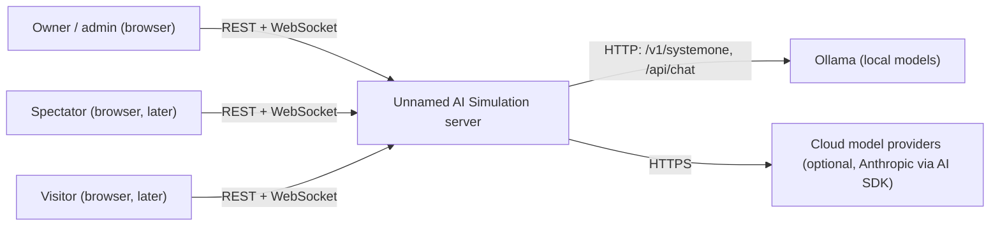
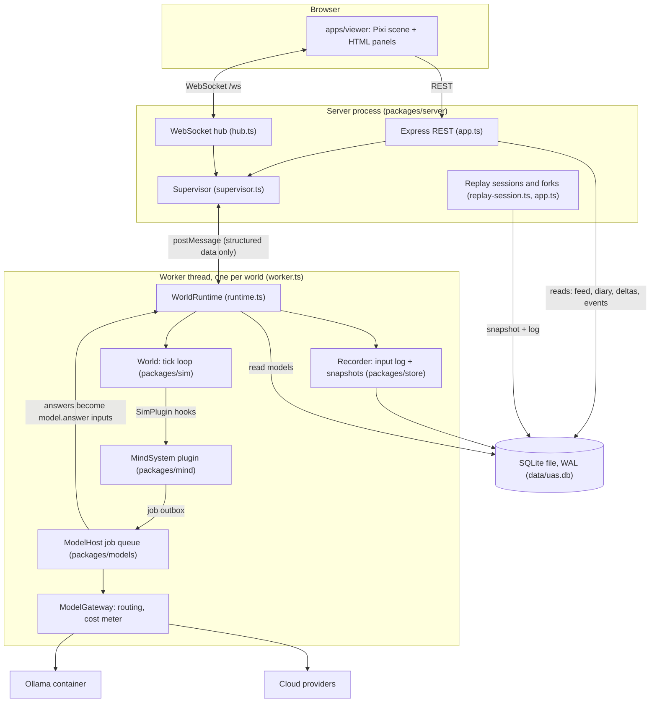
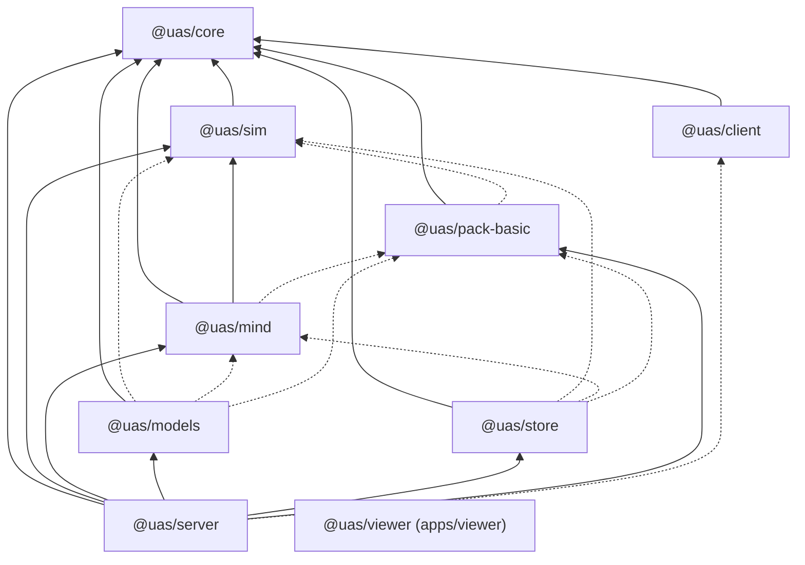

# Architecture overview

One Node.js server process serves REST and WebSocket and supervises one worker thread per world. Each worker runs the deterministic simulation, the minds, the model gateway and its own SQLite connection. The viewer is a separate browser app.

All packages ship TypeScript source. Node runs it directly with type stripping, so the server has no build step. Only the viewer is built (with Vite).

## System context

Spectators and visitors are supported by the API (roles, visitor queue) but the viewer is built for the owner first. See [PRODUCT.md](../../PRODUCT.md).

## Containers

Notes:

- The viewer talks to the server through `@uas/client`; in development Vite proxies `/api` to it. It can also run on an in-browser sample world (`?source=sample`). This switch is in progress; see [viewer.md](viewer.md#data-sources).
- The model gateway runs **inside each world worker**, not in the server process. Each world has its own cost meter and daily AUD cap. See [models.md](models.md).
- There is no separate event bus. The worker writes inputs, snapshots and read models to SQLite itself and posts each tick's deltas to the supervisor, which forwards them to the hub. See [events-and-replay.md](events-and-replay.md).
- Replay sessions and forks re-simulate in the **server process** (main thread), from the same SQLite file.

## Package dependencies

Derived from each `package.json`. Solid arrows are `dependencies`; dotted arrows are `devDependencies` (tests only).

| Package | Manifest | Main third-party dependencies | Role |
| --- | --- | --- | --- |
| `@uas/core` | [package.json](../../packages/core/package.json) | zod | Types, IDs, hashing, seeded PRNG, grid, pack schemas and registry, WebSocket protocol types. No I/O. |
| `@uas/sim` | [package.json](../../packages/sim/package.json) | none | Tick loop, built-in verbs, action queue, effects, A* pathfinding, snapshots. See [simulation.md](simulation.md). |
| `@uas/mind` | [package.json](../../packages/mind/package.json) | none | `MindSystem`, a `SimPlugin`: needs, mood, boredom, senses, triggers, autopilot, memory, beliefs, standby, visitor queue, prompt builder. See [mind.md](mind.md). |
| `@uas/models` | [package.json](../../packages/models/package.json) | ai, @ai-sdk/anthropic, yaml, zod | Model interfaces, adapters, routing, AUD meter, job queue. See [models.md](models.md). |
| `@uas/store` | [package.json](../../packages/store/package.json) | better-sqlite3, drizzle-orm | Input log, snapshots, read models, `Recorder`, `replay()`. See [events-and-replay.md](events-and-replay.md). |
| `@uas/pack-basic` | [package.json](../../packages/pack-basic/package.json) | none | The robot pack and garden map. See [content-packs.md](../content-packs.md). |
| `@uas/server` | [package.json](../../packages/server/package.json) | express, ws, yaml, zod | REST, WebSocket hub, auth, supervisor, worker bootstrap. See [server-and-api.md](server-and-api.md). |
| `@uas/client` | [package.json](../../packages/client/package.json) | none | Typed REST and WebSocket client for frontends. |
| `@uas/viewer` | [package.json](../../apps/viewer/package.json) | pixi.js, @fontsource fonts; vite, playwright (dev) | The blueprint viewer. Imports `@uas/client`, but its manifest doesn't declare it yet (it resolves through the workspace). See [viewer.md](viewer.md). |

Two edges differ from the spec's package table: `@uas/mind` depends on `@uas/sim` (it implements `SimPlugin` and reads `World`), and `@uas/store` needs no sim at runtime (it works through its own small `Simulation` interface). The workspace is npm, not pnpm. All of these are in [decisions.md](../decisions.md#deviations-from-the-spec).

## Process rules

| Rule | How the code enforces it |
| --- | --- |
| The sim never awaits I/O. | Model jobs go into `MindSystem.outbox`; the runtime drains it after each tick and hands it to `ModelHost`. Answers come back as `model.answer` input events on a later tick. See [`system.ts`](../../packages/mind/src/system.ts), [`runtime.ts`](../../packages/server/src/runtime.ts). |
| No clocks, randomness or I/O in `sim` or `mind`. | [`determinism-rules.test.ts`](../../packages/sim/test/determinism-rules.test.ts) scans both packages' sources for `Date.now()`, `Math.random()`, timers, `fetch`, `process.*` and I/O imports. |
| Workers share no mutable state with the server. | [`worker.ts`](../../packages/server/src/worker.ts) talks only through `postMessage` with the message types in [`protocol.ts`](../../packages/server/src/protocol.ts). |
| Everything from outside enters as a logged input event. | Admin edits, visitor commands, model answers and model-load signals all go through `Recorder.submit`, which appends to the log before queueing. See [events-and-replay.md](events-and-replay.md). |
