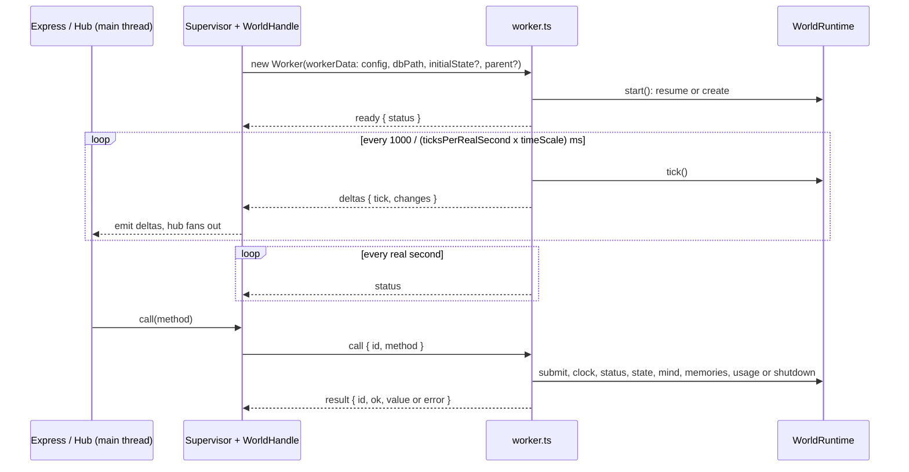
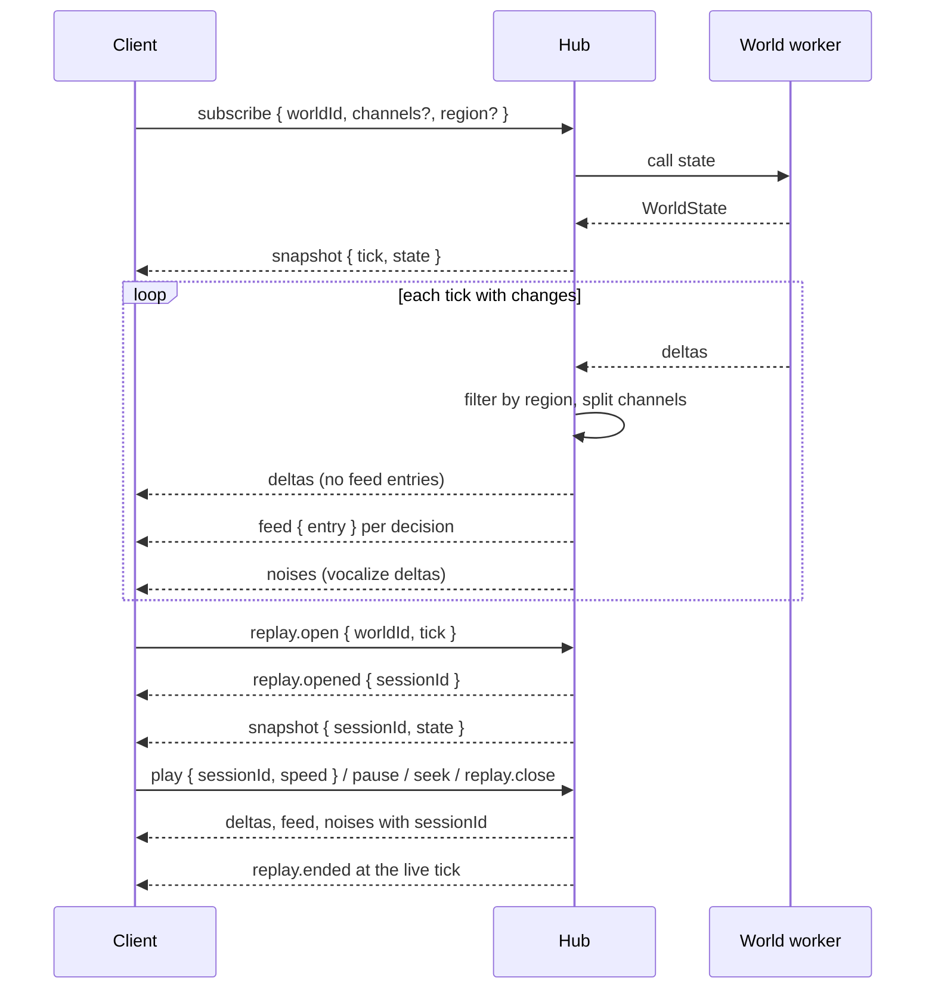

# Server and API

`@uas/server` is one Node.js process: Express for REST, a `ws` WebSocket hub, API-key auth, and a supervisor that runs one worker thread per world. `@uas/client` is the typed client frontends use.

Code: [`packages/server/src`](../../packages/server/src): [`main.ts`](../../packages/server/src/main.ts), [`app.ts`](../../packages/server/src/app.ts), [`auth.ts`](../../packages/server/src/auth.ts), [`hub.ts`](../../packages/server/src/hub.ts), [`region.ts`](../../packages/server/src/region.ts), [`supervisor.ts`](../../packages/server/src/supervisor.ts), [`worker.ts`](../../packages/server/src/worker.ts), [`runtime.ts`](../../packages/server/src/runtime.ts), [`replay-session.ts`](../../packages/server/src/replay-session.ts), [`config.ts`](../../packages/server/src/config.ts), [`catalog.ts`](../../packages/server/src/catalog.ts), [`protocol.ts`](../../packages/server/src/protocol.ts). Client: [`packages/client/src/index.ts`](../../packages/client/src/index.ts).

For the exact message and payload shapes a frontend sees, read [viewer-integration.md](../viewer-integration.md). This page covers how the server is put together.

## Startup and shutdown

1. [`main.ts`](../../packages/server/src/main.ts) reads `PORT`, `UAS_DB`, `UAS_WORLDS` and the key variables, and creates the app.
2. Every `*.yaml` in the worlds directory is loaded (with `${VAR}` substitution), validated by `WorldFileSchema` ([`config.ts`](../../packages/server/src/config.ts)) and started.
3. A world with history resumes from its latest snapshot and the input log; a new one is built from its config ([events-and-replay.md](events-and-replay.md#snapshots)).
4. On `SIGINT` or `SIGTERM` the server closes sockets and replay sessions, asks each worker to shut down (final snapshot, usage totals to `usage_daily`), then exits.

## Worker threads and the clock

- The supervisor and workers exchange only structured-clone messages ([`protocol.ts`](../../packages/server/src/protocol.ts)). Calls are matched by `id`.
- Each worker opens its own SQLite connection to the same file (WAL mode).
- `PATCH /worlds/:id/clock` sets `paused` and `timeScale` in the worker. Pacing is described in [simulation.md](simulation.md#clock-and-pacing).

- The hub tells each worker whether any WebSocket subscriber is watching (`clock { watched }`). The worker then runs at `ticksPerRealSecond`, or at `idleTicksPerRealSecond` when nobody is.
- `ticksPerRealSecond` replaced `ticksPerSecond` in world configs. The status reports `ticksPerRealSecond`, `secondsPerTick` and `inWorldSecondsPerRealSecond`. The catalog still returns `ticksPerSecond` as a deprecated alias.

## Sign in with Vercel

OAuth 2.0 / OIDC with an authorization code and PKCE (S256), plus state and nonce ([`session.ts`](../../packages/server/src/session.ts)). It is only available when `VERCEL_OAUTH_CLIENT_ID` is set.

| Route | What it does |
| --- | --- |
| `GET /auth/login?returnTo=/path` | Puts a signed 10-minute cookie (state, nonce, verifier, returnTo) on the browser and redirects to `https://vercel.com/oauth/authorize` with scopes `openid email profile` |
| `GET /auth/callback` | Checks the state, exchanges the code (`POST https://api.vercel.com/login/oauth/token`, with client id/secret, `code_verifier` and the same `redirect_uri`), checks the id_token's nonce, reads `GET /login/oauth/userinfo`, then revokes Vercel's token (we keep our own session). Stores the session in SQLite (`sessions`) and sets `uas_session` (signed id, httpOnly, SameSite=Lax, `Secure` on https, 30 days). Redirects to `UAS_PUBLIC_URL + returnTo`, or to `/?authError=...` on failure |
| `POST /auth/logout` | Deletes the session and clears the cookie |
| `GET /auth/me` | `{ user: { id, name, email, avatarUrl, username } \| null, role, loginAvailable }`; with an API key (and no session) it returns `user: null` and the key's role |

- **Callback URL.** `redirect_uri` is `UAS_PUBLIC_URL + '/api/auth/callback'`. In dev that's `http://localhost:5173/api/auth/callback`: the browser hits Vite, the `/api` proxy strips the prefix, and the server's `/auth/callback` handles it. Register exactly that URL in the Vercel app; loopback http is allowed.
- **Roles.**
  - `UAS_ADMIN_VERCEL_USERS` lists Vercel user ids (`sub`, preferred) or usernames (`preferred_username`). Those users are admins.
  - Every other signed-in user is a visitor, and no session means spectator.
  - API keys keep working alongside, and a key takes precedence over a cookie. Visitor limits apply per user: the session's user, or the API key.
- **CSRF.** Cookie-authenticated mutations (anything but GET/HEAD/OPTIONS) must carry an `Origin` (or `Referer`) equal to `UAS_PUBLIC_URL`'s origin or the server's own, on top of SameSite=Lax. Otherwise the response is 403. API-key requests are exempt.
- **WebSocket.** `/ws` accepts the session cookie as well as `?key=`.
- **Setting up the app.**
  - The Vercel CLI (65.16.0) has no command for OAuth apps, and there's no public API for creating them. Create the app in the dashboard: team **Settings → Apps → Create** (name and slug).
  - On the app's **Manage** page:
    - add the authorization callback URL;
    - generate a client secret (client authentication `client_secret_post`);
    - enable the permissions `openid`, `email` and `profile`;
    - optionally restrict **Sign-In Access** to team members.
  - Vercel's guide lists a deployed project as a prerequisite, but local callback URLs (`http://localhost:...`) can be registered directly.

## REST endpoints

Auth: `Authorization: Bearer <key>` or `x-api-key: <key>`. An unknown key gets 401 on every route. A missing key counts as an anonymous spectator, allowed only where the world has `publicRead: true`. Too low a role gets 403 (401 if anonymous). Errors are `{ error }` with status 400 unless stated.

| Method and path | Role | What it does |
| --- | --- | --- |
| `GET /healthz` | anyone | `{ ok, worlds }` |
| `GET /metrics` | anyone | Prometheus text, see below |
| `GET /worlds` | spectator | Every running world's summary with live status |
| `POST /worlds` | admin | Start a world from a world-config body (not saved to `worlds/`) |
| `GET /worlds/:id` | spectator | One world's summary and status |
| `GET /worlds/:id/settings` | spectator | `{ values, schema, derived }`: live world settings, each with a label, unit, range, step and help text for a generic UI, plus derived costs ([below](#live-world-settings)) |
| `PATCH /worlds/:id/settings` | admin | Validate and apply a partial `values` live; returns `{ values, derived, effects }` |
| `PATCH /worlds/:id/clock` | admin | `{ paused?, timeScale? }`; returns the status |
| `GET /worlds/:id/catalog` | spectator | Display data from the world's packs: objects (tags, solid, portable, verb names), archetypes (needs, energy label, noises, sight and hearing range), `ticksPerRealSecond`, `secondsPerTick`, daily cap, energy floor, energy per AUD, and `models: { id, adapter, model?, provider?, local }[]` (the feed's `modelId` is the `id`; no keys) |
| `POST /worlds/:id/entities` | admin | `admin.spawn` input; returns the logged event |
| `PATCH /worlds/:id/entities/:eid` | admin | `admin.edit` input (`pos`, `state`, `needs`, `energy`) |
| `DELETE /worlds/:id/entities/:eid` | admin | `admin.despawn` input |
| `GET /worlds/:id/characters/:cid/mind` | spectator | Needs, energy, mood, sleep, open items, queue, current action, pending jobs; 404 if no mind |
| `GET /worlds/:id/characters/:cid/memories` | spectator | STM, LTM, beliefs, character sheet |
| `GET /worlds/:id/characters/:cid/diary?day=` | spectator | Diary lines for a day (default: today) |
| `POST /worlds/:id/characters/:cid/poke` | admin | `admin.poke` input |
| `POST /worlds/:id/characters/:cid/situation` | admin | `{ tick?, title?, why?, tags? }` → `{ situation, path }`: "save this moment as a test", the character's moment now (or at `tick`, by replay) as an eval situation; also written under `UAS_SITUATIONS_DIR` when set ([testing-models.md](../testing-models.md#capturing-a-moment)) |
| `GET /catalog` | spectator | The server-wide airdrop catalogue: enabled `CatalogItem`s; admins also get disabled ones with `disabled`, `updatedAt`, `updatedBy` |
| `GET /catalog/templates` | admin | `{ name, item }[]` starter items: snack, toy, noise-maker, inert |
| `POST /catalog/validate` | admin | `{ item }` → `{ ok: true, item }` or `{ ok: false, errors: [{ path, message }] }` |
| `PUT /catalog/:itemId` | admin | `{ item, disabled? }` → the saved entry; 400 `{ error, errors }` when invalid |
| `DELETE /catalog/:itemId` | admin | Remove an item (drops already in worlds keep their copy) |
| `GET /worlds/:id/airdrops` | spectator | `Airdrop[]` in the world now |
| `GET /worlds/:id/airdrops/:dropId` | spectator | `Airdrop` plus `beliefs: { characterId, text, firmness }[]` about things that look like it |
| `POST /worlds/:id/airdrops` | visitor | `{ itemId, pos }` → `Airdrop`; `airdrop.drop` input. 400 bad body, 403 not enabled here, 404 unknown or disabled item, 409 world full or no free tile, 429 per-visitor limit or cooldown |
| `DELETE /worlds/:id/airdrops/:dropId` | admin | `airdrop.remove` input |
| `GET /worlds/:id/mail` | spectator | `{ waiting, mine?, all? }`: `mine` for a signed-in visitor or key, `all` for admins (`MailStatus[]`) |
| `POST /worlds/:id/mail` | visitor | `{ text }` → `MailStatus`; `mail.post` input. 400 empty, over 280 characters or filtered; 429 mailbox full, per-visitor limit or cooldown |
| `DELETE /worlds/:id/mail/:mailId` | admin | `mail.remove` input (waiting messages only) |
| `GET /worlds/:id/events?fromSeq=&limit=` | spectator | Page the input log (limit up to 1,000); `mail.post` text is removed for non-admins |
| `GET /worlds/:id/feed?characterId=&limit=&beforeTick=` | spectator | Brain feed: the newest `limit` entries (up to 500), oldest first; `beforeTick` returns the page of entries before that tick |
| `GET /worlds/:id/deltas?fromTick=&toTick=&kinds=` | spectator | Stored deltas per tick; `kinds` filters by delta kind |
| `POST /worlds/:id/seek` | spectator | `{ tick }`; opens a replay session, returns `{ sessionId, tick, state }` (waiting mail text blanked for non-admins) |
| `POST /worlds/:id/fork` | admin | `{ tick, id?, config? }`; starts a fork ([events-and-replay.md](events-and-replay.md#forking)) |
| `GET /packs` | admin | Packs this server can load: name, version, licence, content hash, maps |
| `POST /packs` | admin | Always 501: packs are registered in code ([`catalog.ts`](../../packages/server/src/catalog.ts)) |
| `GET /packs/:name/sounds/:file` | anyone | Always 404: the robot pack has no recorded sounds |
| `GET /usage?worldId=&day=` | admin | Per world: `{ rows, queue }`, usage rows by day, model and job (tokens, AUD, energy) and the model queue stats |

## WebSocket protocol

Connect to `/ws?key=<key>` (no key for public worlds). An unknown key closes the socket with code 4401. Message types are in [`protocol.ts`](../../packages/core/src/protocol.ts); their fields are documented in [viewer-integration.md](../viewer-integration.md#websocket-protocol).

- Snapshots (live, replay and seek) blank `state.mailbox.queue[].text` for everyone but admins: waiting mail is private to its sender and admins.
- Channels default to all three. `region` filters only positional deltas (`moved` if either end is inside, `spawned`, `vocalize`); all others pass.
- A session opened over REST (`POST /seek`) can be driven from any socket: the last socket to send a control message receives its output.
- Closing a socket closes its subscriptions and the replay sessions it owns.

## Roles and API keys

[`auth.ts`](../../packages/server/src/auth.ts):

| Role | Can | Keys from |
| --- | --- | --- |
| `admin` | everything | `UAS_ADMIN_KEYS` |
| `visitor` | drop catalogue items and post mail, within the world's limits; read like a spectator | `UAS_VISITOR_KEYS` |
| `spectator` | read state, feed, diary, deltas, events, replay | `UAS_SPECTATOR_KEYS`, or no key when `publicRead: true` |

- Each variable is a comma-separated list. Keys are held in memory only as SHA-256 hashes and compared in constant time. The `api_keys` table exists but is unused.
- A principal's `keyId` (first 16 hex characters of the hash) is stamped on admin and visitor input events as `causedBy.userId`.
- Roles are ranked admin > visitor > spectator; a higher role can do everything a lower one can.
- Visitor actions carry a `Sender { username, admin, userKey }`: the Vercel username (or `visitor-<keyId prefix>` for a key), and the `keyId` that limits are counted by.

## Visitors: airdrops and the mailbox

Visitors are never characters. They drop catalogue items into a world and post notes to its mailbox; the contract and data shapes are in [visitors.md](visitors.md). Server side ([`visitors.ts`](../../packages/server/src/visitors.ts), `WorldRuntime`):

- **Catalogue.** Server-wide, in SQLite (`catalog_items`), validated with `validateCatalogItem` from `@uas/core` against the need keys and noise names of every pack the server knows. Seeded once on first run (battery snack, squeaky toy, heavy rock; a `server_meta` flag stops a re-seed after deletes).
- **Drops.** The server copies the item's JSON into an `airdrop.drop` input (so later catalogue edits don't change it), snapped to the nearest free walkable tile. Expiry is the item's `expiresAfter`, else the world's `airdropDefaultExpiry`.
- **Mail.** Text is cleaned (control characters and line breaks collapsed), capped at 280 characters and checked against a small local word list. The text is stored in the `mail` table (statuses follow `mail` deltas) and logged in `mail.post`. `reaction` on a read message is the reader's first feed entry at or after the read tick.
- **Limits** are world settings ([below](#live-world-settings)); admins are exempt. Cooldowns are counted in real seconds per user in the worker, outside the sim (not persisted).
- **Start-up.** A resumed world gets any config entity with a fixed `id` that it lacks (e.g. the mailbox, added to `garden.yaml` after the world was created), once, as a logged `admin.spawn`. An entity an admin deleted (a logged `admin.despawn` of that id) is not brought back. Leftover visitor characters (`state.visitor: true`, from before) are removed with logged `admin.despawn` inputs. A world whose snapshot was saved under older pack versions loads, replays its log, then logs `pack.loaded` with the current versions ([events-and-replay.md](events-and-replay.md)).

## Persistence

SQLite through Drizzle and better-sqlite3, in WAL mode, at `UAS_DB` (default `data/uas.db`). Postgres is not wired up. Live world state is in memory in each worker; the database holds the input log, snapshots and read models. Tables and who writes them are listed in [events-and-replay.md](events-and-replay.md#tables).

## Health and metrics

`GET /healthz` returns `{ ok: true, worlds: [...] }`; the Docker image's `HEALTHCHECK` calls it.

`GET /metrics` reports gauges per world, labelled `world="<id>"`, from the status each worker posts every second:

| Metric | Meaning |
| --- | --- |
| `uas_tick` | Current tick |
| `uas_tick_lag_ms` | How far the tick loop runs behind schedule |
| `uas_model_latency_ms` | Mean latency of the last 50 model answers |
| `uas_cost_aud_today`, `uas_cost_aud_per_hour` | Spend today, and its average per real hour so far (UTC) |
| `uas_pending_jobs` | Model jobs waiting or running |
| `uas_model_queue_depth`, `uas_model_queue_wait_p50_ms`, `uas_model_queue_wait_p95_ms`, `uas_model_run_p50_ms`, `uas_model_run_p95_ms` | Model queue depth, wait and run times |
| `uas_model_jobs_completed`, `uas_model_jobs_dropped_stale`, `uas_model_jobs_dropped_superseded`, `uas_model_jobs_failed`, `uas_model_timeouts` | Model queue outcomes |
| `uas_mail_waiting` | Messages waiting in the world's mailbox |

The queue metrics belong to the [job queue](models.md#job-queue), which is in progress.

## `@uas/client`

[`packages/client/src/index.ts`](../../packages/client/src/index.ts) re-exports every `@uas/core` type and adds `UasClient` (one method per REST endpoint, including `catalogItems`, `catalogTemplates`, `validateItem`, `saveItem`, `deleteItem`, `airdrops`, `airdrop`, `dropItem`, `removeAirdrop`, `mail`, `postMail` and `removeMail`; `ApiError.errors` carries catalogue validation paths) and `WorldStream` (typed `on(type, handler)`, `next(type)`, `subscribe`, and replay controls). It works in browsers and in Node. The M7 test drives the server through it ([`m7-server.test.ts`](../../packages/server/test/m7-server.test.ts)). Usage examples are in [viewer-integration.md](../viewer-integration.md).

## Live world settings

`GET /worlds/:id/settings` and `PATCH /worlds/:id/settings` cover the following fields ([`settings.ts`](../../packages/server/src/settings.ts), `WorldRuntime.applySettings`):

| Field | Unit | Effect |
| --- | --- | --- |
| `ticksPerRealSecond` | ticks/s | Sim steps per real second. In a real-time world, `secondsPerTick` becomes 1 / rate, so time stays at 1× (smoother, not faster); `moveTicksPerTile` and `durationScale` follow |
| `moveSecondsPerTile` | s/tile | Walking speed |
| `timeScale`, `paused` | ×, on/off | Same as `PATCH /clock`; real-time worlds re-align on resume or on returning to 1× |
| `dailyCapAud` | A$/day | Hosted spend cap per world (persisted per day) |
| `energyPerAud` | battery per A$ | The energy rate: how much battery each A$ of thinking costs, so how much a robot can think |
| `hostedModels` | on/off | Skip hosted models (local and autopilot only) |
| `needDecayMultiplier` | × | How fast needs run down (battery drain unchanged) |
| `escalateBelow` | confidence | Re-ask unsure decisions of Jev, then plan |
| `catalogEnabled` | item ids (`string[]` field) | Catalogue items visitors may drop here; `*` (the default) enables all |
| `airdropMaxActivePerVisitor`, `airdropWorldCap` | items | Drops one visitor may have in the world at once; drops the world holds |
| `airdropCooldownSeconds`, `mailCooldownSeconds` | real s | Wait between one visitor's drops or posts |
| `airdropDefaultExpiry` | in-world s | Expiry for items without their own `expiresAfter`; 0 = never |
| `mailCapacity`, `mailMaxWaitingPerVisitor` | messages | Messages waiting in the mailbox; per visitor |
| `mailExpirySeconds` | in-world s | How long a message may wait unread; 0 = never |

Visitor limits default to effectively unlimited (1,000,000, or 0 s) and never apply to admins. Their schema `kind` is `number`, except `catalogEnabled`, whose kind is `string[]`.

- **Logging.** A change is logged as a `settings.change` input (with the admin's id as `causedBy.userId`). The mind applies its part (`energyPerAud`, `needDecayMultiplier`) from that input. Tick rate or walking speed also log a `sim.config` input. Replays therefore follow every change.
- **Restarts.** Host-side values (tick rate, cap, hosted on/off, escalation, visitor limits) are re-applied from the log, so changes survive. Pause and time scale are session-level.
- **Derived values** in the response:
  - `averageDecisionCostAud`: today's measured average for decide calls, or an estimate of about 350 input tokens on the first usable decide model, with `averageDecisionCostEstimated`;
  - `batteryPerDecision`, which is that cost × `energyPerAud` (1 = a full battery);
  - `decisionsPerFullBattery`;
  - `spentTodayAud`, `dailyCapAud` and `capRemainingAud`;
  - `hostedModelsAvailable`;
  - `secondsPerTick`, `moveTicksPerTile` and `inWorldSecondsPerRealSecond`.
