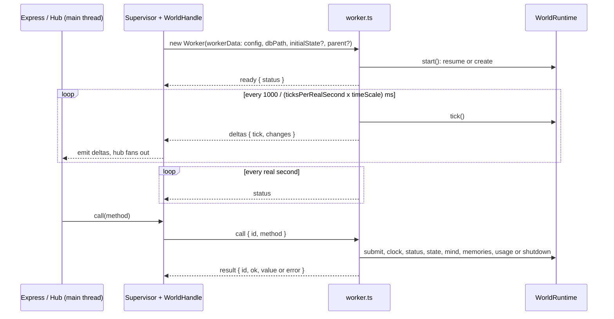
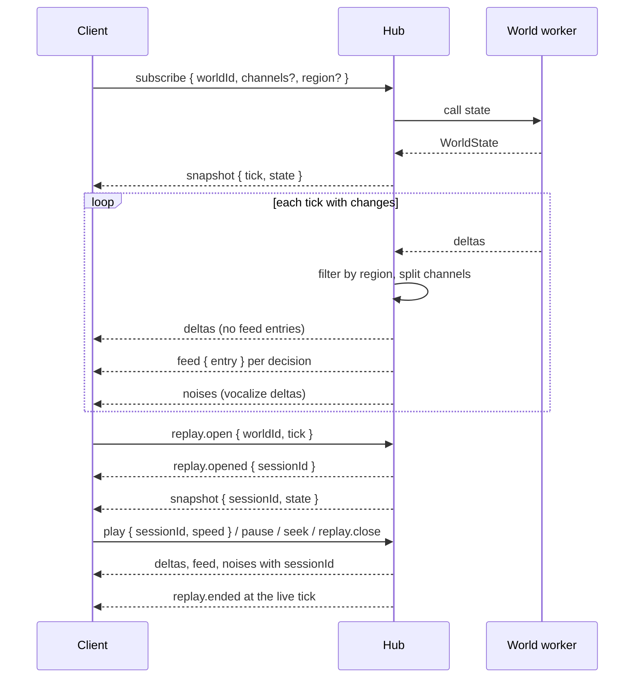

# Server and API

`@uas/server` is one Node.js process: Express for REST, a `ws` WebSocket hub, API-key auth, and a supervisor that runs one worker thread per world. `@uas/client` is the typed client frontends use.

Code: [`packages/server/src`](../../packages/server/src): [`main.ts`](../../packages/server/src/main.ts), [`app.ts`](../../packages/server/src/app.ts), [`auth.ts`](../../packages/server/src/auth.ts), [`hub.ts`](../../packages/server/src/hub.ts), [`region.ts`](../../packages/server/src/region.ts), [`supervisor.ts`](../../packages/server/src/supervisor.ts), [`worker.ts`](../../packages/server/src/worker.ts), [`runtime.ts`](../../packages/server/src/runtime.ts), [`replay-session.ts`](../../packages/server/src/replay-session.ts), [`config.ts`](../../packages/server/src/config.ts), [`catalog.ts`](../../packages/server/src/catalog.ts), [`protocol.ts`](../../packages/server/src/protocol.ts). Client: [`packages/client/src/index.ts`](../../packages/client/src/index.ts).

For the exact message and payload shapes a frontend sees, read [viewer-integration.md](../viewer-integration.md). This page covers how the server is put together.

## Startup and shutdown

1. [`main.ts`](../../packages/server/src/main.ts) reads `PORT`, `UAS_DB`, `UAS_WORLDS` and the key variables, and creates the app.
2. Every `*.yaml` in the worlds directory is loaded (with `${VAR}` substitution), validated by `WorldFileSchema` ([`config.ts`](../../packages/server/src/config.ts)) and started.
3. A world with history resumes from its latest snapshot and the input log; a new one is built from its config ([events-and-replay.md](events-and-replay.md#snapshots)).
4. On `SIGINT` or `SIGTERM` the server closes sockets and replay sessions, asks each worker to shut down (final snapshot, usage totals to `usage_daily`), then exits.

## Worker threads and the clock

- The supervisor and workers exchange only structured-clone messages ([`protocol.ts`](../../packages/server/src/protocol.ts)). Calls are matched by `id`.
- Each worker opens its own SQLite connection to the same file (WAL mode).
- `PATCH /worlds/:id/clock` sets `paused` and `timeScale` in the worker. Pacing is described in [simulation.md](simulation.md#clock-and-pacing).

- The hub tells each worker whether any WebSocket subscriber is watching (`clock { watched }`). The worker then runs at `ticksPerRealSecond`, or at `idleTicksPerRealSecond` when nobody is.
- `ticksPerRealSecond` replaced `ticksPerSecond` in world configs. The status reports `ticksPerRealSecond`, `secondsPerTick` and `inWorldSecondsPerRealSecond`. The catalog still returns `ticksPerSecond` as a deprecated alias.

## REST endpoints

Auth: `Authorization: Bearer <key>` or `x-api-key: <key>`. An unknown key gets 401 on every route. A missing key counts as an anonymous spectator, allowed only where the world has `publicRead: true`. Too low a role gets 403 (401 if anonymous). Errors are `{ error }` with status 400 unless stated.

| Method and path | Role | What it does |
| --- | --- | --- |
| `GET /healthz` | anyone | `{ ok, worlds }` |
| `GET /metrics` | anyone | Prometheus text, see below |
| `GET /worlds` | spectator | Every running world's summary with live status |
| `POST /worlds` | admin | Start a world from a world-config body (not saved to `worlds/`) |
| `GET /worlds/:id` | spectator | One world's summary and status |
| `PATCH /worlds/:id/clock` | admin | `{ paused?, timeScale? }`; returns the status |
| `GET /worlds/:id/catalog` | spectator | Display data from the world's packs: objects (tags, solid, portable, verb names), archetypes (needs, energy label, noises, sight and hearing range), `ticksPerRealSecond`, `secondsPerTick`, daily cap, energy floor, energy per AUD |
| `POST /worlds/:id/entities` | admin | `admin.spawn` input; returns the logged event |
| `PATCH /worlds/:id/entities/:eid` | admin | `admin.edit` input (`pos`, `state`, `needs`, `energy`) |
| `DELETE /worlds/:id/entities/:eid` | admin | `admin.despawn` input |
| `GET /worlds/:id/characters/:cid/mind` | spectator | Needs, energy, mood, sleep, open items, queue, current action, pending jobs, visitor queue; 404 if no mind |
| `GET /worlds/:id/characters/:cid/memories` | spectator | STM, LTM, beliefs, character sheet |
| `GET /worlds/:id/characters/:cid/diary?day=` | spectator | Diary lines for a day (default: today) |
| `POST /worlds/:id/characters/:cid/poke` | admin | `admin.poke` input |
| `POST /worlds/:id/visitors` | visitor | Join: spawns a visitor character (`visitor-<keyhash>`, at `pos` or 0,0); one per key per world |
| `POST /worlds/:id/visitors/:vid/actions` | visitor | `{ actions }`, 1 to 3; only your own visitor (admins may drive any); `visitor.command` input |
| `GET /worlds/:id/events?fromSeq=&limit=` | spectator | Page the input log (limit up to 1,000) |
| `GET /worlds/:id/feed?characterId=&limit=` | spectator | Brain feed, oldest first (limit up to 500) |
| `GET /worlds/:id/deltas?fromTick=&toTick=&kinds=` | spectator | Stored deltas per tick; `kinds` filters by delta kind |
| `POST /worlds/:id/seek` | spectator | `{ tick }`; opens a replay session, returns `{ sessionId, tick, state }` |
| `POST /worlds/:id/fork` | admin | `{ tick, id?, config? }`; starts a fork ([events-and-replay.md](events-and-replay.md#forking)) |
| `GET /packs` | admin | Packs this server can load: name, version, licence, content hash, maps |
| `POST /packs` | admin | Always 501: packs are registered in code ([`catalog.ts`](../../packages/server/src/catalog.ts)) |
| `GET /packs/:name/sounds/:file` | anyone | Always 404: the robot pack has no recorded sounds |
| `GET /usage?worldId=&day=` | admin | Per world: `{ rows, queue }`, usage rows by day, model and job (tokens, AUD, energy) and the model queue stats |

## WebSocket protocol

Connect to `/ws?key=<key>` (no key for public worlds). An unknown key closes the socket with code 4401. Message types are in [`protocol.ts`](../../packages/core/src/protocol.ts); their fields are documented in [viewer-integration.md](../viewer-integration.md#websocket-protocol).

- Channels default to all three. `region` filters only positional deltas (`moved` if either end is inside, `spawned`, `vocalize`); all others pass.
- A session opened over REST (`POST /seek`) can be driven from any socket: the last socket to send a control message receives its output.
- Closing a socket closes its subscriptions and the replay sessions it owns.

## Roles and API keys

[`auth.ts`](../../packages/server/src/auth.ts):

| Role | Can | Keys from |
| --- | --- | --- |
| `admin` | everything | `UAS_ADMIN_KEYS` |
| `visitor` | join a world as one visitor and act as it; read like a spectator | `UAS_VISITOR_KEYS` |
| `spectator` | read state, feed, diary, deltas, events, replay | `UAS_SPECTATOR_KEYS`, or no key when `publicRead: true` |

- Each variable is a comma-separated list. Keys are held in memory only as SHA-256 hashes and compared in constant time. The `api_keys` table exists but is unused.
- A principal's `keyId` (first 16 hex characters of the hash) is stamped on admin and visitor input events as `causedBy.userId`.
- Roles are ranked admin > visitor > spectator; a higher role can do everything a lower one can.
- The visitor-to-key binding is an in-memory map in the server process, so it is lost on restart (the visitor entity remains in the world).

## The visitor queue

The API side is thin: joining spawns a character with `state.visitor: true` (no mind) through `admin.spawn`, and actions are sent as `visitor.command`. Anything aimed at a character joins that character's visitor queue inside the deterministic mind, which decides if and when to respond. The queue rules are in [mind.md](mind.md#visitor-queue). `client.noiseAt(...)` in [`@uas/client`](../../packages/client/src/index.ts) is a shortcut for a `vocalize` aimed at a character.

## Persistence

SQLite through Drizzle and better-sqlite3, in WAL mode, at `UAS_DB` (default `data/uas.db`). Postgres is not wired up. Live world state is in memory in each worker; the database holds the input log, snapshots and read models. Tables and who writes them are listed in [events-and-replay.md](events-and-replay.md#tables).

## Health and metrics

`GET /healthz` returns `{ ok: true, worlds: [...] }`; the Docker image's `HEALTHCHECK` calls it.

`GET /metrics` reports gauges per world, labelled `world="<id>"`, from the status each worker posts every second:

| Metric | Meaning |
| --- | --- |
| `uas_tick` | Current tick |
| `uas_tick_lag_ms` | How far the tick loop runs behind schedule |
| `uas_model_latency_ms` | Mean latency of the last 50 model answers |
| `uas_cost_aud_today`, `uas_cost_aud_per_hour` | Spend today, and its average per real hour so far (UTC) |
| `uas_pending_jobs` | Model jobs waiting or running |
| `uas_model_queue_depth`, `uas_model_queue_wait_p50_ms`, `uas_model_queue_wait_p95_ms`, `uas_model_run_p50_ms`, `uas_model_run_p95_ms` | Model queue depth, wait and run times |
| `uas_model_jobs_completed`, `uas_model_jobs_dropped_stale`, `uas_model_jobs_dropped_superseded`, `uas_model_jobs_failed`, `uas_model_timeouts` | Model queue outcomes |
| `uas_visitor_queue_depth` | Visitor requests waiting across all characters |

The queue metrics belong to the [job queue](models.md#job-queue), which is in progress.

## `@uas/client`

[`packages/client/src/index.ts`](../../packages/client/src/index.ts) re-exports every `@uas/core` type and adds `UasClient` (one method per REST endpoint, plus `noiseAt`) and `WorldStream` (typed `on(type, handler)`, `next(type)`, `subscribe`, and replay controls). It works in browsers and in Node. The M7 test drives the server through it ([`m7-server.test.ts`](../../packages/server/test/m7-server.test.ts)). Usage examples are in [viewer-integration.md](../viewer-integration.md).
