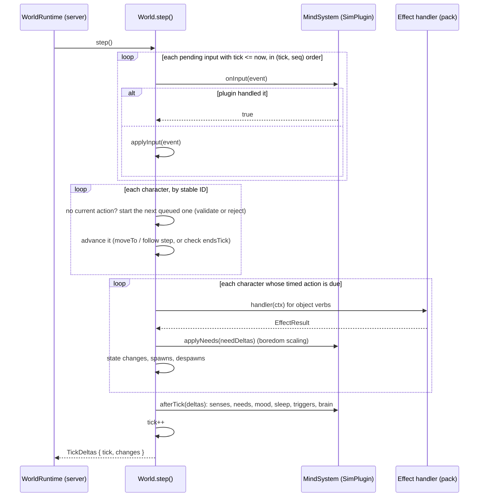
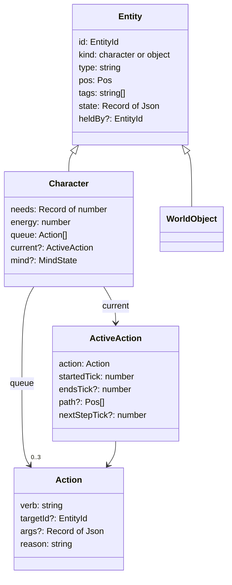
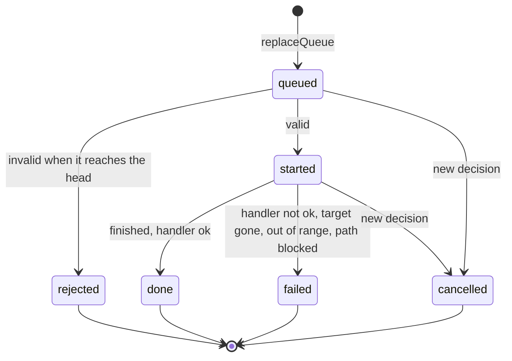

# Simulation

The simulation is a deterministic, fixed-step tile world. Given the same snapshot, the same content pack versions and the same input events, it produces the same state, byte for byte.

Code: [`packages/sim/src/world.ts`](../../packages/sim/src/world.ts), [`packages/sim/src/path.ts`](../../packages/sim/src/path.ts), and the shared types in [`packages/core/src`](../../packages/core/src).

## World state

`WorldState` ([`world.ts`](../../packages/sim/src/world.ts)) is plain JSON, so a snapshot is a `structuredClone` of it and its hash is `hashJson` over canonical (sorted-key) JSON ([`json.ts`](../../packages/core/src/json.ts)).

| Field | Meaning |
| --- | --- |
| `config` | `worldId`, `seed`, `grid`, `secondsPerTick`, `dayLengthSeconds`, `startSecond`, `moveTicksPerTile` |
| `packVersions` | e.g. `basic@0.1.0#<hash>`; must match the loaded registry (an older world upgrades through a logged `pack.loaded`) |
| `tick` | The tick the next `step()` will process |
| `nextId`, `mapVersion` | ID counter for spawned entities; walkability version that keys the path cache |
| `rng` | State of every named PRNG stream |
| `entities` | All characters and objects, by ID |
| `ext` | Plugin-owned state, e.g. `ext.mind` (the `MindConfig`) and `ext.modelsBusy` |
| `mailbox` | `{ queue }`: messages waiting, oldest first (`mailId`, `text`, `by`, `postedTick`, `expiresTick?`). Absent until the first post |

The shapes as a frontend sees them are in [viewer-integration.md](../viewer-integration.md#worldstate-the-snapshot).

## Tick loop

`World.step()` runs one tick in this order:



The spec lists "update needs, run senses, emit triggers" as separate tick phases. In the code they all happen inside the mind's `afterTick` hook, in the order described in [mind.md](mind.md#per-tick-order).

Inputs the sim handles itself (when the plugin does not): `model.answer` for job `decide` with an `{ actions }` answer (replaces the queue), `admin.spawn`, `admin.edit`, `admin.despawn`, `airdrop.drop`, `airdrop.remove`, `mail.post`, `mail.remove` and `pack.loaded` (see [Airdrops and the mailbox](#airdrops-and-the-mailbox)). `admin.poke` is rejected without a mind; `models.load` is ignored. Anything else emits an `inputRejected` delta.

## Determinism rules

| Rule | Where |
| --- | --- |
| No `Date.now()`, `new Date()`, `Math.random()`, `performance.now()`, `process.*`, timers, `fetch`, dynamic `import()` or I/O module imports in `packages/sim/src` or `packages/mind/src`. | Enforced by [`determinism-rules.test.ts`](../../packages/sim/test/determinism-rules.test.ts) (a test, not a lint rule). |
| One seed per world, split into named xoshiro128** streams so adding a consumer never shifts another stream. Streams in use: `effects` (handlers), `autopilot` (exploration, noise candidates). | [`rng.ts`](../../packages/core/src/rng.ts) |
| Entities are iterated in sorted ID order. | `World.entities()` |
| Inputs are applied in `(tick, seq)` order; an input for a past tick throws. | `World.enqueue()` |
| Model answers, admin edits, airdrops, mail and the model-load signal enter only as input events. | [events-and-replay.md](events-and-replay.md) |
| Pathfinding breaks ties on `(f, h, insertion order)` with a fixed neighbour order N, E, S, W. | [`path.ts`](../../packages/sim/src/path.ts), [`grid.ts`](../../packages/core/src/grid.ts) |

Tests: [`world.test.ts`](../../packages/sim/test/world.test.ts) (snapshot round trip), [`m1-scripted.test.ts`](../../packages/pack-basic/test/m1-scripted.test.ts) (identical hashes across two runs), [`m2-replay.test.ts`](../../packages/store/test/m2-replay.test.ts) (10,000-tick replay).

## Grid and space

- Row-major tile grid; each tile is a key into a terrain table with `walkable`, `blocksSight` and `soundDamping` ([`grid.ts`](../../packages/core/src/grid.ts)).
- Each entity occupies one tile. Objects marked `solid` block movement onto their tile; `isWalkable` checks terrain and solid, unheld objects.
- There is no spatial hash: `entitiesAt` scans entities in ID order. That is fine at the current scale (a handful of entities).

## Entities



Source: [`entities.ts`](../../packages/core/src/entities.ts). Characters spawn with every need and energy at `START_LEVEL` (0.75). An archetype type spawns a character; an object type spawns an object; anything else is rejected. An entity may carry `tags` (airdrops take the item's). Visitors are not entities; a leftover visitor character from older worlds is removed on start.

## Verbs and effect handlers

Objects declare verbs in pack JSON (`range`, `durationTicks`, `handler`, optional `params` and `boredomStep`). A verb points at a named TypeScript handler, registered as `pack.name` ([`pack.ts`](../../packages/core/src/pack.ts)).

```ts
type EffectHandler = (ctx: EffectContext) => EffectResult;
// ctx: actor, target, world (read-only WorldView), rng (the 'effects' stream), params (verb params merged with action args)
// result: ok, reason?, needDeltas?, stateChanges?, spawn?, despawn?, observation
```

Source: [`effects.ts`](../../packages/core/src/effects.ts). The actor's mind receives `observation` (and `reason` on failure), never `needDeltas`. An `energy` need delta is ignored, with or without a mind: physical actions never change the battery (decision 42; only thinking drains it and only sleep recharges it, both in the mind). Need deltas pass through the mind's `applyNeeds` hook, which applies boredom scaling; without a mind they are added as-is.

### Built-in verbs

Available to every character, no target object needed ([`world.ts`](../../packages/sim/src/world.ts)):

| Verb | Behaviour |
| --- | --- |
| `moveTo` | To `targetId` (stops on a non-solid object's tile, or next to a solid object or character) or to `args.x, args.y`. One tile every `moveTicksPerTile`. Replans if the next tile becomes blocked; fails with `path blocked` if it can't. |
| `follow` | Steps toward a target for `args.ticks` (default 100, max 3,000); fails if the target disappears. |
| `vocalize` | `args.notes`: 1 to `maxChain` notes from the archetype's noise set, e.g. `["beep-C", "chirp-E"]`. Emits a `vocalize` delta and a sound at start; lasts 2 ticks per note. |
| `wait` | `args.ticks` (default 10). |
| `rest` | `args.ticks` (default 100). The mind treats `rest` (and the dock's `rest` verb) as resting. |

### Action queue and statuses

Each character has a queue of at most 3 actions (`MAX_QUEUE`). A new decision replaces the queue and cancels the running action. The head action is validated when it starts: unknown target, unknown verb, out of range, bad notes or no path reject it, and the next one starts in the same tick.



Every transition emits an `action` delta. Range is Manhattan distance, checked at start and again when the handler runs; an object the actor holds is always in range.

## Schema-2 objects

Objects are defined in object schema 2 ([objects.md](objects.md)): numeric state with ranges, verbs with requirements and ordered effect blocks, rules over in-world time, product slots and described appearance. In the sim ([`world.ts`](../../packages/sim/src/world.ts)):

- **Verbs** run `core.blocks`: requirements (`self`, `holding`, `near`, `tile`), then effects in order (`changeState`, `affectNeeds`, `observe`, `makeNoise`, `consume`, `createObject`, `harvest`, `handler`). They are worked out on copies first, so a failure applies nothing. `handler` blocks call the pack's TypeScript handlers (push, chase, dock, rinse, mailbox `read`, …).
- **Footprints:** an object can cover `w × h` tiles from its `pos` (the garden bed is 3 × 2). Range checks, sight and candidates measure to its nearest tile. `createObject` with `at: freeTileIn` picks the free tile in the footprint nearest the actor ("no room" when full).
- **Rules** run at the start of each tick for every in-world 30 min, hour or day that passed (`WorldState.rulesSeconds`). After a clock jump the missed periods are applied one by one, capped at 7 in-world days, and a `catchUp` delta records it. `nearby` rules (the antenna mast's signal) apply every tick to characters in range, scaled by the time spent there.
- **Products** fill once every `everyHours` while their condition holds, up to `max`; the timer is on the entity. The slot's verb harvests one into the actor's hands (a new entity, `heldBy` set), then applies the `reset`.
- **Views:** each schema-2 object carries `stateSpec`, `appearance` (current texts), `products`, `footprint` and `createdBy`. An `objectView` delta follows whenever the appearance or products change.
- **The battery** is never touched by any of this (decision 42).

## Airdrops and the mailbox

Visitors' items and notes ([visitors.md](visitors.md)) live in the sim, so expiry and consumption replay exactly:

- **Landing.** `airdrop.drop` spawns an object of type `airdrop` (id `drop-<dropId>`) on the nearest free walkable tile to `pos` (breadth-first from the clamped tile; free means walkable terrain with no object on it; `World.nearestFreeTile`). Its state holds `dropId`, `itemId`, the item JSON copy, `verbs`, `droppedBy`, `droppedTick`, and `usesLeft` and `expiresTick` when they apply. Emits `airdrop` `added`.
- **Verbs per entity.** An entity's own `state.verbs` come before its type's (`World.verbDefOf`, `verbsFor`). Airdrop verbs come from the item's blocks (`airdropVerbs`): `scan` always, `pickup`/`drop` when portable, and one verb per `affectsNeeds` (handler `basic.airdropNeeds`) or `makesNoise` (handler `basic.airdropNoise`, 2 ticks per note) block. A verb whose handler isn't registered is rejected.
- **Use and consumption.** Each completed verb on an airdrop emits `airdrop` `used`. A consumable's `usesLeft` counts down; at 0 the item is removed at the start of the next tick (`removed`, reason `used up`), so minds still see what they just used.
- **Expiry.** At the start of each tick, drops and waiting mail past their `expiresTick` are removed (`removed` reason `expired`; `mail` status `expired`).
- **Mailbox.** `mail.post` appends to `state.mailbox.queue`; every `mailbox` object's `state.waiting` mirrors the queue length (the flag), with a `mailbox` delta. The `read` verb's handler (`basic.mailRead`) returns the oldest message as `a note from a stranger: "<quoted text>"` and takes it (`mail` status `read`, with `readerId`), or `the mailbox was empty`. `mail.remove` deletes a waiting message.
- **Noise.** A handler may return `noise` (notes): the sim emits a `vocalize` delta and a sound from the object, like a character's noise.

## Pathfinding

4-connected A* with a binary heap and deterministic tie-breaks ([`path.ts`](../../packages/sim/src/path.ts)). A goal is a target tile plus a radius (stop within that Manhattan distance). The search gives up after 10,000 nodes. Results are cached per `(mapVersion, from, target, radius)`, up to 2,000 entries, after which the cache is cleared. `mapVersion` goes up whenever a solid object spawns, moves or despawns.

## Day and night

In-world time is `startSecond + tick × secondsPerTick`. The day number is that divided by `dayLengthSeconds`; `timeOfDay` is the fraction through the day (0 = midnight). It is daylight from 06:00 to 18:00 (`timeOfDay` in [0.25, 0.75)).

Day and night affect:

- the solar pad, which only charges in daylight ([content-packs.md](../content-packs.md));
- sight range, halved at night;
- the mind: mood arousal, beliefs keyed by `@day` or `@night`, and reflection ([mind.md](mind.md)).

The runtime takes a snapshot at every in-world day boundary ([events-and-replay.md](events-and-replay.md#snapshots)).

## Clock and pacing

`World` never reads a clock. In-world time is `seconds(tick) = baseSeconds + (tick − baseTick) × secondsPerTick`, stored in `WorldState.clock` and moved only by logged inputs ([`world.ts`](../../packages/sim/src/world.ts)). `timeOfDay`, `isDaylight` (06:00–18:00) and `day` derive from it.

**Real-time worlds** (`clock.mode: realtime`, the default; [`worlds/garden.yaml`](../../worlds/garden.yaml)):

- **Speed.** One in-world second per real second. The default is 4 ticks per real second at 0.25 s per tick (`ticksPerRealSecond`; `secondsPerTick` = 1 / rate), and walking is `sim.moveSecondsPerTile` 0.75 (3 ticks per tile). The viewer interpolates between ticks. Models are called per decision, not per tick, so the tick rate barely affects CPU.
- **Durations.** Pack `durationTicks` and built-in `ticks` arguments are written for 1 s per tick. `WorldConfig.durationScale` (1 / `secondsPerTick` in real time; 1 in scaled worlds) converts them, so charging still takes 50 in-world seconds at any tick rate.
- **Time of day.** It is the real local time in `clock.timezone`: an IANA name, defaulting to the server's system timezone. It's night in the garden when it's night for the owner.
- **Anchor.** When a world is created, the server logs `clock.anchor { epochMs, tzOffsetMinutes, timezone }` at tick 0. `baseSeconds` becomes local wall-clock seconds since the epoch, and day 0 is that local date.
- **Restarts.** On restart, the world fast-forwards through its log and then logs `clock.jump { reason: 'restart' }` to now. The missed time is not simulated.
- **Pauses.** Resuming from a pause logs `clock.jump { reason: 'resume' }`.
- **Speed-ups.** `PATCH /clock { timeScale }` still speeds a world up for development. Setting `timeScale` back to 1 logs `clock.jump { reason: 'realign' }`, which can move time backwards. `PATCH /clock { realign: true }` forces a realign.
- **Drift.** Every 60 s the worker compares the world with the wall clock and logs `clock.jump { reason: 'sync' }` past `clock.maxDriftSeconds` (default 30). This happens on slow hosts and with timer jitter.
- **DST** changes are picked up by the next jump.
- **Migrating an older world** to real time happens on its first real-time start, with two logged inputs:
  - `sim.config { secondsPerTick, moveTicksPerTile }` switches it to the configured timing. The clock is re-based, so time stays continuous.
  - `clock.anchor` follows, rather than a downtime jump. The anchor keeps the world's own day count, from its ticks at the old rate, so `day` never becomes days-since-1970, and nothing is remembered as "switched off".
  - `WorldState.clock.anchored` records that a world has been anchored.
- **Config check.** A real-time config whose `secondsPerTick × ticksPerRealSecond` (or the idle rate) isn't 1 is refused at load time.
- **Drift syncs.** The drift check runs every 60 s with `clock.maxDriftSeconds` 30, so sync jumps are rare.
- **Robots and jumps.** A forward jump of 5 minutes or more is felt as having been switched off ([mind.md](mind.md)):
  - Needs and battery don't drain over the gap, because no ticks ran.
  - Plans and pending decisions are dropped.
  - The robot remembers "I was switched off for 7 hours and woke up at 13:30" (diary and short-term memory) and gets a `woke-up` trigger.
  - Shorter jumps (drift syncs) pass unnoticed.
- **Learning is slow.** At 1×, learning day versus night takes real days. Run a fast scaled world alongside to see it in hours.

**Scaled worlds** (`clock.mode: scaled`, e.g. [`examples/worlds/garden-fast.yaml`](../../examples/worlds/garden-fast.yaml)):

- The old fast clock: `seconds = startSecond + tick × secondsPerTick`, with no anchor or jumps.
- Defaults are 2 s per tick, `ticksPerRealSecond` 5 while a viewer is subscribed and `idleTicksPerRealSecond` 0.75 otherwise. That's 10× and 1.5×, a day in 2.4 real hours.
- Copy the file into `worlds/` to run it alongside the real-time garden, or run it alone with `UAS_WORLDS=examples/worlds npm start`.

**Pacing in the worker.**

- The worker steps every `1000 / (ticks per real second × timeScale)` ms. Ticks per real second are `ticksPerRealSecond` while a WebSocket subscriber is watching and `idleTicksPerRealSecond` otherwise (`clock { watched }` from the hub; in real-time mode both default to `1 / secondsPerTick`).
- The worker runs at most 4 catch-up ticks per turn. `paused` or `timeScale: 0` stops the clock.
- The status reports `clockMode`, `timezone`, `worldSeconds`, `driftSeconds`, `watched`, `effectiveTicksPerRealSecond` and `inWorldSecondsPerRealSecond`.

**Settings in seconds.** World configs can give durations in in-world seconds, and the server converts them to ticks ([`config.ts`](../../packages/server/src/config.ts)):

- `snapshotEverySeconds`;
- `mind.jobTimeoutSeconds`;
- `models.queue.staleSeconds`.

Need decay and drain were already per in-world hour. Verb durations in pack JSON are still in ticks: with 1 s per tick, charging takes 50 s and a dock rest 200 s.

The sim's own default (`DEFAULT_CONFIG`) is 6 in-world seconds per tick if a world config doesn't set one. Worlds created before this change get `clock = { baseSeconds: startSecond, baseTick: 0, dayZero: 0 }`.

