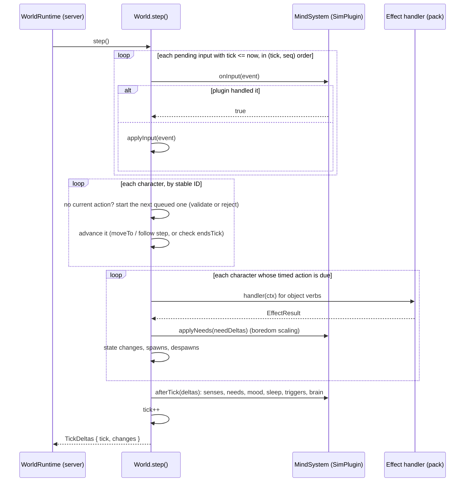
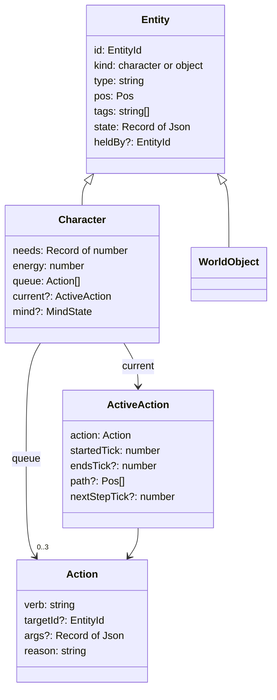
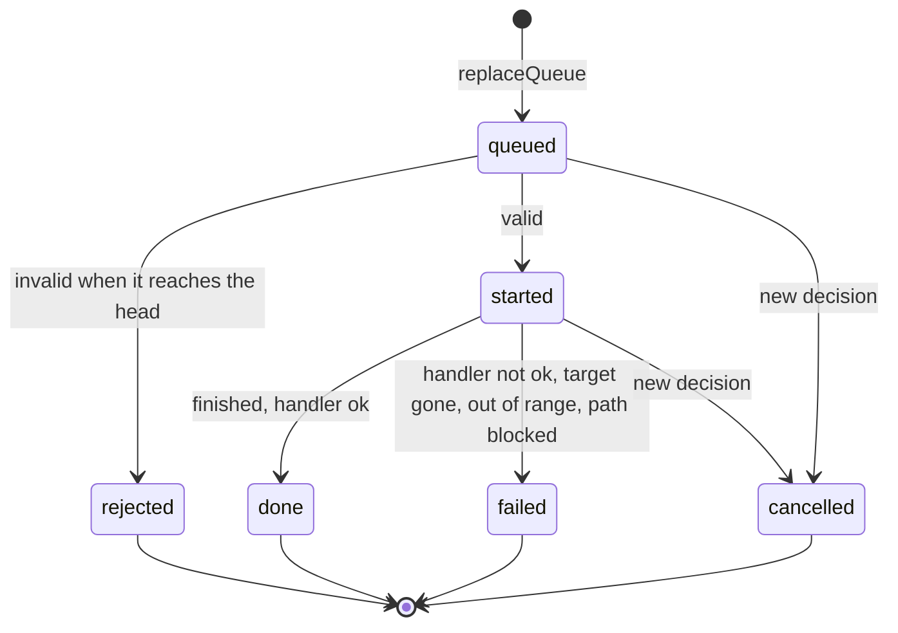

# Simulation

The simulation is a deterministic, fixed-step tile world. Given the same snapshot, the same content pack versions and the same input events, it produces the same state, byte for byte.

Code: [`packages/sim/src/world.ts`](../../packages/sim/src/world.ts), [`packages/sim/src/path.ts`](../../packages/sim/src/path.ts), and the shared types in [`packages/core/src`](../../packages/core/src).

## World state

`WorldState` ([`world.ts`](../../packages/sim/src/world.ts)) is plain JSON, so a snapshot is a `structuredClone` of it and its hash is `hashJson` over canonical (sorted-key) JSON ([`json.ts`](../../packages/core/src/json.ts)).

| Field | Meaning |
| --- | --- |
| `config` | `worldId`, `seed`, `grid`, `secondsPerTick`, `dayLengthSeconds`, `startSecond`, `moveTicksPerTile` |
| `packVersions` | e.g. `basic@0.1.0#<hash>`; must match the loaded registry and every input event |
| `tick` | The tick the next `step()` will process |
| `nextId`, `mapVersion` | ID counter for spawned entities; walkability version that keys the path cache |
| `rng` | State of every named PRNG stream |
| `entities` | All characters and objects, by ID |
| `ext` | Plugin-owned state, e.g. `ext.mind` (the `MindConfig`) and `ext.modelsBusy` |

The shapes as a frontend sees them are in [viewer-integration.md](../viewer-integration.md#worldstate-the-snapshot).

## Tick loop

`World.step()` runs one tick in this order:



The spec lists "update needs, run senses, emit triggers" as separate tick phases. In the code they all happen inside the mind's `afterTick` hook, in the order described in [mind.md](mind.md#per-tick-order).

Inputs the sim handles itself (when the plugin does not): `model.answer` for job `decide` with an `{ actions }` answer (replaces the queue), `admin.spawn`, `admin.edit`, `admin.despawn`, and `visitor.command`. `admin.poke` is rejected without a mind; `models.load` is ignored. Anything else emits an `inputRejected` delta.

## Determinism rules

| Rule | Where |
| --- | --- |
| No `Date.now()`, `new Date()`, `Math.random()`, `performance.now()`, `process.*`, timers, `fetch`, dynamic `import()` or I/O module imports in `packages/sim/src` or `packages/mind/src`. | Enforced by [`determinism-rules.test.ts`](../../packages/sim/test/determinism-rules.test.ts) (a test, not a lint rule). |
| One seed per world, split into named xoshiro128** streams so adding a consumer never shifts another stream. Streams in use: `effects` (handlers), `autopilot` (exploration, noise candidates), `visitors` (visitor-queue pick). | [`rng.ts`](../../packages/core/src/rng.ts) |
| Entities are iterated in sorted ID order. | `World.entities()` |
| Inputs are applied in `(tick, seq)` order; an input for a past tick or another pack version throws. | `World.enqueue()` |
| Model answers, admin edits, visitor commands and the model-load signal enter only as input events. | [events-and-replay.md](events-and-replay.md) |
| Pathfinding breaks ties on `(f, h, insertion order)` with a fixed neighbour order N, E, S, W. | [`path.ts`](../../packages/sim/src/path.ts), [`grid.ts`](../../packages/core/src/grid.ts) |

Tests: [`world.test.ts`](../../packages/sim/test/world.test.ts) (snapshot round trip), [`m1-scripted.test.ts`](../../packages/pack-basic/test/m1-scripted.test.ts) (identical hashes across two runs), [`m2-replay.test.ts`](../../packages/store/test/m2-replay.test.ts) (10,000-tick replay).

## Grid and space

- Row-major tile grid; each tile is a key into a terrain table with `walkable`, `blocksSight` and `soundDamping` ([`grid.ts`](../../packages/core/src/grid.ts)).
- Each entity occupies one tile. Objects marked `solid` block movement onto their tile; `isWalkable` checks terrain and solid, unheld objects.
- There is no spatial hash: `entitiesAt` scans entities in ID order. That is fine at the current scale (a handful of entities).

## Entities



Source: [`entities.ts`](../../packages/core/src/entities.ts). Characters spawn with every need and energy at `START_LEVEL` (0.75). An archetype type spawns a character; an object type spawns an object; anything else is rejected. Visitors are characters with `state.visitor === true` and no `mind`.

## Verbs and effect handlers

Objects declare verbs in pack JSON (`range`, `durationTicks`, `handler`, optional `params` and `boredomStep`). A verb points at a named TypeScript handler, registered as `pack.name` ([`pack.ts`](../../packages/core/src/pack.ts)).

```ts
type EffectHandler = (ctx: EffectContext) => EffectResult;
// ctx: actor, target, world (read-only WorldView), rng (the 'effects' stream), params (verb params merged with action args)
// result: ok, reason?, needDeltas?, stateChanges?, spawn?, despawn?, observation
```

Source: [`effects.ts`](../../packages/core/src/effects.ts). The actor's mind receives `observation` (and `reason` on failure), never `needDeltas`. Need deltas pass through the mind's `applyNeeds` hook, which applies boredom scaling; without a mind they are added as-is.

### Built-in verbs

Available to every character, no target object needed ([`world.ts`](../../packages/sim/src/world.ts)):

| Verb | Behaviour |
| --- | --- |
| `moveTo` | To `targetId` (stops on a non-solid object's tile, or next to a solid object or character) or to `args.x, args.y`. One tile every `moveTicksPerTile`. Replans if the next tile becomes blocked; fails with `path blocked` if it can't. |
| `follow` | Steps toward a target for `args.ticks` (default 100, max 3,000); fails if the target disappears. |
| `vocalize` | `args.notes`: 1 to `maxChain` notes from the archetype's noise set, e.g. `["beep-C", "chirp-E"]`. Emits a `vocalize` delta and a sound at start; lasts 2 ticks per note. |
| `wait` | `args.ticks` (default 10). |
| `rest` | `args.ticks` (default 100). The mind treats `rest` (and the dock's `rest` verb) as resting. |

### Action queue and statuses

Each character has a queue of at most 3 actions (`MAX_QUEUE`). A new decision replaces the queue and cancels the running action. The head action is validated when it starts: unknown target, unknown verb, out of range, bad notes or no path reject it, and the next one starts in the same tick.



Every transition emits an `action` delta. Range is Manhattan distance, checked at start and again when the handler runs; an object the actor holds is always in range.

## Pathfinding

4-connected A* with a binary heap and deterministic tie-breaks ([`path.ts`](../../packages/sim/src/path.ts)). A goal is a target tile plus a radius (stop within that Manhattan distance). The search gives up after 10,000 nodes. Results are cached per `(mapVersion, from, target, radius)`, up to 2,000 entries, after which the cache is cleared. `mapVersion` goes up whenever a solid object spawns, moves or despawns.

## Day and night

In-world time is `startSecond + tick × secondsPerTick`. The day number is that divided by `dayLengthSeconds`; `timeOfDay` is the fraction through the day (0 = midnight). It is daylight from 06:00 to 18:00 (`timeOfDay` in [0.25, 0.75)).

Day and night affect:

- the solar pad, which only charges in daylight ([content-packs.md](../content-packs.md));
- sight range, halved at night;
- the mind: standby, mood arousal, beliefs keyed by `@day` or `@night`, and reflection ([mind.md](mind.md)).

The runtime takes a snapshot at every in-world day boundary ([events-and-replay.md](events-and-replay.md#snapshots)).

## Clock and pacing

- `World` has no notion of real time. The world worker decides when to call `step()` ([`worker.ts`](../../packages/server/src/worker.ts)).
- The world config sets `ticksPerRealSecond` (default 5) and `timeScale` (default 1). The worker steps every `1000 / (ticksPerRealSecond × timeScale)` ms, runs at most 4 catch-up ticks per turn, and resets its schedule if it falls more than a second behind. `timeScale: 0` or `paused` stops the clock. See [`config.ts`](../../packages/server/src/config.ts).
- In-world speed is `secondsPerTick × ticksPerRealSecond × timeScale` in-world seconds per real second, reported as `inWorldSecondsPerRealSecond` in the world status. In [`worlds/garden.yaml`](../../worlds/garden.yaml) it is 2 × 5 × 1 = 10× real time (`UAS_SECONDS_PER_TICK`), so an in-world day takes 2.4 real hours. That was chosen from measured CPU-only Tev1 latency (5–20 s per decision on the dev laptop), so a decision spans 1–3 in-world minutes. Raise `timeScale` to watch faster; model answers then arrive later in in-world time.
- **Watched and idle pacing.** `ticksPerRealSecond` applies while a viewer is subscribed over WebSocket. When nobody is, the worker drops to `idleTicksPerRealSecond` (default 0.75, so 1.5× real time at 2 s per tick), and fewer ticks means fewer model calls. The hub tells the worker through `clock { watched }`. The status reports `watched` and `effectiveTicksPerRealSecond`.
- The sim's own default (`DEFAULT_CONFIG`) is 6 in-world seconds per tick if a world config doesn't set one.
