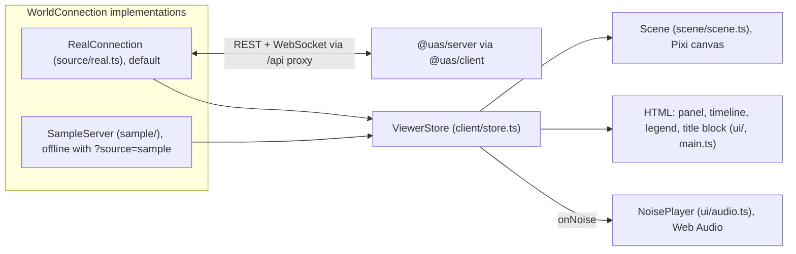

# Viewer

`apps/viewer` is a browser app that draws a world as a top-down construction blueprint. The world scene is drawn with Pixi.js (WebGL); every control is plain HTML. It is built for the owner first and has to work on phones as well as desktop.

- Product intent and principles: [PRODUCT.md](../../PRODUCT.md).
- Visual design system (colour tokens, type, symbols, components): [DESIGN.md](../../DESIGN.md).
- Wire shapes it consumes: [viewer-integration.md](../viewer-integration.md).

Code: [`apps/viewer/src`](../../apps/viewer/src). Build: Vite ([`vite.config.ts`](../../apps/viewer/vite.config.ts)), TypeScript, fonts from `@fontsource` (Overpass for drafting labels, Atkinson Hyperlegible Next for body text).

## Data sources

- **Real server (default).** [`source/real.ts`](../../apps/viewer/src/source/real.ts) (`RealConnection`) uses `UasClient` and `WorldStream` from `@uas/client`. On connect it loads, in order: the world list (first world unless `?world=`), `GET /worlds/:id/catalog`, the last 500 feed entries (`GET /worlds/:id/feed`), and the ticks where beliefs changed (`GET /worlds/:id/deltas?kinds=beliefs`). It then opens the WebSocket and subscribes to `deltas` and `feed` (vocalize deltas arrive inside `deltas`, so the `noises` channel isn't needed). It polls `GET /worlds/:id` every 5 s for today's spend, pause state and time scale.
- **View model.** [`client/view.ts`](../../apps/viewer/src/client/view.ts) turns the snapshot `state` (typed as `WorldStateView` in `@uas/client`) and each tick's `Delta[]` into the viewer's view model ([`types.ts`](../../apps/viewer/src/types.ts)). From the backend, not viewer code:
  - the map: grid tiles and terrain keys (`#` wall, `~` water, `*` rock, `:` path, `.` floor; unknown keys fall back to `walkable` / `blocksSight`);
  - entities, robot names (`state.name`, else the id), positions, needs, battery, mood, sleep, current action and beliefs;
  - object labels (derived from the pack type, e.g. `solarPad` → "Solar pad") and verb lists;
  - the gauge list and low marks (the archetype's needs with their `low` and `critical` levels; battery at the world's `energyFloor`);
  - sight and hearing ranges, noise pitches and synth settings (archetype `noises`), the daily AUD cap and the in-world clock (`secondsPerTick`, `dayLengthSeconds`, `startSecond`).
- **States.** Live, replay (a server replay session: `replay.open`, then `seek`, `play` with speed, `pause`; *Go live* sends `replay.close` and resubscribes for a fresh live snapshot), connecting, disconnected (socket closed or server unreachable, with a Reconnect button), and an empty world. Red-pen alerts come from levels (battery under the energy floor, a need under its `critical` level) and from `action` deltas with status `rejected` or `failed`. Fallback rows are the feed's own `fallback` entries, with their `reason`. A selected robot's beliefs are fetched from `GET /worlds/:id/characters/:cid/memories`, refreshed when a `beliefs` delta arrives (replay shows the replayed snapshot's beliefs).
- **Clock and pacing.** In-world time is `baseSeconds + (tick − baseTick) × secondsPerTick` from the snapshot's `state.clock`, re-based on every `clock` delta (anchor, restart, resume, realign, sync). In a real-time world (`WorldStatus.clockMode === 'realtime'`) those seconds are local wall-clock time, read with UTC getters, and the title block shows the local date with the time. The server only sends ticks that changed something, so between deltas the viewer advances its shown tick at `WorldStatus.effectiveTicksPerRealSecond` (falling back to the configured rate × time scale) and corrects it on every real delta and status poll.
- **Movement.** Each whole-tile `moved` step glides linearly over `moveTicksPerTile ÷ effective ticks per real second` (2 s in the real-time garden); a carried object rides with its carrier. Reduced motion jumps instead.
- **Days.** Sheet numbers and the timeline's day labels count from the world's first in-world day (sheet 1).
- **Connection settings.** REST base `VITE_UAS_API` (default `/api`). In dev and preview, Vite proxies `/api/*` and the WebSocket at `/api/ws` to `VITE_UAS_SERVER` (default `http://localhost:8080`) ([`vite.config.ts`](../../apps/viewer/vite.config.ts)). URL switches: `?world=<id>` and `?key=<api key>` (spectator access needs no key on a `publicRead` world).
- **Offline sample.** `?source=sample` uses `SampleServer` ([`sample/server.ts`](../../apps/viewer/src/sample/server.ts)), which pre-simulates a few in-world days in the browser with its own stand-in sim ([`sample/sim.ts`](../../apps/viewer/src/sample/sim.ts)) and speaks the real protocol: a `WorldStateView` snapshot, real `Delta`s and `FeedEntry`s, and a catalog shaped like `GET /worlds/:id/catalog`. It is not the real brain: tiers, models, costs and learning are faked with simple rules and a seeded RNG. The gesture checks and the `SET=sample` screenshots use it because it is deterministic. The top bar and title block say "Simulated" only for this source.
- **Revision numbers** in the brain feed are positions in the feed the viewer has loaded (the last 500 entries plus the live feed), so they are stable within a session but not across reloads. To keep memory bounded the source and the store keep at most about 2,000 entries; the source counts what it dropped (`feedTrimmed()`) so numbers don't shift. The real server writes no feed row for a standby reflection, so belief markers on the timeline link to a feed row only when one exists at that tick.

Both sources implement one interface, `WorldConnection` ([`types.ts`](../../apps/viewer/src/types.ts)), so the rest of the viewer has one code path. If the server can't be reached, the sheet says so and points to `npm start` or `?source=sample`.



## Structure

| Area | Files | Responsibility |
| --- | --- | --- |
| App shell | [`main.ts`](../../apps/viewer/src/main.ts), [`styles.css`](../../apps/viewer/src/styles.css), [`index.html`](../../apps/viewer/index.html) | Builds the page (top bar, sheet, inspector), wires the store to the scene, panel, timeline and audio, handles the phone drawer and URL review switches |
| State | [`client/store.ts`](../../apps/viewer/src/client/store.ts) | `ViewerStore`: the current snapshot kept up to date by deltas, the brain feed, selection, live or replay mode, play speed, highlighted feed row. Notifies listeners at most once per animation frame. |
| Scene (diegetic) | [`scene/scene.ts`](../../apps/viewer/src/scene/scene.ts), [`scene/palette.ts`](../../apps/viewer/src/scene/palette.ts) | Everything drawn on the plan: paper and grid, terrain, fixtures, robots, movement trails, callouts with gauges, sight and hearing circles, sound arcs, red-pen alerts, dimensions, north arrow. The canvas is `aria-hidden`. |
| Controls (HTML) | [`ui/panel.ts`](../../apps/viewer/src/ui/panel.ts), [`ui/feed.ts`](../../apps/viewer/src/ui/feed.ts), [`ui/timeline.ts`](../../apps/viewer/src/ui/timeline.ts), [`ui/legend.ts`](../../apps/viewer/src/ui/legend.ts), [`ui/icons.ts`](../../apps/viewer/src/ui/icons.ts), [`ui/format.ts`](../../apps/viewer/src/ui/format.ts) | Inspector (overview, or a robot's needs, alerts, brain feed and beliefs tabs), the scale-bar timeline (range input, play or pause, speed, go live, belief markers), the symbol legend, title block |
| Visitors | [`client/visitors.ts`](../../apps/viewer/src/client/visitors.ts), [`source/visitors.ts`](../../apps/viewer/src/source/visitors.ts), [`ui/visitors.ts`](../../apps/viewer/src/ui/visitors.ts), [`ui/catalogue.ts`](../../apps/viewer/src/ui/catalogue.ts), [`icons/`](../../apps/viewer/src/icons) | Airdropped items, the mailbox and the admin catalogue page; the item icon language rendered to Pixi and SVG |
| Audio | [`ui/audio.ts`](../../apps/viewer/src/ui/audio.ts) | Synthesised noise playback |
| Review tooling | [`scripts/screenshots.mjs`](../../apps/viewer/scripts/screenshots.mjs), [`scripts/interaction-check.mjs`](../../apps/viewer/scripts/interaction-check.mjs) | Playwright screenshots (`SET=real` against the server, default; `SET=sample` offline, including the visitor and catalogue shots) and camera and selection checks (on the sample) against `npm run dev` |

The split follows a rule from the spec and DESIGN.md: information about the world is drawn **inside** the blueprint (callouts, tables, markup), while controls are ordinary HTML so they are accessible.

URL switches: `?source=sample`, `?world=<id>`, `?key=<api key>`; for reviewing states `?select=<id>`, `&drawer=closed|peek|full`, `&at=<tick>`, `&legend=0|1`, `&view=cx,cy,zoom`, `&tab=beliefs`; visitor views `&open=airdrop|mail|drop:<dropId>`; the catalogue page `?page=catalogue[&item=<id>]`; sample only: `&scenario=empty|lowbattery`, `&state=disconnected`, `&as=admin|visitor|spectator`.

## Accounts and world settings

- **Sign in.** The top bar shows *Sign in with Vercel* only when `GET /auth/me` reports `loginAvailable`; it sends the browser to `/api/auth/login?returnTo=<path>`. Signed in, it shows the avatar (or initials), name and role with *Sign out* (`POST /auth/logout`); on phones only the avatar shows there and sign-out moves into the settings tab. A failed sign-in comes back with `?authError=` and is shown next to the button. An `?key=` API key is still sent on every request ([`source/account.ts`](../../apps/viewer/src/source/account.ts)).
- **World settings.** A *World settings* tab beside *Brain feed* in the inspector (and the phone drawer), drawn as a spec table from the server's schema ([`ui/settings.ts`](../../apps/viewer/src/ui/settings.ts)): number inputs with units, or switches, each with its help text. Changes apply on commit (leaving the field or Enter), the table then shows the server's confirmed values and its `effects` summary, and validation errors (400 `{ error }`) show inline under the field. The derived line reads like "≈ 0.40% battery per decision · ~250 decisions per full battery · A$0.15 of A$2.00 today".
- **Who sees what.** Admins edit. Spectators and visitors see the same table read-only, because the energy rate and the daily cap explain how the robots behave (PRODUCT.md: cost is visible).
- **Sample.** `?source=sample` mocks the contract ([`sample/account.ts`](../../apps/viewer/src/sample/account.ts)); `?as=admin|visitor|spectator` picks the role and `?login=0` hides sign-in.

## Thinking budget and sleep (iteration 2, Stage 1)

- **Battery as thinking budget.** The battery gauge reads "Battery · thinking". Hover or keyboard focus (tap on a phone) shows what is left in money: "≈ A$0.13 of thinking left · a full battery is A$0.20", from the catalogue's `energyPerAud`; the same text is in the gauge's `aria-valuetext`.
- **Sleep pressure and fog** (`mind.sleepPressure`, `mind.fog` in the snapshot; `pressure` deltas) show as two more gauges, *Sleep* and *Fog*, in the inspector and as SLEEP and FOG rows in the map callout. They read worse as they rise: the mark sits at the high threshold and the row turns Red Pen above it.
- **Sleep work** (`mind.sleepWork`, `sleepWork` deltas): while asleep the inspector's action reads "Asleep" and lists the night's steps in order (settling memories with a count, finding habits, rewriting the character sheet, reviewing the day when the `refine` step runs, resting), the current one filled; the callout's last row reads e.g. "ASLEEP · MEMORIES 24/72".
- **Thinking depth.** A feed entry's `depth` (habit, gut, think it through) labels its tier mark (Habit, Gut, Think) and leads the detail box ("Gut: a quick call to the decision model"), with `depthWhy` when given; the model tier stays in the box.
- The sample source stands in for all of this (display only; its rules are unchanged): pressure grows with time awake and decisions since waking, the first in-world hour of sleep walks through the steps, and depth follows the tier.

## Brain feed

[`ui/feed.ts`](../../apps/viewer/src/ui/feed.ts) (`FeedView`) draws the feed as a revision list, used for all robots in the overview and for one robot in its view.

- **Entry hierarchy.** First what was decided, in plain words: the steps of a plan joined by arrows ("Pick up ball → push ball → drop ball"), with the robot's tag in the all-robots list and a noise chain as a dashed note tag. Then the reason, quoted, in smaller Secondary Ink. Then one muted meta line: the revision button (△ number, links to the cloud on the plan and the timeline), the in-world time, the tier mark and the cost (A$ and battery, or "free"), plus "after a refusal" when the decision was triggered by a refused step.
- **Problems.** A refused or failed step is lettered in Red Pen with its status, and a line under it gives the world's reason ("Refused: pick up ball · someone is already holding it"). Reasons come from the step's `result` (the server rewrites the stored row and sends `feedStep` messages as steps resolve; the store applies them in place), else from `action` deltas seen this session (`ViewerStore.stepOutcomes`). When neither is known but the robot's next decision was triggered by a refusal, the entry says "Refused: a step didn't go through, so the robot decided again." Fallbacks show their `reason`. Rows with a problem sit on Red Wash. A superseded step is muted and marked *replaced*; *done* and *queued* aren't marked.
- **Runs.** Consecutive identical decisions (same robot, same steps and targets, same notes, and both fine or both with a problem; reasons may differ; an entry hidden by the filter breaks a run) collapse into one row: "Wait ×136 · 13:35–15:35 · total A$0.00547", with *Show all* (`aria-expanded`) listing each entry with its own revision button. A run that keeps restarting after refusals is called out: "Stuck: the same decision 79 times in a row, each one after the last attempt was refused."
- **Grouping.** Rows are grouped by in-world hour under sticky headings ("Day 1 · 15:00–16:00 · 9 decisions").
- **Tier detail.** The tier mark (bars plus a short label: Auto, Plan, Local, Scorer, LLM, Fallback, or Mixed for a run of several tiers) is a borderless button. Hover or keyboard focus shows a detail box (`aria-describedby` while open), and click, tap or Enter pins it and moves focus into it; Escape or a tap outside closes it and returns focus. A target-less *go to* in a plan is named after the next step's target ("Go to piano → play piano"). It is a Popover API element in the top layer, so the inspector's scroll box never clips it. It lists the tier and what it means, the model (with the real model and provider from the catalogue's `models`), confidence ("Plan, no score" for text models, which report none), latency, input, cached and output tokens, A$ and battery cost, the trigger, an escalation if any, and each plan step with its reason.
- **Filters.** All · Model calls (decision, local, llm) · Autopilot (autopilot, carry-on, fallback) · Problems (refused or failed steps, decisions made after a refusal, fallbacks), as toggle buttons.
- **Paging.** Newest first, 25 rows a page, *Load older* adds a page. When the loaded feed runs out it pages back through the server with `GET /worlds/:id/feed?beforeTick=&limit=` (`WorldConnection.feedBefore`), asking from the oldest tick held (inclusive, deduplicated, since several robots can decide in one tick). A server that ignores the cursor answers with its newest entries, which the source detects and reports as "no more". Paging stops at 500 rows, with a note to scrub the timeline for earlier history.
- **Live while reading.** In live mode, once the reader scrolls the list away from its top, the newest edge freezes and new entries wait behind an "N new decisions · show" button at the top of the scroll box; it (or scrolling back up) shows them.

## Visitors: airdrops, the mailbox and the catalogue

See [visitors.md](visitors.md) for the model; this is how the viewer shows it.

- **Data.** `VisitorStore` ([`client/visitors.ts`](../../apps/viewer/src/client/visitors.ts)) holds the world's airdrops, the mail view and the catalogue, fetched over REST ([`source/visitors.ts`](../../apps/viewer/src/source/visitors.ts): `/catalog…`, `/worlds/:id/airdrops…`, `/worlds/:id/mail…`). It polls every 10 s and refreshes (debounced) whenever a delta of kind `airdrop`, `mailbox` or `mail` arrives (`ViewerStore.onVisitorDelta`). Refusals become a `VisitorError` with the status, the server's message or `errors[]`, and any Retry-After; a 404 reads "not available on this server yet". The sample source mocks the whole contract ([`sample/visitors.ts`](../../apps/viewer/src/sample/visitors.ts)) with the same validator and limits (cooldowns, three items per visitor), and adds a mailbox fixture to its snapshots.
- **Icon language.** Items carry an icon in the restricted language; [`icons/iconlang.ts`](../../apps/viewer/src/icons/iconlang.ts) parses it with the shared `parseIcon` from `@uas/core` and adds the geometry (outlines, arcs, diagonal hatching clipped to closed shapes, like the pond). [`icons/render.ts`](../../apps/viewer/src/icons/render.ts) draws it in Pixi (`drawIcon`) and as inline SVG (`iconSvg`, `currentColor`). Weights map to the DESIGN.md strokes in screen pixels at every size; an invalid icon draws as a dashed placeholder square.
- **On the plan.** Each drop is its icon in a dashed ring with a ▼ drop mark; a solid arc on the ring is the share of its life left. The name label shows when zoomed in, hovered or focused, placed where it doesn't collide. Drops are hit-tested like robots and open the item card. The mailbox is a post box whose flag rises while mail waits, with a circled count callout; clicking it opens the mailbox. While placing an airdrop the hovered or chosen tile is outlined in the focus colour with a ghost of the icon and "DROP HERE · NAME".
- **Inspector views.** The overview lists drops in an *Item schedule* (keyboard route to every drop). Views open in the inspector, or the full phone drawer, with a back button:
  - *Item card* ([`ui/visitors.ts`](../../apps/viewer/src/ui/visitors.ts)): icon, name, description, who dropped it (admins marked), when and where, expiry, uses left; *What it does* in plain words from the blocks beside *What the robot believes* (each robot's belief and firmness); *View JSON*; admin *Delete item* (two-step).
  - *Airdrop*: a radio list of the items enabled in this world → tap a tile (or pick column and row) → *Drop at P10*. Server refusals show as written ("Airdrop cooldown: 72 s left…", the per-visitor limit). On phones the drawer drops to peek while placing. Spectators get *Sign in to airdrop*.
  - *Mailbox*: how many wait; a composer with a live 280-character counter; *My mail* with each message's status (waiting and its place in line, read with the robot's reaction and its notes, expired, deleted); admins also get *Waiting mail* with *Delete*.
- **Top bar.** *Airdrop* and *Mail* (with the waiting count) on wider screens; on phones they move into the drawer under the robot schedule. Admins get a *Catalogue* link.
- **Catalogue page** ([`ui/catalogue.ts`](../../apps/viewer/src/ui/catalogue.ts), `?page=catalogue`, admins). A drawing register of items (number, icon, name and id, enabled or disabled) and an editor: a JSON textarea with a line-number gutter, validated live by `POST /catalog/validate` (local syntax errors first; each error's path is mapped to its line and marked in the gutter, and listed with a jump link), a live icon preview at 96, 48 and 24 px and an info-card preview, *New item* from the server's templates, *Save*, *Duplicate*, *Disable*/*Enable* and *Delete*. Which items a world may airdrop is the `catalogEnabled` world setting (`string[]`; `*` = every item, including later ones), shown in World settings as a checklist with icons.

## Camera

Implemented in `Scene` ([`scene.ts`](../../apps/viewer/src/scene/scene.ts)) and wired in [`main.ts`](../../apps/viewer/src/main.ts):

- Drag to pan; wheel or pinch to zoom. A click selects only if the pointer didn't move (drag versus click rule, checked by `interaction-check.mjs`).
- Buttons: zoom in, zoom out, fit sheet, follow the selected robot. Panning turns follow off.
- Keyboard, with the plan focused: `+` / `-` zoom, arrow keys pan, `0` fits. `Escape` clears the selection.
- The plan is fitted inside insets so it never sits under the title block, legend, camera buttons or the phone drawer.
- Robots parked together at the dock are drawn in a row in front of the bay and share one leader-lined name tag. Labels cut by the edge of the drawing area are hidden until they are fully in view, and the plan is clipped to the drawing area.
- The title block shows the current scale. Labels that would overprint each other or the selected robot's callout are hidden rather than shrunk; zooming in brings them back.

## Audio synthesis

`NoisePlayer` plays each note chain with Web Audio: one oscillator per note at the note's pitch, shaped by the noise's synth settings (`wave`, `ms`, `sweep`, `vibratoHz`, `octave`, `rough`), with a short gap between notes. Gain falls off with distance from the selected robot, and stereo pan follows the source's x position on the map. Sound is off until the user turns it on, because browsers block autoplay.

Pitches and synth settings are not hard-coded: `NoisePlayer.configure` loads them from the first archetype with `noises` in the world's catalog (`GET /worlds/:id/catalog`), as [viewer-integration.md](../viewer-integration.md#noise-playback) asks. Only the output level per waveform is the viewer's own ([`audio.ts`](../../apps/viewer/src/ui/audio.ts)). Noises with a recorded `sound` instead of a `synth` are skipped.

## Accessibility

- WCAG 2.2 AA is the target ([PRODUCT.md](../../PRODUCT.md#accessibility--inclusion)). Palette comments in [`palette.ts`](../../apps/viewer/src/scene/palette.ts) record contrast against the sheet colour.
- Skip link to the inspector; the plan region has a screen-reader description of where each robot is, and keyboard instructions.
- The inspector uses real tabs (`role="tab"`, arrow-key navigation) and an `aria-live` alerts list; the timeline is a real range input.
- Every noise is drawn on the plan as sound arcs labelled with its notes, so sound is never the only channel.
- `prefers-reduced-motion` stops camera easing, smoothed robot movement and animated sound arcs (the arcs are drawn static), in both the scene and the CSS.
- On narrow screens (below 720 px) the inspector becomes a three-position pull-up drawer and the timeline moves into it.

## Running it

```sh
npm run dev                              # server on :8080 (local Ollama models) and the viewer on :5173 together; dev:fake for offline
npm run dev --workspace=@uas/viewer      # viewer only (Vite on :5173), proxying /api to VITE_UAS_SERVER
npm run build --workspace=@uas/viewer    # tsc + vite build into apps/viewer/dist
```

Open `http://localhost:5173/` for the server's first world, or add `?source=sample` to run without a server. The production image does not include the viewer yet. More in [operations.md](../operations.md#running-locally).
