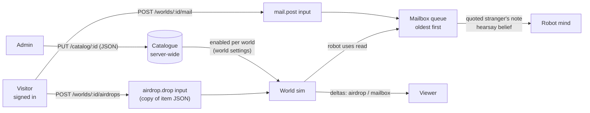

# Visitors: airdrops and the mailbox

Status: **being built** (contract agreed 17 Nov 2026). Design source: the spec's "Visitors: airdrops and the mailbox" section and decisions 39–41. Visitors are never characters; the old visitor characters, `visitor.command` and the per-character visitor queue are removed.



## Roles

- Spectator (no session): read the catalogue, items in the world and their info, the mailbox count.
- Visitor (signed in with Vercel, or a `visitor` API key): drop items and post mail, subject to the world's limits; see their own mail.
- Admin: everything, no limits, edit the catalogue, delete items and mail, see waiting mail.

## Catalogue item JSON (schema 1, provisional)

```json
{
  "schema": 1,
  "id": "battery-snack",
  "name": "Battery snack",
  "description": "A small cell. Gives a little charge.",
  "icon": "<icon><rect x=\"7\" y=\"4\" w=\"10\" h=\"16\" shade=\"light\"/><line x1=\"10\" y1=\"2\" x2=\"14\" y2=\"2\" weight=\"heavy\"/></icon>",
  "tags": ["metal", "small"],
  "portable": true,
  "expiresAfter": "24h",
  "behaviours": [
    { "block": "affectsNeeds", "verb": "eat", "range": 0, "durationSeconds": 5, "needs": { "energy": 0.1 }, "observation": "a tingle of charge" },
    { "block": "consumable", "uses": 1 }
  ]
}
```

- `id`: kebab-case, unique. `expiresAfter`: duration string (`30m`, `24h`, `7d`), optional (world default applies).
- Blocks (v1): `affectsNeeds { verb, range?, durationSeconds?, needs, observation }`, `portable {}` (adds pickup/drop), `consumable { uses }` (counts uses of any verb; removes the item at 0), `makesNoise { verb, range?, notes: string[] (≤4, e.g. "beep-C") , observation? }`, `inert {}`.
- Need keys must exist on the world's archetypes (`energy` plus archetype needs); deltas are clamped to −1..1.
- Unknown fields or blocks are rejected with a path-specific error.

### Icon language

`<icon>` root, 24×24 user units, children only from: `line (x1,y1,x2,y2)`, `polyline (points)`, `rect (x,y,w,h, r?)`, `circle (cx,cy,r)`, `ellipse (cx,cy,rx,ry)`, `path (d: M, L, H, V, A, Z only)`. Shared attributes: `shade` = `none|light|medium|dense` (diagonal hatching), `weight` = `thin|regular|heavy`, `dashed` = `true|false`. Nothing else: no colours, styles, text, images, scripts or other attributes. Coordinates 0–24. Max 32 shapes. Parsing is a whitelist parser shared by server (validation) and viewer (render), in `@uas/core`.

## REST

| Method and path | Role | Body → returns |
| --- | --- | --- |
| `GET /catalog` | spectator | `CatalogItem[]` (admins also get disabled items and `updatedAt`, `updatedBy`) |
| `GET /catalog/templates` | admin | `{ name, item }[]` starter items (snack, toy, noise-maker, inert) |
| `POST /catalog/validate` | admin | `{ item }` → `{ ok: true, item }` or `{ ok: false, errors: [{ path, message }] }` |
| `PUT /catalog/:itemId` | admin | `{ item, disabled? }` → saved item; 400 with `errors[]` |
| `DELETE /catalog/:itemId` | admin | removes it (drops already in worlds are unaffected) |
| `GET /worlds/:id/airdrops` | spectator | `Airdrop[]` currently in the world |
| `GET /worlds/:id/airdrops/:dropId` | spectator | `Airdrop` plus `beliefs: { characterId, text, firmness }[]` about it |
| `POST /worlds/:id/airdrops` | visitor | `{ itemId, pos }` → `Airdrop`; 400/403/409/429 `{ error }` |
| `DELETE /worlds/:id/airdrops/:dropId` | admin | removes it |
| `GET /worlds/:id/mail` | spectator | `{ waiting: number, mine?: MailStatus[], all?: MailStatus[] (admin) }` |
| `POST /worlds/:id/mail` | visitor | `{ text }` → `MailStatus`; 400 (length, filter) / 429 `{ error }` |
| `DELETE /worlds/:id/mail/:mailId` | admin | removes a waiting message |

World settings (existing `GET/PATCH /worlds/:id/settings`) gain: `catalogEnabled: string[]` (item ids), `airdropMaxActivePerVisitor`, `airdropCooldownSeconds`, `airdropWorldCap`, `airdropDefaultExpiry`, `mailCapacity`, `mailExpirySeconds`, `mailMaxWaitingPerVisitor`, `mailCooldownSeconds`. Defaults are effectively unlimited (e.g. 1,000,000 or 0 s cooldown).

```ts
interface Airdrop {
  id: string; entityId: string; itemId: string; item: CatalogItem; // copy at drop time
  pos: { x: number; y: number }; droppedBy: { username: string; admin: boolean };
  droppedTick: number; expiresTick?: number; usesLeft?: number;
}
interface MailStatus {
  id: string; status: 'waiting' | 'read' | 'expired' | 'deleted'; position?: number; // 1 = next
  text?: string;               // sender and admins always; everyone once read
  from: { username: string; admin: boolean };
  postedTick: number; readTick?: number;
  reaction?: { feedTick: number; summary: string; notes?: string[] }; // what the robot did right after
}
```

## Sim and events

- Inputs: `airdrop.drop { dropId, item, pos, by }`, `airdrop.remove { dropId, reason }`, `mail.post { mailId, text, by }`, `mail.remove { mailId }`. Expiry and consumption happen inside the sim, deterministically.
- A dropped item is an ordinary object entity (`type: "airdrop"`, `state.itemId`, `state.dropId`, `tags` from the item); its verbs come from its blocks via generic `airdrop.*` handlers in the basic pack.
- `mailbox` is a basic-pack object with `read` (and `scan`); `state.waiting` drives the flag. `read` returns the oldest message as an observation like `a note from a stranger: "…"`; the mind stores it quoted and marks any belief from it as hearsay (low firmness, `source: "told"`).
- Deltas the viewer uses: `airdrop` (added, removed, used), `mailbox` (`waiting` count), plus the usual `entity` changes.
