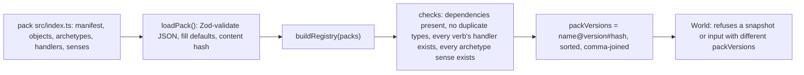

# Content packs

Objects, verbs, effect handlers, senses, archetypes and maps ship as content packs: JSON validated with Zod, plus TypeScript handlers and senses. The world never hard-codes what an object does.

Code: schemas and loader in [`packages/core/src/pack.ts`](../packages/core/src/pack.ts); the server's pack catalog in [`packages/server/src/catalog.ts`](../packages/server/src/catalog.ts); the first pack in [`packages/pack-basic`](../packages/pack-basic).

## Pack layout

```text
packages/pack-basic/
  pack.json            name, semver version, licence, dependencies
  objects/*.json       one object type per file
  archetypes/*.json    one character archetype per file
  handlers/*.ts        effect handlers (EffectHandler)
  senses/*.ts          senses (Sense)
  maps/*.json          tile maps (legend + rows)
  src/index.ts         basicPack() and gardenGrid(): imports the JSON and code and calls loadPack()
```

There is no `sounds/` folder: robot noises are synthesised, so the basic pack has no audio files.

## Loading



- Handlers are registered as `pack.handler` (e.g. `basic.charge`); a verb names its handler that way.
- The content hash covers the validated JSON plus the **names** of handlers and senses, not their source. Changing a handler's behaviour therefore needs a version bump, or replays could silently differ.
- Packs are registered in code in [`catalog.ts`](../packages/server/src/catalog.ts) (`PACKS`). A world config lists pack names and a map as `pack:map`. There is no hot reload and no runtime install (`POST /packs` returns 501).
- `GET /packs` lists loadable packs; `GET /worlds/:id/catalog` gives a frontend the display data (verbs, needs, noises, ranges). See [server-and-api.md](architecture/server-and-api.md#rest-endpoints).

### Schemas

| Schema | Fields |
| --- | --- |
| `PackManifestSchema` | `name`, `version` (semver), `licence`, `dependencies` |
| `ObjectDefSchema` | `type`, `tags`, `portable` (not enforced by the sim yet), `solid` (blocks movement), `verbs`, `state` |
| `VerbDefSchema` | `range` (Manhattan, 0 = same tile), `durationTicks`, `handler`, `params`, `boredomStep` |
| `ArchetypeDefSchema` | `type`, `tags`, `needs`, `energy { label, idleDrainPerHour }`, `noises`, `sightRange` (6), `hearingRange` (8), `senses`, `mind` tuning, `sheet` lines (`text`, `locked`) |
| `NoisesSchema` | `pitches` (note letter to Hz), `set` (noise name to `{ synth }` or `{ sound }`), `maxChain` |

Need fields: `decayPerHour`, `activeDecayMultiplier`, `low`, `critical`, `restRecoveryPerHour`, `nearbyRecoveryPerHour`. Mind tuning defaults are in [mind.md](architecture/mind.md#configuration).

## The basic pack (robots)

[`pack.json`](../packages/pack-basic/pack.json): `basic@0.1.0`, licence "MIT (code), CC BY 4.0 (media)".

### The robot archetype

[`archetypes/robot.json`](../packages/pack-basic/archetypes/robot.json):

| Need | Decay per hour | Other |
| --- | --- | --- |
| `cool` | 0.04, × 2.5 while active | low 0.25, critical 0.1, recovers 0.15/h while resting |
| `signal` | 0.03 | low 0.3, recovers 0.2/h with another character in sight |
| `curiosity` | 0.05 | low 0.3; the need boredom works on hardest |
| energy, labelled `battery` | 0.02 idle drain | also spent on every model call |

Sight 6 tiles, hearing 8 tiles. Mind tuning overrides: `wakeThreshold` 0.5, `boredomStep` 0.15, `boredomHalfLifeHours` 2, `boredomThreshold` 0.6, `curiosityWeight` 0.3. Sheet: "I am a small robot who lives in a garden." (locked) and "I like finding out what things do."

### Noises

| Noise | Synth |
| --- | --- |
| `beep` | sine, 120 ms |
| `chirp` | triangle, 160 ms, sweep × 1.5 (upward glide) |
| `trill` | square, 300 ms, vibrato 18 Hz |
| `buzz` | sawtooth, 250 ms, one octave down, roughness 0.4 |

Pitches: C 523.25 Hz, D 587.33 Hz, E 659.25 Hz, G 783.99 Hz. A note is `noise-pitch` (e.g. `chirp-E`), so there are 16 notes. `maxChain` is 4: `vocalize` accepts 1 to 4 notes and rejects anything else. Noises have no built-in meaning; listeners learn what chains go with through memory, like any other outcome.

### Objects and verbs

Effects below are what the handlers do. **The robot is never told any of this**: it sees only verb names, and learns effects from what it feels.

| Object | Solid | Verb | Range | Ticks | Handler | Effect |
| --- | --- | --- | --- | --- | --- | --- |
| `solarPad` | no | `charge` | 0 | 50 | `basic.charge` | +0.15 battery **only in daylight**; at night "the pad stayed dark and cold" and nothing changes |
| | | `scan` | 6 | 20 | `basic.inspect` | +0.03 curiosity; describes tags and state |
| `dock` | no | `dock` | 0 | 60 | `basic.dock` | +0.02 battery, +0.05 cool |
| | | `rest` | 0 | 200 | `basic.dock` | +0.004 battery, +0.05 cool; used for standby |
| `ball` (portable) | no | `pickup` | 1 | 10 | `basic.pickup` | holds it; +0.02 curiosity; fails if held or grippers full |
| | | `drop` | 0 | 5 | `basic.drop` | puts it down |
| | | `push` | 1 | 10 | `basic.push` | rolls 1 to 3 tiles away; +0.04 curiosity, −0.01 cool |
| | | `chase` | 3 | 40 | `basic.chase` | ball moves 1 to 2 tiles, robot follows; +0.08 curiosity, −0.02 battery, −0.04 cool |
| `fountain` (tags `water`, `loud`) | yes | `rinse` | 1 | 30 | `basic.rinse` | +0.25 cool if flowing |
| | | `splash` | 1 | 15 | `basic.splash` | +0.12 curiosity, +0.05 cool, −0.03 battery; boredom step 0.35 |
| | | `scan` | 6 | 20 | `basic.inspect` | as above |
| `piano` (tags `music`, `loud`) | yes | `play` | 1 | 40 | `basic.play` | +0.1 curiosity, +0.02 signal |
| | | `press` | 1 | 5 | `basic.press` | +0.02 curiosity; a random key (C, D, E or G) from the `effects` stream |
| | | `scan` | 6 | 20 | `basic.inspect` | as above |

Handlers: [`energy.ts`](../packages/pack-basic/handlers/energy.ts), [`ball.ts`](../packages/pack-basic/handlers/ball.ts), [`fountain.ts`](../packages/pack-basic/handlers/fountain.ts), [`piano.ts`](../packages/pack-basic/handlers/piano.ts), [`inspect.ts`](../packages/pack-basic/handlers/inspect.ts). Objects: [`objects/`](../packages/pack-basic/objects).

Using a verb on an object tagged `loud` makes a sound other characters can hear.

### The hidden twists

Two rules exist to prove the robot learns:

1. **The solar pad only charges in daylight** (06:00 to 18:00). Beliefs are keyed by day and night (`charge:solarPad@day`, `charge:solarPad@night`), so the robot can learn both, and autopilot values charging before dusk once it believes the night version does nothing. The M5 test checks this after 3 in-world days ([`m5-beliefs.test.ts`](../packages/models/test/m5-beliefs.test.ts)).
2. **Splashing is fun but gets dull fast and costs battery.** Its boredom step is 0.35 against the default 0.15, and each splash costs 0.03 battery.

### Senses

| Sense | File | Rules |
| --- | --- | --- |
| `basic.sight` | [`sight.ts`](../packages/pack-basic/senses/sight.ts) | Entities within `sightRange` (halved at night) with line of sight (Bresenham, blocked by `blocksSight` tiles). Reports distance and direction, and the verb names an object offers. Also reports "it is light" or "it is dark". |
| `basic.hearing` | [`hearing.ts`](../packages/pack-basic/senses/hearing.ts) | Sounds this tick within `hearingRange`. Volume falls off with distance and is multiplied down by each tile's `soundDamping`; below 0.05 it isn't heard. Reports the note chain (or "a loud piano" if the source is in sight) and direction. |

Shared geometry: [`geometry.ts`](../packages/pack-basic/senses/geometry.ts).

### The garden map

[`maps/garden.json`](../packages/pack-basic/maps/garden.json): 24 × 16 tiles with a hut, a pond edge on the east side and gravel paths.

| Key | Terrain | Walkable | Blocks sight | Sound damping |
| --- | --- | --- | --- | --- |
| `.` | floor | yes | no | 0 |
| `:` | path | yes | no | 0 |
| `#` | wall | no | yes | 0.8 |
| `~` | water | no | no | 0.1 |
| `*` | rock | no | yes | 0.3 |

The garden world ([`worlds/garden.yaml`](../worlds/garden.yaml)) places one robot, the solar pad, dock, ball, fountain and piano.
