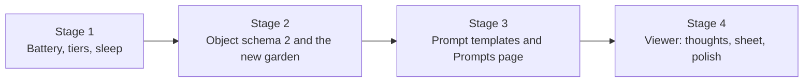

# Iteration 2: thinking budget, sleep and living objects

Status: **Planned** (agreed 17 Nov 2026). Design: the spec's [Thinking budget, sleep and living objects](../../Unnamed%20AI%20Simulation%20—%20Spec.md#thinking-budget-sleep-and-living-objects-iteration-2) section and decisions 42–53.

**Goal:** make the robot worth watching. Its battery becomes its thinking budget, sleep becomes how it recharges and grows, objects come alive with state and products, and its thoughts show on the map.

**Success:** over a few in-world days, a viewer can see the robot learn what things do to its body (cool, signal, curiosity) and learn when thinking is worth paying for, and can follow its garden, habits and goal.

**Out of scope:** weather, an experiment board, a songbook, a second robot.

Stages land in order, and the owner tries each one in the real app before the next starts. Viewer work for a stage can run alongside its backend work against the contract.

## Stage 1: battery, thinking tiers and sleep

Owner: backend (viewer: battery and sleep display).

- [ ] Energy drains only from token-costing calls (decide, plan, reflect, consolidation, sheet rewrite, appraisal, scoring); remove every physical drain (idle drain, `chase`, `splash`, need-delta `energy` from actions).
- [ ] `energyPerAud` default 5 (a full battery = A$0.20); the A$0.50 daily cap stays.
- [ ] Tier ladder by battery band (plan model → decision model → habit/autopilot → autopilot only), with configurable bands in World settings.
- [ ] Thinking-depth choice: habit (free) / gut (decision model) / think it through (plan model). Start rule: unfamiliar or important → think it through; familiar → gut or habit. Record the choice in the feed entry.
- [ ] Sleep pressure from time awake and STM fullness; STM fullness is a perceivable "fog" sense.
- [ ] Recharge only during sleep, scaled by pressure; minimum sleep 1 in-world hour; wake when rested or full; strong events can wake it after the minimum.
- [ ] Sleep pipeline, paid from the battery: consolidation → habit detection → character-sheet rewrite (locked core, one step per sleep, one self-chosen goal, history kept) → `refine` hook (empty, typed extension point that takes the day's feed, outcomes and eval results and returns no proposals).
- [ ] Locked sheet core includes "sleeping recharges me and settles my memories".
- [ ] Items can't change `energy` (catalogue validation rejects it); admin battery top-up in World settings as a logged input.
- [ ] Tests: no physical drain; tier stepping; nap gives ~nothing; minimum sleep; wake rules; sleep pipeline order and cost; refine hook called with the right inputs; replay determinism across a full sleep.
- [ ] Eval situations updated: remove solar-pad checks; add "battery low, should choose habit or gut", "foggy, should sleep", "just woke, shouldn't nap".

**Done when:** in a scratch world the robot spends its battery thinking, gets foggy, chooses to sleep, recharges, and its sheet and habits change overnight; the daily cap is never exceeded.

## Stage 2: object schema 2 and the new garden

Owner: backend (viewer: object state on the card, products, planting).

- [ ] Schema 2 for world objects and catalogue items: state values; rules over time, from actions and under conditions; products (slot, harvest verb, optional reset); items that are consumed to create objects; appearance descriptions per state band.
- [ ] Existing handlers become blocks; pack objects (dock, ball, fountain, piano, mailbox) rewritten in schema 2; schema-1 catalogue items migrated automatically.
- [ ] New objects: garden bed, seed, plant (water, growth, stages, flowers that lift curiosity, seed products), watering can (fill at the fountain), antenna mast (signal strong nearby).
- [ ] Remove the solar pad and every `charge` verb.
- [ ] The robot perceives appearance descriptions, never numbers; the API gives viewers the real values.
- [ ] Fresh world: archive the iteration-1 world read-only (database copy plus a read-only server mode or world flag), start a new garden at day 0.
- [ ] Catalogue editor accepts schema 2 (templates updated: seed, toy, noise-maker, cooling gel).
- [ ] Tests: rule evaluation, products and harvest, planting, appearance bands, schema-1 migration, replay determinism with growing plants.

**Done when:** in the new garden the robot can fill the can, water the bed, watch a plant grow over real days, pick a flower or seeds and plant them, and viewers can see every step.

## Stage 3: prompt templates and the Prompts page

Owner: backend (templates, API) and viewer (Prompts page).

- [ ] Five templates (decision state, plan, sleep consolidation/reflection, sheet rewrite, mail framing) with documented `{{variables}}` and a code-appended locked safety block.
- [ ] Server-wide versioned storage; per-world active version; feed entries record the template version.
- [ ] API: list, get, draft, validate (unknown variables), preview against a saved situation, test against the eval situations (cost shown first), activate, roll back.
- [ ] Prompts admin page: template list, editor with variable list, live preview, diff against active, Test, Activate, Roll back.
- [ ] Golden prompts follow the active version; the free prompt check still runs in `npm run check`.

**Done when:** an admin can edit the plan prompt, preview it, test it against the situations, activate it, see new feed entries use it, and roll it back.

## Stage 4: viewer: thoughts, sheet and polish

Owner: viewer.

- [ ] Thought callouts on the map: current reason as a short blueprint note, noise notes as it vocalises, "consolidating…" with a memory count while asleep; respects reduced motion; readable on phones.
- [ ] Inspector: character sheet (locked lines marked), edit history by night, goal, habits.
- [ ] Battery shown as a thinking budget (A$ equivalent on hover), sleep pressure and fog shown with the needs.
- [ ] Brain feed shows the thinking-depth choice and template version.
- [ ] Object cards show state values, products ready to harvest and growth over time.
- [ ] Impeccable finish review and screenshots, desktop and phone.

**Done when:** a new viewer can tell within a minute what the robot is thinking, how much thinking it has left, and what it has learned.

## Risks

- **Cost:** sleep work adds model calls; check the daily spend after Stage 1 with `/usage`.
- **Determinism:** plant growth and sleep timing must stay inside the sim (no clocks); replay tests guard it.
- **Rate limits:** the free gateway tier allows 5 Laya requests a minute shared between the server and evals.
- **Scope:** schema 2 is the largest change; if it slips, ship the garden bed and watering can first and leave item-creates-object for later.

## Changes to the plan

None yet.
