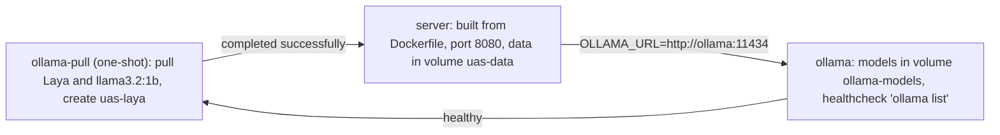

# Operations

How to run, configure and observe the server. Requires Node 26 (it runs the TypeScript sources directly through type stripping). Quick-start commands are also in the root [README.md](../README.md).

## Running locally

| Command | What it does |
| --- | --- |
| `npm install` | Install all workspaces |
| `npm start` | Server on `:8080`, every world in `worlds/`, models as configured (offline `fake` models by default) |
| `UAS_BRAIN=autopilot npm start` | No model jobs at all |
| `UAS_ADMIN_KEYS=<key> npm start` | Enable admin endpoints for that key |
| `npm run dev` | Server and viewer dev server together, with prefixed output, using local Ollama models (the default; `dev:local` is an alias) ([`scripts/dev.mjs`](../scripts/dev.mjs)): `UAS_DECIDER=localDm`, `UAS_PLANNER=local`, `UAS_REFLECTOR=local` unless already set. Warns if Ollama isn't reachable; the server then falls back to the fake models. |
| `npm run dev:fake` | The same offline, with fake models and no Ollama. |
| `npm run check` | Typecheck and run the tests |
| `npm test` | Tests only (vitest). Unit tests never touch the network. |

With `npm run dev` or `dev:fake` running, open `http://localhost:5173/`; the viewer reaches the server through Vite's `/api` proxy ([viewer.md](architecture/viewer.md#data-sources)). Add `?source=sample` to see the offline sample world instead.

`npm run dev` sets a fixed development admin key (printed at start) unless `UAS_ADMIN_KEYS` is set. Don't use it on a reachable host.

Stopping the server with Ctrl-C snapshots every world; the next start resumes from that snapshot. The database is `data/uas.db` by default; delete it to start the worlds from scratch.

## Secrets and `.env`

Copy `.env.example` to `.env` and fill in what you need. `.env` is git-ignored.

```sh
cp .env.example .env
# then set AI_GATEWAY_API_KEY=... in .env (from your Vercel AI Gateway dashboard)
npm run smoke:gateway   # one Jev, one hosted Laya and one text call, with latency and A$ cost
```

- `npm start`, `npm run dev`, `npm run smoke:gateway` and `npm run bakeoff` load `.env` with Node's `--env-file-if-exists` (or `process.loadEnvFile` in the dev script). Real environment variables win.
- **The only key needed for hosted models is `AI_GATEWAY_API_KEY`.** Without it, everything works locally, with one warning per world at startup.
- **Spend:** `UAS_DAILY_CAP_AUD` (default 0.5) is a hard cap per world per UTC day. It is persisted in SQLite, so restarts don't reset it. When it's reached, decisions use local Laya, then autopilot.
- The key is never logged. Error messages include the response status and body, never the request headers.

## Local models with Ollama (Podman or Docker)

```sh
npm run ollama:up      # create or start the `ollama` container (Podman if installed, else Docker)
npm run ollama:pull    # pull Laya and llama3.2:1b, build uas-laya (UAS_PULL_TEV=1 also builds uas-tev1)
npm run smoke:ollama   # end-to-end check of both models, with latency and a sample decision
npm run dev            # or: UAS_DECIDER=localDm UAS_REFLECTOR=local npm start
```

- [`scripts/ollama-up.sh`](../scripts/ollama-up.sh) runs `docker.io/ollama/ollama:latest` as a container named `ollama` on port 11434, with models in the named volume `ollama`. It sets `OLLAMA_KEEP_ALIVE=-1` (keep models loaded), `OLLAMA_MAX_LOADED_MODELS=2` (both models resident), `OLLAMA_NUM_PARALLEL=1` (the server's queue orders requests) and `OLLAMA_CONTEXT_LENGTH=2048`. If an existing container has different settings, it is recreated; `--recreate` forces that. Models survive because they live in the volume.
- **CPU limits, so models never take over the laptop.** The container gets `--cpus ${OLLAMA_CPUS:-4}` (a hard cgroup `cpu.max` quota) and `--cpu-shares ${OLLAMA_CPU_SHARES:-256}` (a low CPU weight, so foreground work wins under contention). Compose sets the same with `cpus` and `cpu_shares`.
  - On this WSL host, rootless Podman has the cgroup v2 `cpu` controller delegated, but not `cpuset`. `--cpus` and `--cpu-shares` take effect: the container's `cpu.max` reads `400000 100000` and `cpu.weight` reads 35, and `top` shows the llama runners at about 400% instead of about 700%. `--cpuset-cpus` does not work here.
  - Threads must match the cap. llama.cpp starts one thread per core by default, and more threads than allowed CPUs fight over the quota. Measured under the 4-CPU cap: llama3.2:1b took 24.5 s p50 with default threads and 12.8 s with 4 threads; Laya took 8.8 s and 7.0 s.
  - `OLLAMA_THREADS` (default 4) sets the threads. Text models get it as `num_thread` per request (`numThread` in garden.yaml). Decision models can't take request options through `/v1/systemone`, so `ollama:pull` bakes it into the derived models `uas-laya` and `uas-tev1`.
  - Cost of the cap, on a small sample (uncapped versus 4 CPUs with 4 threads): llama3.2:1b tags p50 9.9 → 12.8 s, Laya decide p50 5.0 → 7.0 s. Load average with a model running drops from about 6 to about 3, and the machine stays usable.
- [`scripts/ollama-pull.sh`](../scripts/ollama-pull.sh) pulls `laya:421m-typed-decisions-bf16` and `llama3.2:1b`, and derives `uas-laya` (Laya with `num_thread` = `OLLAMA_THREADS`). With `UAS_PULL_TEV=1` it also pulls `tev1:0.8b` and derives `uas-tev1` (2,048-token context and the same threads). Laya needs Ollama 0.40 or later, Tev1 0.35.
- [`smoke-ollama.ts`](../packages/models/scripts/smoke-ollama.ts) exits 1 with a clear message if Ollama isn't reachable at `OLLAMA_URL`.
- The real-Ollama test is opt-in: `OLLAMA_INTEGRATION=1 npx vitest run packages/models/test/ollama.integration.test.ts`.

Which models do what is in [models.md](architecture/models.md#local-models).

## Docker and Podman Compose

```sh
docker compose up
podman-compose -f docker-compose.yml -f compose.podman.yml up    # rootless Podman (see below)
```

[`docker-compose.yml`](../docker-compose.yml) runs three services:



- The [`Dockerfile`](../Dockerfile) installs only the server workspace and its `@uas/*` dependencies (`npm ci --omit=dev --ignore-scripts`), copies `packages/` and `worlds/`, stores the database at `/data/uas.db`, and health-checks `GET /healthz`. better-sqlite3 ships prebuilt binaries, so no toolchain is needed. The viewer is not in the image.
- Compose defaults the decision chain to the local Tev1 model (`UAS_DECIDER=localDm`), reflection to `llama3.2:1b` (`UAS_REFLECTOR=local`), and appraises outcomes in code (`UAS_APPRAISE=false`, `UAS_SCORER=fake`), because CPU-only local models are slow. No cloud keys are needed.
- `stop_grace_period: 30s` gives the server time to snapshot every world on shutdown.

### The Podman host-network override

[`compose.podman.yml`](../compose.podman.yml) exists because on the WSL dev host, rootless `podman network create` fails inside netavark (an "EOF" error), and so does `--network bridge`. Without a compose network the services can't reach each other by name, so the override:

- puts every service on `network_mode: host`;
- moves Ollama to `127.0.0.1:${UAS_OLLAMA_PORT:-11435}` so it doesn't clash with a standalone `ollama` container already on 11434 (from `npm run ollama:up`);
- points the server's `OLLAMA_URL` and the pull job's `OLLAMA_HOST` at that address.

Docker users don't need the override.

Under podman-compose 1.5, `depends_on: condition: service_completed_successfully` is not waited for, so the server can start before the models are pulled. Until they are, model calls fail and the router falls through to the `fake` entries at the end of each chain.

## Environment variables

[`.env.example`](../.env.example) lists them all. Every value is optional. Variables named in [`worlds/garden.yaml`](../worlds/garden.yaml) only affect worlds whose YAML uses them.

| Variable | Default | Used by | Meaning |
| --- | --- | --- | --- |
| `PORT` | 8080 | server | HTTP and WebSocket port |
| `UAS_DB` | `data/uas.db` | server | SQLite file (WAL mode) |
| `UAS_WORLDS` | `worlds` | server | Directory of world configs (`*.yaml`) |
| `UAS_ADMIN_KEYS`, `UAS_VISITOR_KEYS`, `UAS_SPECTATOR_KEYS` | empty | server | Comma-separated API keys per role ([server-and-api.md](architecture/server-and-api.md#roles-and-api-keys)) |
| `UAS_BRAIN` | `models` | garden.yaml | `models` or `autopilot` |
| `UAS_DECIDER` | `fake` | garden.yaml | Head of the `decide` and `vocalize` chains: `fake`, `localDm`, `local` or `small` |
| `UAS_SCORER` | `fake` | garden.yaml | Head of `appraise` and `scoreMemory` |
| `UAS_REFLECTOR` | `fakeChat` | garden.yaml | Head of `reflect` |
| `UAS_PLANNER` | `fakeChat` | garden.yaml | Head of `plan` (low-confidence escalation) |
| `UAS_APPRAISE` | `false` | garden.yaml | Ask models to appraise and score every outcome (two extra jobs per action) |
| `UAS_JOB_TIMEOUT_TICKS` | 600 | garden.yaml | The mind's safety-net deadline for an answer |
| `UAS_STALE_TICKS` | 150 | garden.yaml | Drop a queued job whose trigger is older than this ([job queue](architecture/models.md#job-queue)) |
| `UAS_SECONDS_PER_TICK` | 2 | garden.yaml | In-world seconds per tick (pacing, with `ticksPerRealSecond` 5 = 10× real time) |
| `UAS_ESCALATE_BELOW` | 0.35 (`npm run dev`: 0.15) | garden.yaml | Decisions below this confidence escalate to the `plan` chain |
| `UAS_START_SECOND` | 28800 (08:00) | garden.yaml | In-world time of day at tick 0 for a new world |
| `AI_GATEWAY_API_KEY` | empty | garden.yaml, smoke:gateway, bake-off | Vercel AI Gateway key for every hosted model; empty means local only |
| `UAS_DAILY_CAP_AUD` | 0.5 | garden.yaml | Daily hosted spend cap per world (persisted) |
| `UAS_HOSTED_TEXT_MODEL` | `meta/llama-3.1-8b` | garden.yaml, smoke:gateway | Gateway id for `hostedText` (plans, reflection, appraisal) |
| `UAS_DM_MODEL` | `uas-laya` | garden.yaml | Decision model tag for `localDm` |
| `UAS_TEV_MODEL` | `uas-tev1` | garden.yaml | Tev1 tag for the `tev` alternative (`UAS_DECIDER=tev`) |
| `UAS_TEXT_MODEL` | `llama3.2:1b` | garden.yaml | Text model for `local` (plans, reflection) |
| `OLLAMA_CPUS` | 4 | ollama-up.sh, compose | Hard CPU cap on the Ollama container (0 = none) |
| `OLLAMA_CPU_SHARES` | 256 | ollama-up.sh, compose | CPU weight (default 1024); lower yields to foreground work |
| `OLLAMA_THREADS` | 4 | garden.yaml, ollama-pull.sh, bake-off | llama.cpp threads; keep equal to `OLLAMA_CPUS` |
| `OLLAMA_URL` | `http://localhost:11434` | garden.yaml, smoke test, dev script | Ollama endpoint |
| `UAS_OLLAMA_PORT` | 11435 | compose.podman.yml | Ollama port under the host-network override |
| `ANTHROPIC_API_KEY` | empty | garden.yaml | Enables the `small` and `big` cloud models. Other AI SDK providers and Jev are not wired up. |
| `OLLAMA_INTEGRATION` | unset | tests | `1` runs the real-Ollama integration test |
| `VITE_UAS_SERVER` | `http://localhost:8080` | viewer dev server | Where Vite proxies `/api` and `/api/ws` |
| `VITE_UAS_API` | `/api` | viewer build | REST base URL the viewer calls |

Never commit a `.env` file; it is in `.gitignore` and `.dockerignore`.

## World configuration

Each `worlds/*.yaml` is one world ([`config.ts`](../packages/server/src/config.ts)): `id`, `name`, `seed`, `packs`, `map`, pacing (`ticksPerRealSecond`, `timeScale`), `snapshotEveryTicks`, `publicRead`, `visitorArchetype`, `sim` (time and movement), `mind` ([mind.md](architecture/mind.md#configuration)), `entities`, and `models` ([models.md](architecture/models.md#jobs-and-routing)). `${VAR}` and `${VAR:-default}` are substituted from the environment before parsing. Pacing is in flux; see [simulation.md](architecture/simulation.md#clock-and-pacing).

## Health and metrics

- `GET /healthz` returns `{ ok: true, worlds: [...] }`. The Docker image health-checks it every 30 seconds.
- `GET /metrics` is Prometheus text with per-world gauges: tick, tick lag, model latency, spend, pending jobs, model queue stats and visitor queue depth. The full list is in [server-and-api.md](architecture/server-and-api.md#health-and-metrics).
- `GET /usage` (admin) gives tokens, AUD and energy by day, model and job, plus the queue stats.
- Each world worker logs model routing skips and failures to the server's console, prefixed with the world ID.
